# PipaKlub - Benchmark de HUD e menus

Estudo visual para o PIP-50, com referências de Pokémon e Digimon e revisão do piloto local do PipaKlub. Capturas coletadas em 20/10/2026. O resultado orienta composição e interação; não é uma avaliação de desempenho, economia ou balanceamento.

## Recomendação

A direção recomendada é um caderno de campo brasileiro: parceiro em destaque, rostos para navegar, papel e bambu como linguagem, tipografia legível e comandos consistentes. O piloto já tem identidade no menu principal. O maior ganho agora vem da hierarquia das informações e do contrato de navegação, antes de criar mais molduras.

## Método e limites

Foram consultadas páginas oficiais de Pokémon Legends: Arceus, Pokémon Legends: Z-A, materiais oficiais de Digimon Story Time Stranger e o manual de Digimon World: Next Order. As imagens das franquias são capturas publicadas pelos titulares ou páginas do manual, não sessões próprias dos jogos. As molduras promocionais e chamadas do manual permanecem identificadas. PipaKlub foi aberto num servidor local com banco de teste isolado, HEAD 7183063; os prints incluem 1280 x 720 e amostras de 1920 x 1080. Nenhuma conta ou banco de produção foi alterado.

O benchmark não verifica input lag, animações completas, acessibilidade das franquias ou navegação por controle físico. Os screenshots promocionais não comprovam estados ocultos, fluxos de erro ou regras de negócio. O teste local não conclui PIP-46, PIP-48 ou PIP-49; homologação, migração e implantação continuam trabalhos separados.

## Decisões por sistema

### Combate

Dados vitais nas bordas; leitura do cruzamento no centro. Efeito de skill deve comunicar alcance, janela e acerto. Não copiar ordem de turnos ou menus que bloqueiem a leitura do adversário.

### Dex e coleção

Retratos consistentes + criatura grande + páginas de detalhe + ações no rodapé. Não concentrar toda a história, XP, drops e seis atributos numa única coluna longa.

### Mochila

Categorias e quantidades; seleção revela descrição e ação disponível. Não transformar cada unidade repetida num cartão grande sem necessidade.

### Exploração

Objetivo curto e interação próxima ao contexto. Parceiro presente no mundo. Não manter cinco painéis grandes durante o passeio.

### Diálogo

Uma voz, uma mensagem e uma ação principal; escolhas em lista. Não sobrepor diálogos narrativos e menus ativos com a mesma prioridade.

### Identidade

Papel vivo, bambu, nó, linha, vento e retratos dos Pipamons. Não importar molduras tecnológicas, criaturas, logos ou sprites das franquias.

## Ajustes priorizados no piloto

### P1 - Pausa: rebicadas cortadas

Nome completo, foco visível e navegação por todas as seis opções em 720p e 1080p. Sem depender de arrastar horizontalmente com o mouse.

### P1 - Missões: foco inicial

Abrir com foco em elemento útil; fechar retorna à opção Missões. Confirmar e cancelar não acionam o mundo atrás.

### P1 - Coleção e Dex: informação em páginas

Visão geral mostra criatura, nível, estado de posse e técnica; história e drops em páginas próprias. Todas as páginas e a rolagem interna acessíveis sem cursor.

### P1 - HUD de combate: legibilidade

Aumentar prioridade visual de linha e energia; manter cruzamento de linhas livre. Testar arena com quatro participantes, efeitos e avisos simultâneos.

### P2 - Mochila: escala do inventário

Categorias, quantidades e detalhe contextual; testar vazia, uma unidade e muitas unidades. Agrupamento visual não deve alterar dados ou consumir exemplares incorretos.

### P2 - Estados da coleção

Distinguir foco, consulta, obtido, equipado e indisponível usando forma, texto e ícone além da cor.

### P2 - Diálogos e cenário atrás

Reduzir competição entre sobreposições. Uma camada interativa por vez, sem esconder informação necessária à decisão.

### P1 antes da liberação - Controle físico e jornada completa

PIP-46/PIP-48: testar abertura até Zeca, renomear sem teclado físico, reconexão, cancelamento, persistência e ausência de recompensa duplicada. Ainda pendente.

## Diretrizes propostas para o nosso jogo

- Base de composição: 16:9, com teste em 1280 x 720 e 1920 x 1080. Margem segura proposta: 32 px em 720p, ajustada após teste em TV.
- Texto de leitura: começar com 18-20 px em 720p; rótulos menores só para informação secundária. São propostas para PipaKlub, não medidas das referências.
- Uma ação primária por contexto; rodapé estável com confirmar, voltar, páginas e ações secundárias. Glifos seguem o dispositivo usado.
- Foco = pipa e fio + contorno; equipado = selo e texto; obtido = símbolo e texto; indisponível = requisito explícito. Não depender apenas de cores.
- Sprites preservam proporção e rabiola; ajustar pelo limite visual, sem ampliar uma moldura raster inteira. Containers continuam usando 9-slice.
- Leitura de ficha por abas: Visão geral, Status, Técnica, História e Drops conforme a tela. Não repetir páginas vazias ou ações que não existem.
- Recompensas, equipamento e uso de itens continuam confirmados pelo servidor; mudar a interface não altera essa autoridade.
- Redução de movimento desativa pulsos, deslocamentos e brilhos contínuos sem remover indicação de foco ou estado.

## Capturas comentadas

### Arceus | Preparação e mira

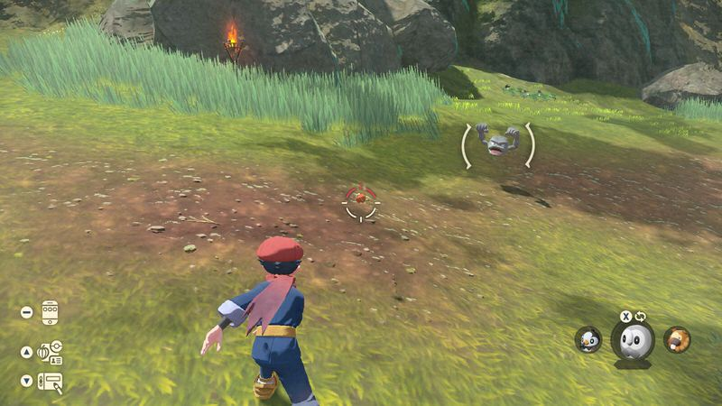

A mira ocupa o centro; os atalhos ficam nas bordas.

**Aplicação:** Reservar o centro para o cruzamento das linhas. Indicadores de alcance precisam aparecer junto do alvo, sem competir com o cenário.

**Evidência:** Captura oficial publicada; não é uma sessão de jogo executada nesta auditoria.

**Fonte:** https://legends.arceus.pokemon.com/en-us/gameplay/

### Arceus | Comandos de combate

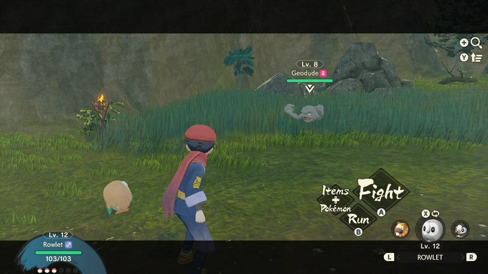

Vida e escolhas de ação ocupam regiões distintas, deixando o confronto visível.

**Aplicação:** Linha e energia junto do retrato; ações em um conjunto compacto. Não importar os turnos: o corte do PipaKlub depende de movimento contínuo.

**Evidência:** Captura oficial publicada; não é uma sessão de jogo executada nesta auditoria.

**Fonte:** https://legends.arceus.pokemon.com/en-us/gameplay/

### Arceus | Lista de técnicas

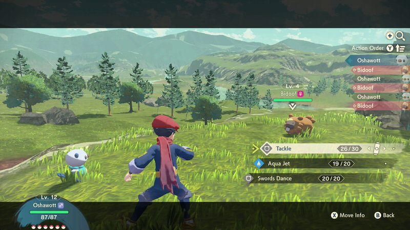

A técnica em foco recebe destaque e os comandos de informação e retorno ficam no rodapé.

**Aplicação:** Mostrar custo, recarga e condição da rebicada selecionada. A ordem de turnos é específica desta referência, sem equivalente obrigatório no nosso jogo.

**Evidência:** Captura oficial publicada; não é uma sessão de jogo executada nesta auditoria.

**Fonte:** https://legends.arceus.pokemon.com/en-us/gameplay/

### Arceus | Pesquisa na Pokédex

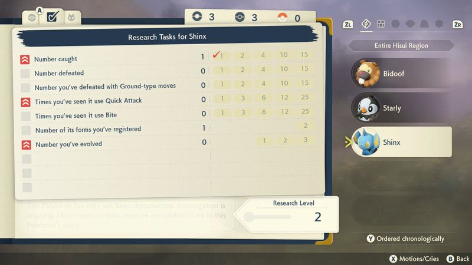

Lista de espécies e área de pesquisa formam duas regiões estáveis.

**Aplicação:** A Pipa Dex pode manter os rostos de um lado e o parceiro do outro; distribuir história, técnica e drops em páginas, evitando uma ficha longa.

**Evidência:** Captura oficial publicada; não é uma sessão de jogo executada nesta auditoria.

**Fonte:** https://legends.arceus.pokemon.com/en-us/gameplay/

### Arceus | Progresso de pesquisa

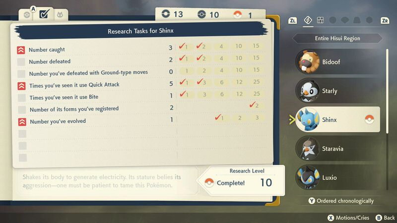

A conclusão da pesquisa ganha um sinal próprio na ficha.

**Aplicação:** Separar espécie conhecida, exemplar obtido e parceiro equipado. O contorno de foco nunca deve ser a única indicação de propriedade.

**Evidência:** Captura oficial publicada; não é uma sessão de jogo executada nesta auditoria.

**Fonte:** https://legends.arceus.pokemon.com/en-us/gameplay/

### Arceus | Criação de itens

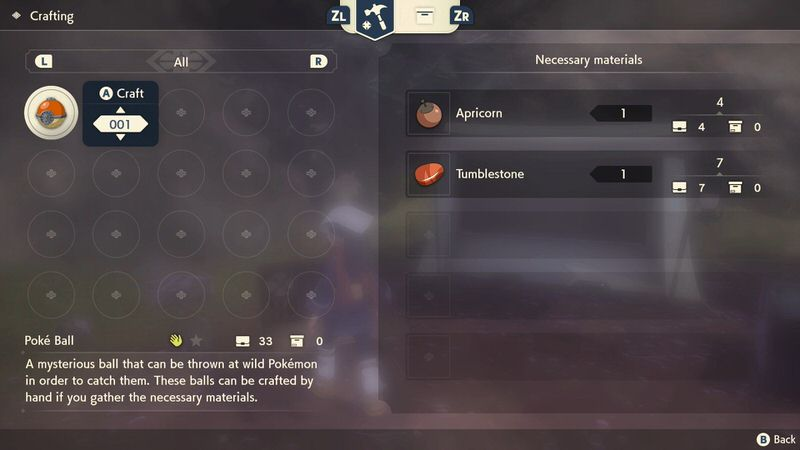

Grade, descrição e materiais têm áreas próprias.

**Aplicação:** Mochila com categorias, quantidade, descrição e ação contextual. Para rabiolas repetidas, agrupar visualmente sem perder a identidade dos exemplares quando ela importar.

**Evidência:** Captura oficial publicada; não é uma sessão de jogo executada nesta auditoria.

**Fonte:** https://legends.arceus.pokemon.com/en-us/gameplay/

### Next Order | Menu Digivice

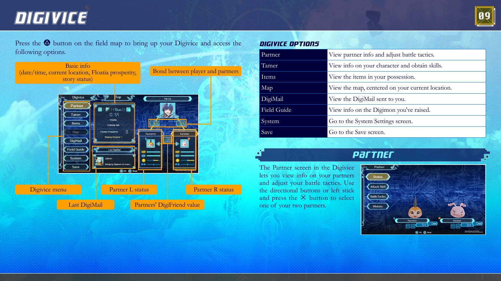

O manual mostra lista de destinos e informações dos parceiros simultaneamente.

**Aplicação:** Manter a lista do Caderno do pipeiro, acrescentando parceiro e contexto útil sem transformar cada opção em um painel decorativo.

**Evidência:** Página 9 do manual oficial renderizada; caixas numeradas e explicações pertencem ao manual, não ao jogo.

**Fonte:** https://d1vtv52f4vjbmu.cloudfront.net/manuals/dwno/PS4-DWNO_manual_GBQS_WEB.pdf#page=9

### Next Order | Guia de criaturas

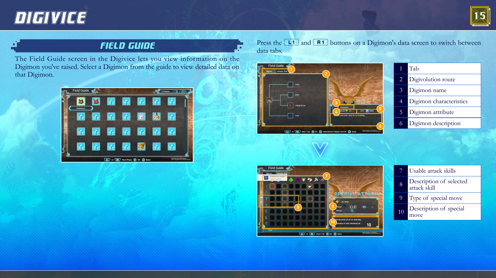

A página documenta grade de criaturas e ficha separada com navegação por páginas.

**Aplicação:** Retratos consistentes, posição lembrada e páginas de informação. Criaturas desconhecidas precisam de uma regra de revelação própria.

**Evidência:** Página 15 do manual oficial renderizada; exemplos internos têm resolução menor que a página.

**Fonte:** https://d1vtv52f4vjbmu.cloudfront.net/manuals/dwno/PS4-DWNO_manual_GBQS_WEB.pdf#page=15

### Next Order | Exploração e minimapa

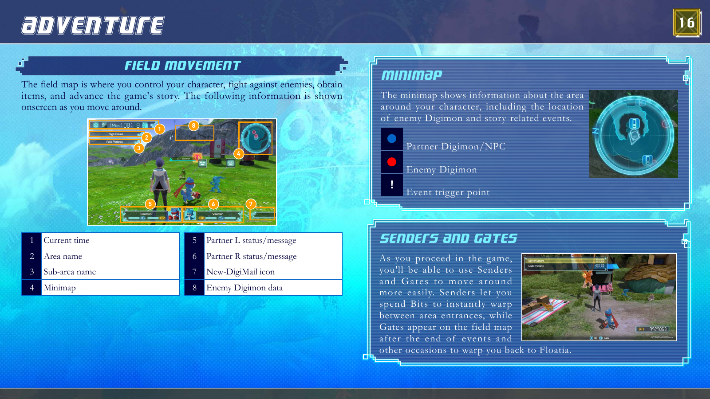

A cena de exploração usa informação periférica e um minimapa com símbolos distintos.

**Aplicação:** No Quintal, priorizar parceiro, missão e interação próxima. Exibir minimapa somente quando o percurso justificar; nunca usar apenas cor para diferenciar NPC e objetivo.

**Evidência:** Página 16 do manual oficial, com chamadas editoriais numeradas.

**Fonte:** https://d1vtv52f4vjbmu.cloudfront.net/manuals/dwno/PS4-DWNO_manual_GBQS_WEB.pdf#page=16

### Next Order | Itens e cuidado

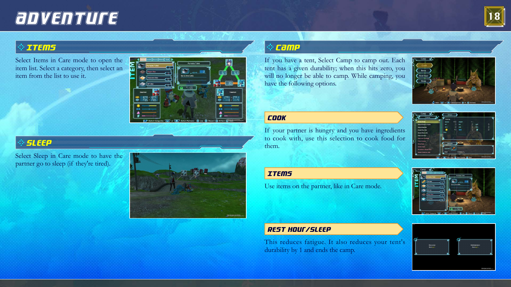

O manual apresenta categorias e seleção de um item em contexto.

**Aplicação:** Organizar rabiolas e consumíveis por função, com alvo e consequência explícitos antes de usar. Mecânicas de fome e sono não fazem parte desta proposta.

**Evidência:** Página 18 do manual oficial; não inferir comportamento não demonstrado pelas imagens.

**Fonte:** https://d1vtv52f4vjbmu.cloudfront.net/manuals/dwno/PS4-DWNO_manual_GBQS_WEB.pdf#page=18

### Next Order | Ordens em batalha

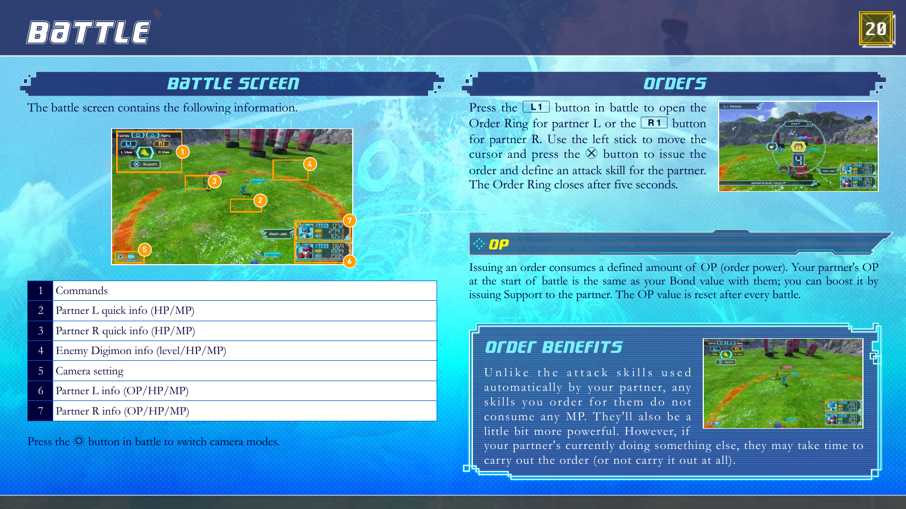

Dados persistentes e menu de ordens temporário cumprem funções diferentes.

**Aplicação:** No online, ações rápidas permanecem acessíveis; menus de estudo devem informar se o mundo continua rodando. Não prometer pausa global numa sala multiplayer.

**Evidência:** Página 20 do manual oficial; o menu radial é uma referência de organização, não uma decisão de implementação.

**Fonte:** https://d1vtv52f4vjbmu.cloudfront.net/manuals/dwno/PS4-DWNO_manual_GBQS_WEB.pdf#page=20

### Next Order | Táticas e saída

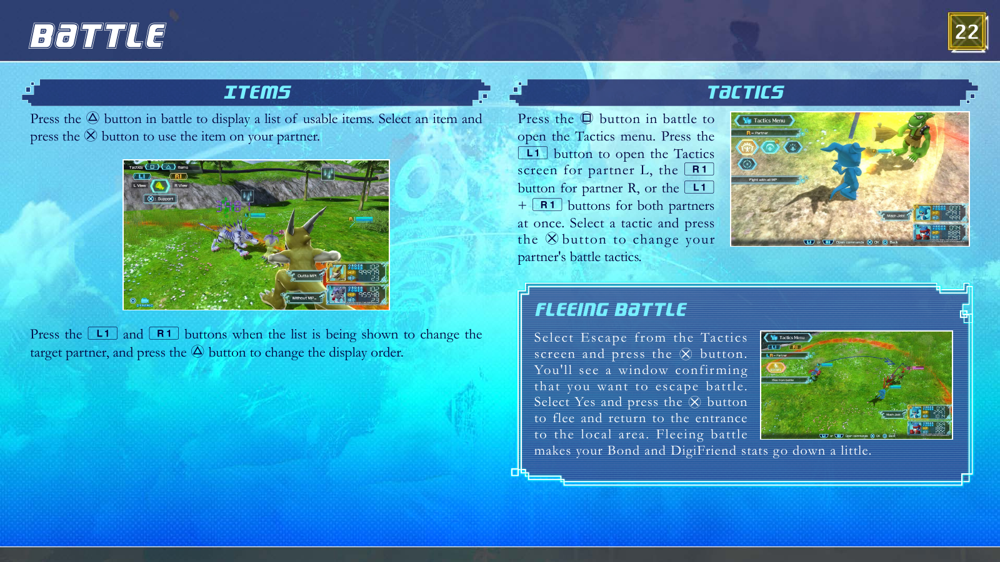

Táticas e confirmação de fuga aparecem como etapas diferentes.

**Aplicação:** Separar continuar, configurar rebicada e abandonar partida. A confirmação de saída precisa explicar a consequência real do modo atual.

**Evidência:** Página 22 do manual oficial, não uma tela de resultado de batalha.

**Fonte:** https://d1vtv52f4vjbmu.cloudfront.net/manuals/dwno/PS4-DWNO_manual_GBQS_WEB.pdf#page=22

### Next Order | Comunicação com parceiro

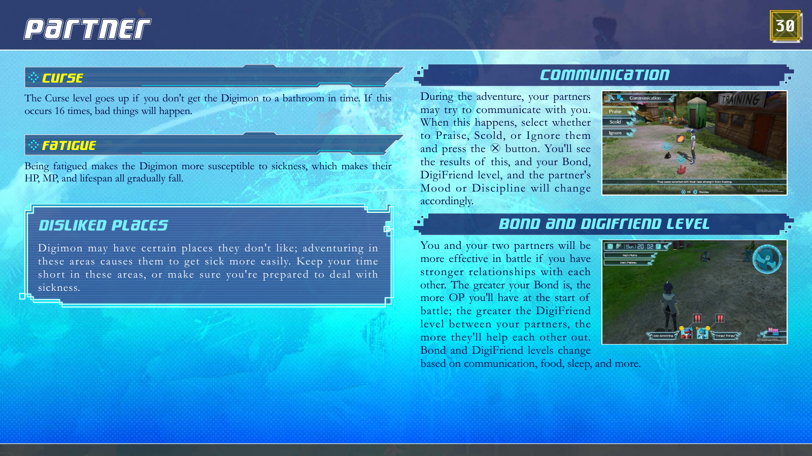

A escolha de resposta preserva a presença das criaturas no cenário.

**Aplicação:** Retrato, nome e mensagem com uma ação principal clara. Em escolhas narrativas, usar uma lista legível e manter o parceiro presente.

**Evidência:** Página 30 do manual oficial; não propõe importar sistemas de punição ou relacionamento.

**Fonte:** https://d1vtv52f4vjbmu.cloudfront.net/manuals/dwno/PS4-DWNO_manual_GBQS_WEB.pdf#page=30

### Time Stranger | Ficha e equipamento

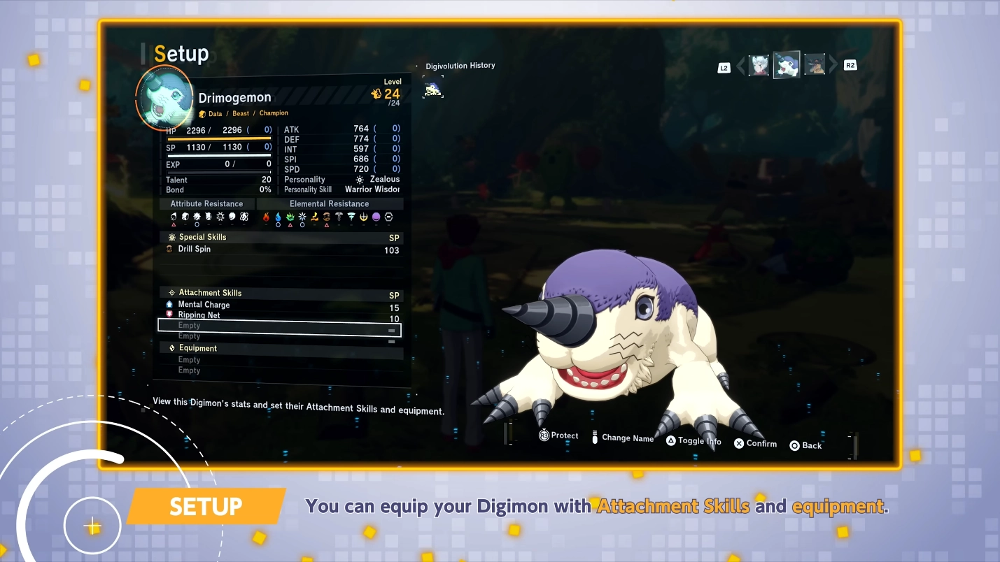

A criatura tem destaque e os atributos ficam agrupados em uma região funcional.

**Aplicação:** Dar escala ao Pipamon e resumir linha, energia e técnica primeiro. Deixar números avançados numa página de status.

**Evidência:** Still oficial de apresentação de sistemas, com moldura e legenda promocionais externas à interface.

**Fonte:** https://www.bandainamcoent.com/news/digimon-story-time-stranger-what-you-need-to-know

### Time Stranger | Habilidades

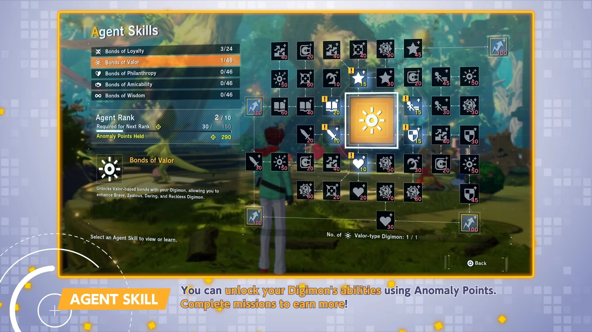

Categoria, nós de habilidade e explicação têm regiões distintas.

**Aplicação:** Para futuras skills de linha, mostrar requisito, custo, estado e efeito da escolha antes de confirmar. Não adicionar uma árvore apenas por semelhança visual.

**Evidência:** Still oficial de apresentação; não foi testado com controle nesta auditoria.

**Fonte:** https://www.bandainamcoent.com/news/digimon-story-time-stranger-what-you-need-to-know

### Time Stranger | Progressão visual

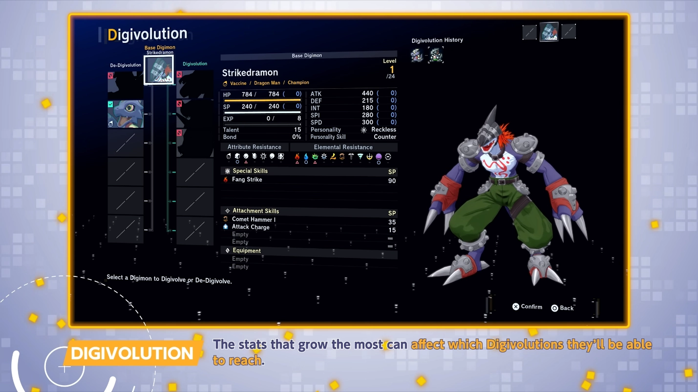

Caminhos e opções de evolução são apresentados junto da criatura.

**Aplicação:** Os marcos 20/30/40/45/50 podem formar uma trilha de brilho com texto e ícone. Evolução de espécie não está sendo proposta.

**Evidência:** Still promocional; esta referência não prova que o PipaKlub possua evolução.

**Fonte:** https://www.bandainamcoent.com/news/digimon-story-time-stranger-what-you-need-to-know

### Z-A | Espaço do confronto

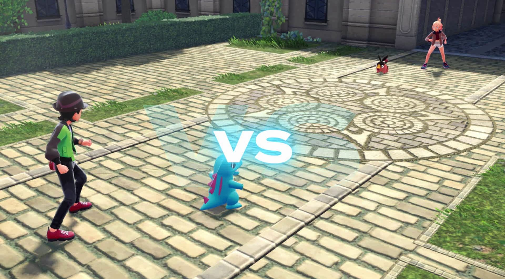

Dois treinadores e seus parceiros estabelecem posições no cenário.

**Aplicação:** Usar como estudo espacial para batalhas em movimento; avaliar distâncias com o gameplay real do PipaKlub.

**Evidência:** Imagem oficial com apresentação VS; não mostra uma HUD completa, recargas ou comportamento de controle.

**Fonte:** https://legends.pokemon.com/en-us/gameplay

### PipaKlub | Menu principal

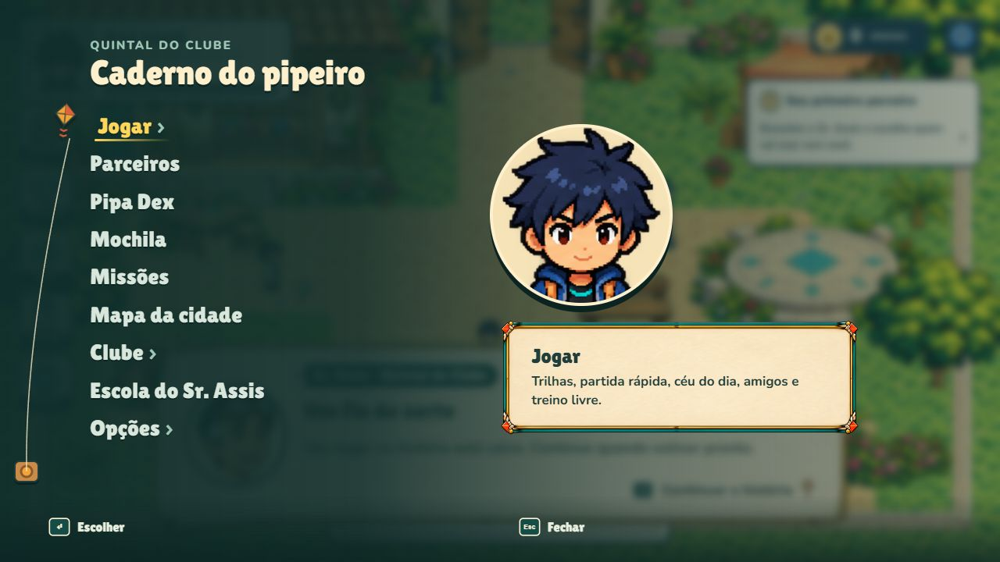

A tipografia, o fio e a pipa de foco já criam identidade. Na conta de teste sem parceiro equipado, aparece o avatar em destaque.

**Aplicação:** Preservar esta direção. Quando houver parceiro, mostrá-lo com nome e nível; informar o estado vazio sem dar aparência de erro.

**Evidência:** Captura própria em navegador; conta Ana Local e banco PGlite isolado. Teclado/mouse, sem validação de controle físico. 1280 x 720.

**Fonte:** PipaKlub local | HEAD 7183063 | 20/10/2026

### PipaKlub | Dex em 720p

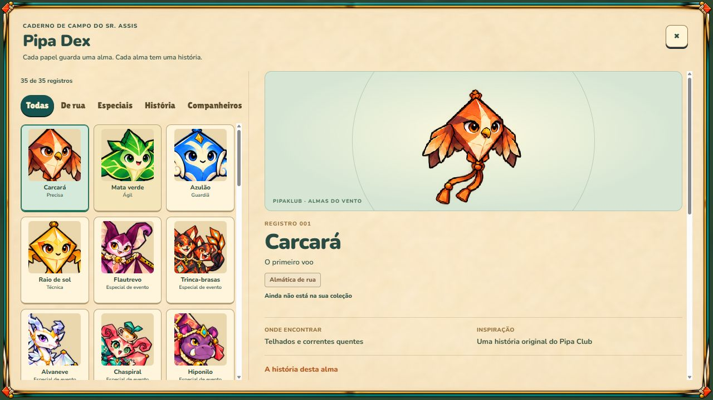

A grade de rostos e a criatura inteira funcionam. A ficha possui rolagem própria; a história começa abaixo da área imediatamente visível.

**Aplicação:** Dividir o detalhe em Visão geral / História / Técnica / Drops, mantendo nome, retrato e rodapé fixos. O scroll interno deve ser alcançável por controle.

**Evidência:** Captura própria em navegador; conta Ana Local e banco PGlite isolado. Teclado/mouse, sem validação de controle físico. 1280 x 720.

**Fonte:** PipaKlub local | HEAD 7183063 | 20/10/2026

### PipaKlub | Parceiros em 720p

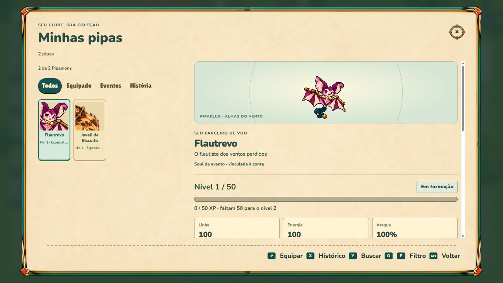

Dois retratos ocupam uma coluna larga; a área de detalhe mostra só parte dos status. O parceiro ocupa uma fração pequena da vitrine.

**Aplicação:** Redimensionar a vitrine pelo tamanho visual da criatura, sem cortar rabiola. Resumir dados principais antes de texto longo; permitir navegar pelos detalhes sem mouse.

**Evidência:** Captura própria em navegador; conta Ana Local e banco PGlite isolado. Teclado/mouse, sem validação de controle físico. 1280 x 720.

**Fonte:** PipaKlub local | HEAD 7183063 | 20/10/2026

### PipaKlub | Parceiros em 1080p

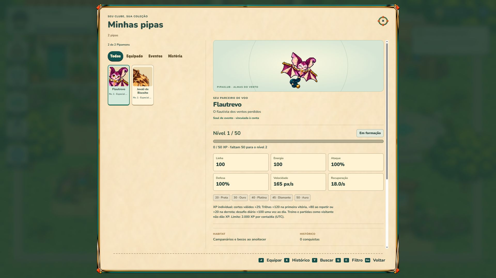

A mesma coleção foi capturada em 1920 x 1080 para comparação de composição.

**Aplicação:** Definir limites de largura e densidade para que o espaço extra melhore a leitura. Uma captura em 1080p não substitui testes de escala do sistema ou TV.

**Evidência:** Captura própria em navegador; conta Ana Local e banco PGlite isolado. Teclado/mouse, sem validação de controle físico. 1920 x 1080.

**Fonte:** PipaKlub local | HEAD 7183063 | 20/10/2026

### PipaKlub | Mochila em 720p

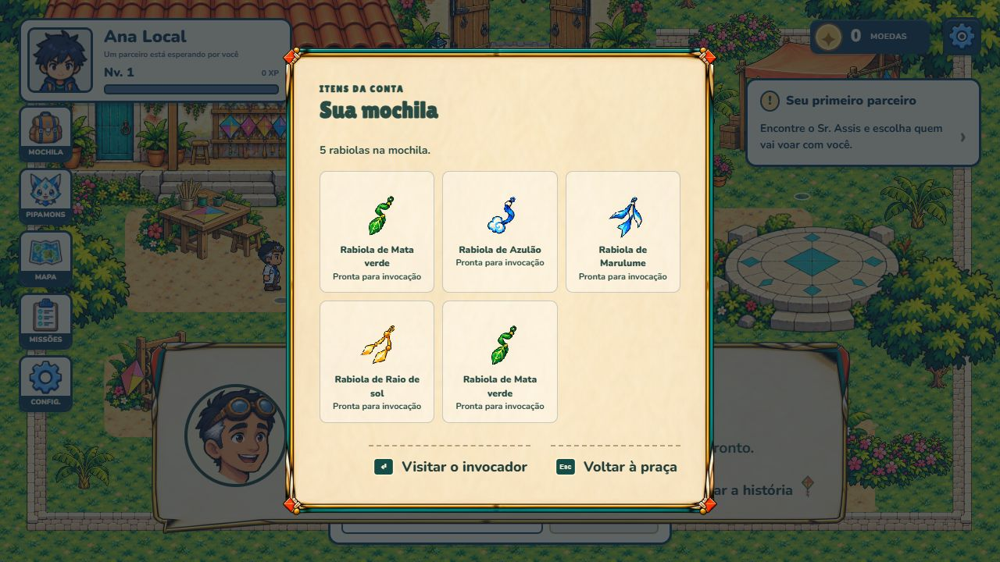

Cinco rabiolas ficam visíveis. Há dois cartões de Mata verde e a ação disponível leva ao invocador.

**Aplicação:** Acrescentar categorias e quantidade quando a coleção crescer; detalhe à direita e consequência da ação. Não criar botão Usar se essa ação não existe no fluxo.

**Evidência:** Captura própria em navegador; conta Ana Local e banco PGlite isolado. Teclado/mouse, sem validação de controle físico. 1280 x 720.

**Fonte:** PipaKlub local | HEAD 7183063 | 20/10/2026

### PipaKlub | Mochila em 1080p

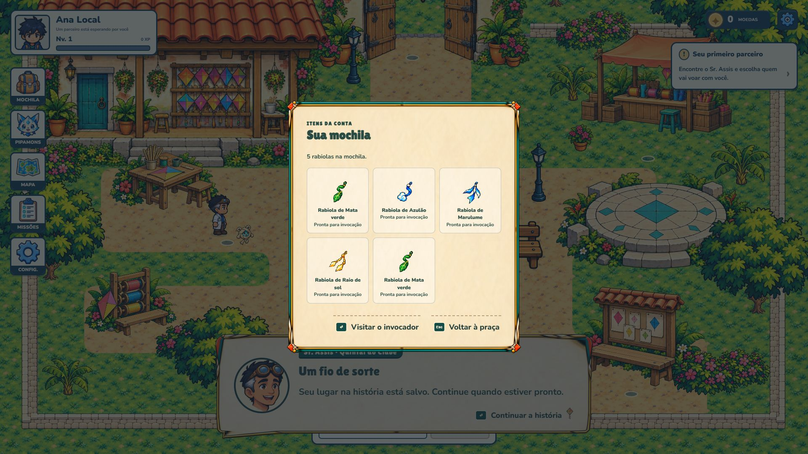

O painel foi observado também na segunda resolução, usando o mesmo banco de teste.

**Aplicação:** Validar 0, 1, 33 e muitas unidades; inventário curto não comprova que paginação, foco e desempenho funcionem com grandes coleções.

**Evidência:** Captura própria em navegador; conta Ana Local e banco PGlite isolado. Teclado/mouse, sem validação de controle físico. 1920 x 1080.

**Fonte:** PipaKlub local | HEAD 7183063 | 20/10/2026

### PipaKlub | Missões

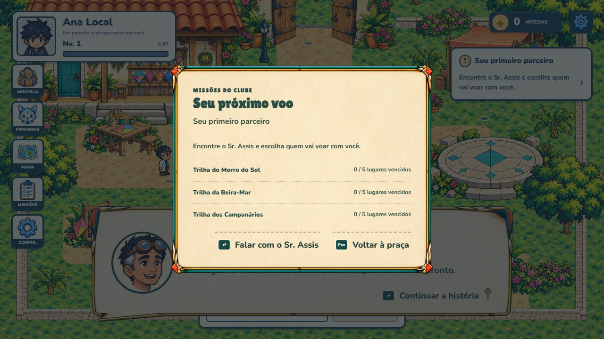

O painel apresenta próximo objetivo e três trilhas. Ao abrir, a árvore de acessibilidade informou foco na página, sem ação focada.

**Aplicação:** P1: colocar foco inicial no objetivo ou ação principal; restaurá-lo ao fechar. Evitar que o diálogo narrativo atrás dispute atenção com a missão.

**Evidência:** Captura própria em navegador; conta Ana Local e banco PGlite isolado. Teclado/mouse, sem validação de controle físico. 1280 x 720.

**Fonte:** PipaKlub local | HEAD 7183063 | 20/10/2026

### PipaKlub | Abertura narrativa

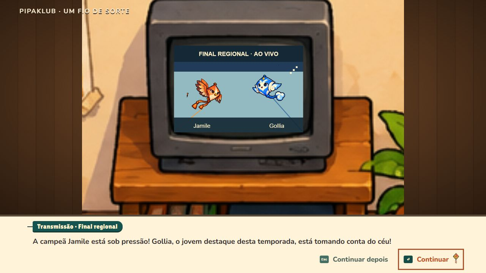

A transmissão fica acima da faixa de fala; Continuar tem destaque e Continuar depois permanece disponível.

**Aplicação:** Preservar separação entre cena e leitura. Testar falas longas, tamanho da fonte, redução de movimento e escolhas sem mouse.

**Evidência:** Captura própria em navegador; conta Ana Local e banco PGlite isolado. Teclado/mouse, sem validação de controle físico. 1280 x 720.

**Fonte:** PipaKlub local | HEAD 7183063 | 20/10/2026

### PipaKlub | HUD no fim de uma rodada de treino

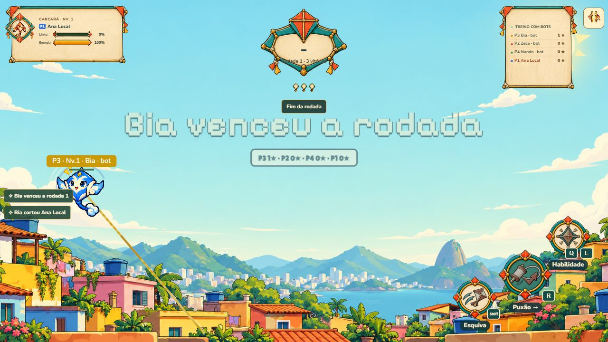

A captura ocorreu no fim de uma rodada: dados nas bordas, resultado no centro e ações à direita. Textos da ficha são pequenos frente à moldura.

**Aplicação:** Priorizar linha, energia e disponibilidade da técnica. Usar avisos centrais breves e não sobrepor o ponto de corte durante a ação. Este print não comprova alinhamento ou latência.

**Evidência:** Captura própria em navegador; conta Ana Local e banco PGlite isolado. Teclado/mouse, sem validação de controle físico. 1280 x 720.

**Fonte:** PipaKlub local | HEAD 7183063 | 20/10/2026

### PipaKlub | Pausa do treino

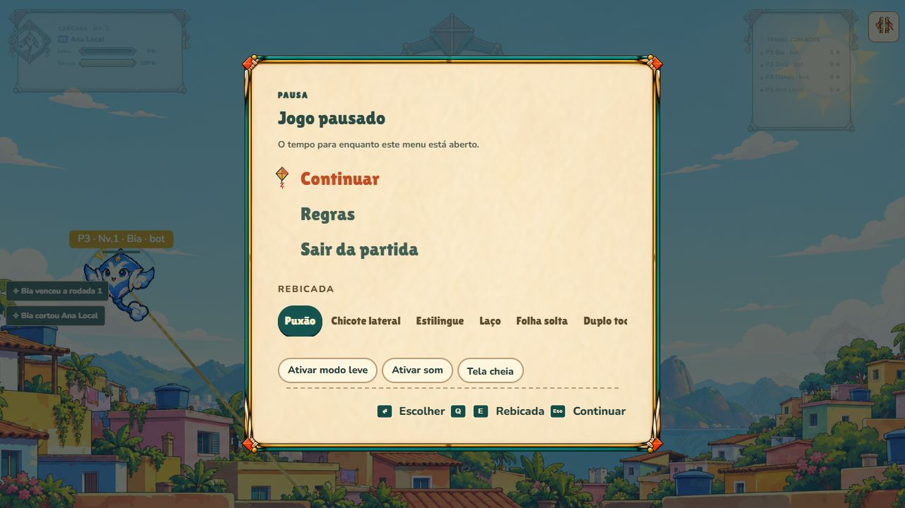

O rótulo Duplo toque aparece cortado na faixa de rebicadas em 1280 x 720. Continuar recebe foco visível.

**Aplicação:** P1: trocar a faixa por seleção paginada com setas e nome completo ou usar uma lista. Manter o foco visível ao alternar e explicar a pausa conforme o modo.

**Evidência:** Captura própria em navegador; conta Ana Local e banco PGlite isolado. Teclado/mouse, sem validação de controle físico. 1280 x 720.

**Fonte:** PipaKlub local | HEAD 7183063 | 20/10/2026

## Próxima revisão jogável

1. Corrigir corte das rebicadas e foco inicial de missões.
2. Aprovar uma ficha de parceiro em 720p com criatura maior, resumo e páginas de detalhe.
3. Testar o conjunto menu, diálogo, coleção e combate com controle físico. Registrar cada transição e retorno de foco.
4. Percorrer a abertura até o duelo de Zeca com conta nova; interromper e retomar em cada marco.
5. Somente após homologação de dados e plano de recuperação, preparar a liberação descrita no PIP-49.

## Acervo e direitos

O acervo contém 42 imagens, com dimensões e origem em fontes.json. A galeria destaca 27 figuras comentadas. Imagens complementares de cenário não são tratadas como evidência de HUD.

Referências de Pokémon e Digimon pertencem aos respectivos titulares e ficam restritas a este estudo. Não foram inseridas nos assets de produção, na interface ou no pacote do jogo. Esta análise propõe padrões funcionais e uma execução visual original para PipaKlub.

## Ampliação: character design e creature design

Ampliação de 21/10/2026: 18 pranchas fornecidas pelo responsável pelo PipaKlub, sendo 12 de personagens humanos e 6 de criaturas. As duas primeiras pranchas mostram duas pessoas cada: o conjunto reúne 14 designs humanos principais. O foco é aprender decisões de construção e produção, não atribuir autoria a desenhistas específicos nem reproduzir personagens das franquias.

### Método e origem

Cada ficha separa observação visual, interpretação de atuação e proposta para o PipaKlub. Identificadores REF-01 a REF-18 seguem exatamente a ordem dos anexos. Usamos títulos descritivos; Olivia e Lusamine são nomes legíveis nas próprias folhas. A origem editorial e a autoria individual dos demais materiais não foram verificadas. Não traduzimos nem inferimos regras a partir das notas japonesas pequenas. Na REF-08 há aviso de material de desenvolvimento: não tratá-la como prova de modelo final. São desenhos estáticos, não testes de animação.

As imagens originais foram copiadas sem alteração para referencias-design/. O manifesto preserva ordem, nome original, dimensões e SHA-256. Escalas, simplificações e entregáveis sugeridos abaixo são propostas nossas, não medidas oficiais das referências. Elas ficam no benchmark, fora dos assets de produção e do build do jogo. A seção histórica de HUD, datada de 20/10/2026, permanece como registro daquele piloto; esta ampliação não revalida seus problemas atuais.

### Direção para humanos

#### Uma massa dominante, sinais de apoio

Escolher uma forma primária reconhecível: chapéu largo, gola, mecha, jaleco ou cabelo preso. Acrescentar sinais secundários só quando reforçam função e individualidade. A cabeça precisa continuar distinguível sem cor e sem objeto. A dupla rural/urbana da REF-01 e os dois atletas da REF-02 demonstram contrastes de massa; não fornecem um figurino pronto para o nosso elenco.

#### Papéis por gesto, não apenas por tema

Professor observa e demonstra; reparador segura ferramentas de maneira plausível; rival protege ou expõe sua linha com uma atitude própria. Criar ao menos um gesto cotidiano além da pose de combate. As REF-03, 04, 10 e 11 mostram a utilidade de pequenas vinhetas de trabalho ou descanso.

#### Família do clube sem apagar diferenças

Compartilhar materiais, um acento ou uma marca pequena. Variar idade, proporção, massa capilar, distribuição de peso e comportamento. A REF-08 é útil para coesão de dupla; as REF-06 e 09 para assimetria e massa dominante. Não deduzir caráter, ocupação ou habilidade a partir de tom de pele, gênero ou corpo.

#### Cor tem área e função

Definir cor dominante, suporte e acento. Avaliar em escala de cinza e no fundo real. Um personagem não se torna original apenas por recolorir uma roupa reconhecível. Se cada acessório recebe um acento saturado, o rosto perde prioridade. A região de maior contraste deve servir a leitura desejada, não decorar tudo.

#### Figurino com continuidade

Desenhar frente, perfil e costas; indicar lado dos acessórios, percurso de alças, sobreposição e estados removíveis. Óculos, chapéus e bolsas devem ter uma versão isolada quando sua construção for ambígua. A ficha é um contrato para vários artistas, não só uma prancha bonita.

#### Expressão preserva anatomia

Olhos, sobrancelhas, mandíbula e postura atuam juntos. Comparar seis emoções sem trocar implantação de orelhas, tamanho do crânio ou identidade da franja. A REF-12 mostra a utilidade de reunir expressões ao redor do mesmo modelo. Detalhe de desenho não substitui repertório emocional.

### Direção para Pipamons

#### Espécie + construção + temperamento

Definir animal ou forma-base, como ela existe em papel/vareta/nó e como seu corpo comunica temperamento. Se o papel só aparece como mochila de pipa presa a um animal convencional, a integração almática ainda está fraca. Selecionar um ou dois componentes estruturais em vez de empilhar ornamentos.

#### Órgão dominante e espaço negativo

Cauda na REF-14, asas na REF-16 e juba na REF-17 organizam toda a espécie. Criar uma hierarquia própria para cada Pipamon. Verificar vãos entre membros, cabeça e apêndices; eles sustentam reconhecimento em miniatura e durante sobreposição com linhas e efeitos.

#### Conexões visíveis e funcionais

Rabiola nasce em ponto documentado; membrana prende em estrutura; crina acompanha cabeça/pescoço; pétalas têm linha ou suporte. O comprimento pode parecer menor por perspectiva, mas não variar arbitrariamente. Esta regra responde diretamente a falhas anteriores de cauda solta e peças flutuantes.

#### Uma espécie tem mais de um estado

Repouso, alerta, antecipação, ação, recuperação e dano precisam manter a mesma identidade. A REF-18 oferece contraste de temperamento; a REF-15 explica assinatura de ação; a REF-13, peso e postura. Não inferir dano, raridade ou evolução a partir da aparência de qualquer referência.

#### Materiais e efeitos em camadas distintas

Papel recebe planos e vincos; bambu é estrutura; linha é conexão; brilho é apresentação. Manter o modelo base legível sem aura. Nas faixas de level existentes, partículas não podem apagar focinho, linha inimiga ou ponto de contato. A análise artística não altera os limites de level ou status.

#### Raridade com direção, não inflação

Uma criatura rara pode ter uma transformação de vela, silhueta incomum ou relação narrativa especial. Coroa, ouro, sino, cristal e brilho em toda criatura tornam o elenco uniforme. Um motivo bem resolvido vale mais que muitas famílias de ornamentos sem relação.

### Mapa de consulta cruzada

| Problema | Referências | Entrega esperada |
| --- | --- | --- |
| Massa da cabeça e roupa | REF-01, 02, 05, 09, 12 | Rosto identificável sem objeto; corpo distinto em silhueta. |
| Ofício e comportamento | REF-01, 03, 04, 07, 10, 11 | Um gesto de rotina e uma pega plausível por objeto. |
| Pertencimento ao elenco | REF-02, 08 | Materiais comuns; cabeças e atitudes diferentes. |
| Assimetria e camadas | REF-02, 06, 10, 11 | Mapa esquerdo/direito e estados de acessórios. |
| Expressões consistentes | REF-03, 05, 06, 12, 18 | Mudança de emoção sem redesenho de identidade. |
| Peso e anatomia | REF-13, 15, 17, 18 | Base de apoio, articulações e volumes coerentes. |
| Apêndice dominante | REF-14, 16, 17, 18 | Âncora, volume e comprimento documentados. |
| Assinatura de ação | REF-13, 14, 15, 16, 18 | Ação compreensível sem partículas ou brilho. |

### Análise das 18 pranchas

#### REF-01 - Contraste de papéis: esportista urbano e trabalhador rural

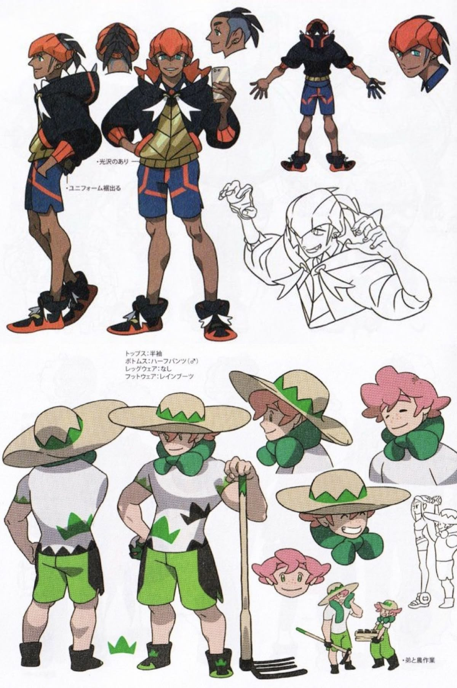

**Origem:** anexo do usuário. Original: `codex-clipboard-7bcf74fb-47f1-4cd5-b9eb-2bdadc0d158f.jpg`. Dimensões: 1200 x 1807 px.

**Silhueta e proporção.** A prancha reúne dois designs, não duas variações do mesmo personagem. No superior, cabelo/cobertura angular, gola alta e mangas volumosas formam uma massa larga sobre pernas finas. No inferior, a aba muito larga do chapéu domina a largura; lenço arredondado e cabelo ondulado contrapõem as pontas do primeiro. Ambos são reconhecíveis antes dos detalhes faciais.

**Cor e hierarquia de valores.** O superior organiza preto e azul como massas grandes, vermelho-alaranjado como acento repetido e amarelo no torso. O inferior usa branco/creme para respiro, verde no lenço e bermuda, e preto em pequenos apoios. Não é a quantidade de cores que define identidade, mas onde cada cor reaparece e qual massa domina.

**Construção, vistas e acessórios.** Punhos, solado e gola repetem a mesma linguagem angular no primeiro. Chapéu, botas e ferramenta situam o segundo em uma atividade. Vistas de costas explicam continuidade de roupa; detalhes do cabelo sem chapéu impedem que o acessório seja tratado como anatomia. A ferramenta é um objeto separável, com pega e apoio no chão.

**Expressão e atuação.** O primeiro distribui confiança por sobrancelha, sorriso lateral e gesto das mãos; o segundo alterna serenidade, sorriso aberto e pálpebra relaxada. Mudar somente a boca não produziria a mesma diferença de atuação. Os rostos menores mantêm o recorte do cabelo.

**Continuidade e custo de animação.** Gola e mangas pedem volumes estáveis em rotação; o chapéu precisa manter elipse e fixação na cabeça. Ferramenta e aba criam risco de colisão visual com NPCs e molduras. Para chibi, a aba deve encolher o suficiente para não esconder rosto nem área de interação.

**Aplicação original ao PipaKlub.** Diferenciar um rival de laje e um cuidador do quintal pela combinação de postura, massa dominante e objeto de trabalho. Para o cuidador, substituir signos importados por material e função locais: bolsa de sementes, banco de reparos ou suporte de carretéis. Para o rival, concentrar ritmo angular no casaco e modo de segurar a linha, sem repetir roupa e emblemas da referência.

**O que não transferir.** Não dar o mesmo chapéu, gola e pulseira a todo o elenco. Não importar motivos gráficos da roupa como se fossem identidade brasileira. Profissão não se resume a um objeto gigante, e tom de pele não determina papel narrativo.

**Critérios de revisão.** Comparar ambos em silhueta preta e com o chapéu/objeto oculto; ainda devem diferir. Exigir frente, perfil, costas e versão sem acessório antes de produzir o atlas. Testar rosto visível atrás da aba na escala do overworld.

#### REF-02 - Duas atletas: fluxo longo e concentração compacta

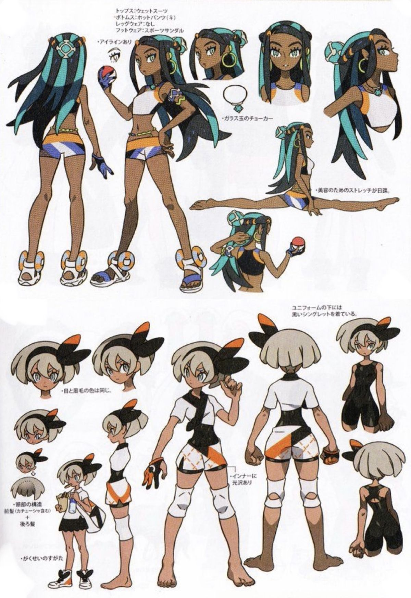

**Origem:** anexo do usuário. Original: `codex-clipboard-92ffc4e7-5a12-4d94-a65f-e9e28ec88cdb.png`. Dimensões: 1200 x 1745 px.

**Silhueta e proporção.** O design superior tem linhas alongadas e cabelo em grandes mechas que continuam além da cintura. O inferior concentra a leitura em cabelo curto, adorno lateral e tronco estreito. O contraste vem de massa e direção, não de acrescentar mais objetos a uma das duas.

**Cor e hierarquia de valores.** Na figura superior, turquesa cria trilhos visuais dentro da massa preta e laranja marca transições da roupa. Na inferior, branco e preto definem blocos claros, enquanto laranja fica em poucos pontos. Uma paleta relacionada pode sustentar personagens distintos quando as proporções das áreas mudam.

**Construção, vistas e acessórios.** As vistas laterais e traseiras resolvem mechas, presilhas e fechamento do traje. A segunda figura mostra roupa externa e camada de baixo como estados diferentes, evitando interpretar recortes como falhas de desenho. Sandálias e luvas recebem desenho funcional próprio.

**Expressão e atuação.** A superior comunica domínio por queixo elevado e olhar lateral; a inferior por sobrancelhas firmes, mandíbula compacta e gesto contido. O alongamento corporal ilustrado não deve ser confundido com proporção obrigatória de um personagem de jogo.

**Continuidade e custo de animação.** Cabelo longo exige âncoras na cabeça e mechas agrupadas; não deve virar dezenas de fitas independentes. Na baixa resolução, o adorno lateral precisa permanecer no mesmo lado nas vistas, salvo espelhamento explicitamente permitido. A prancha inclui pose de alongamento, útil como estudo de deformação, não como frame obrigatório do jogo.

**Aplicação original ao PipaKlub.** Construir duas pipeiras de habilidades diferentes com fluxos opostos: uma com roupa leve e linhas contínuas; outra com mangas e acessórios compactos para movimentos precisos. Priorizar atividade, mobilidade e rosto legível. A versão chibi deve preservar cabelo e gesto, usando figurino apropriado ao papel e à idade do personagem.

**O que não transferir.** Não copiar trajes, padrões ou adornos identificáveis. Não usar pernas mais longas ou exposição corporal como substituto de personalidade. Evitar simplificar todas as mulheres do elenco para a mesma base corporal e trocar só o cabelo.

**Critérios de revisão.** Reduzir os retratos ao tamanho real da interface e confirmar que as duas identidades sobrevivem. Documentar lado dos adornos, massa traseira do cabelo e roupa por estado; não misturar camadas durante animação.

#### REF-03 - Jovem de cabelo verde: atividade cotidiana como identidade

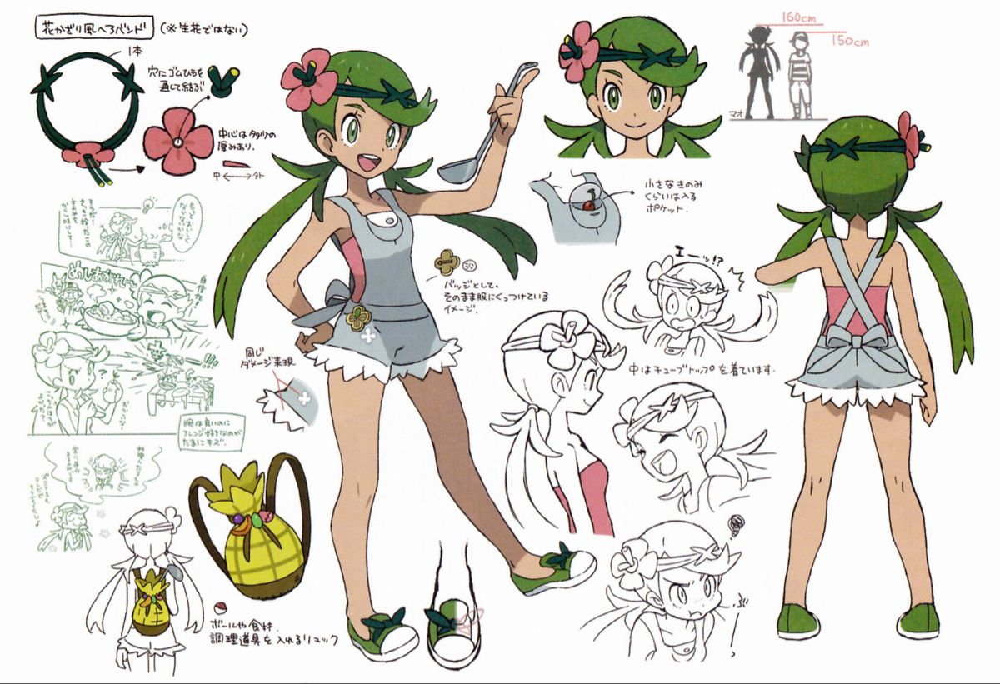

**Origem:** anexo do usuário. Original: `codex-clipboard-ce24568d-1868-4632-aa82-a105d70e4f96.png`. Dimensões: 1200 x 821 px.

**Silhueta e proporção.** Cabelo dividido em massas longas, flor lateral e franja levantada dão três pontos de reconhecimento. O macacão curto forma um bloco simples; os espaços entre braço, cintura e cabelo impedem que a figura se torne uma massa indiferenciada.

**Cor e hierarquia de valores.** Verde domina cabeça e calçado; rosa funciona como acento localizado e cinza claro sustenta a roupa sem competir. A flor não precisa de brilho ou textura complexa para puxar o olhar. A distribuição é mais importante que uma equivalência literal entre cor e elemento.

**Construção, vistas e acessórios.** A prancha separa acessório de cabelo, bolso, alças cruzadas e bolsa. O objeto de cozinha explica uma ocupação possível por uso, enquanto o bolso mostra como algo é carregado. Há uma solução de costas, não somente uma pose frontal atraente.

**Expressão e atuação.** Sorriso aberto, surpresa e concentração são construídos com boca, olhos e inclinação da cabeça. O personagem também aparece fazendo algo com outros, o que amplia o repertório além da pose de apresentação. A flor acompanha a cabeça, sem girar isolada.

**Continuidade e custo de animação.** As duas massas longas de cabelo podem formar um sistema secundário simples. Bolsa e alças têm pontos de fixação; o braço deve conseguir alcançar bolso e utensílio. Em chibi, flor e franja podem ser mantidas enquanto bordados e pequenas costuras são removidos.

**Aplicação original ao PipaKlub.** Para uma NPC de comida de rua ou preparo de material, mostrar rotina com um gesto: separar fitas, costurar papel ou servir lanche. A competência aparece no objeto realmente usado. Traduzir o princípio para um figurino próprio do bairro e uma marca pessoal discreta, sem tornar toda ocupação uma fantasia temática.

**O que não transferir.** Não reproduzir flor, cabelo verde e macacão em conjunto. Não confundir acessórios decorativos com itens que o jogador ganha. As pequenas notas japonesas não foram traduzidas; a leitura de função parte das imagens, não de uma afirmação do texto.

**Critérios de revisão.** Produzir pose neutra, gesto de trabalho e gesto de conversa com o mesmo figurino. Garantir que bolsa, alças e cabelo concordem entre frente e costas; validar reconhecimento sem o utensílio.

#### REF-04 - Jovem pescadora: ritmo calmo e grafismo de poucas massas

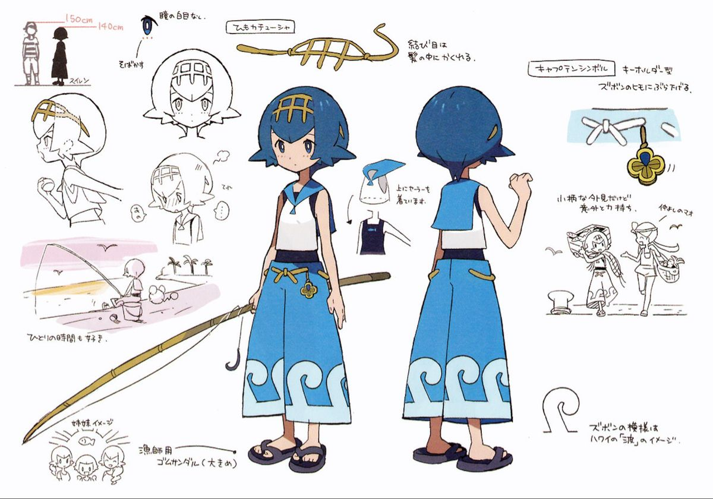

**Origem:** anexo do usuário. Original: `codex-clipboard-f4e01d9a-332d-4f7e-a9f3-c8236ce917bf.png`. Dimensões: 1200 x 840 px.

**Silhueta e proporção.** Cabelo curto arredondado, pontas laterais e calça ampla constroem uma figura compacta no topo e estável na base. A vara desenha uma diagonal que amplia a composição sem alterar a anatomia. A pose neutra permanece simples.

**Cor e hierarquia de valores.** Azul aparece como bloco dominante no cabelo e na calça; branco cria pausa no torso e na barra. Amarelo ocupa nós e acessórios pequenos. As ondas da barra se leem como forma grande; não dependem de estampas minúsculas.

**Construção, vistas e acessórios.** Frente e costas mostram a gola, a faixa da cintura e o percurso das formas na calça. A prancha destaca um pequeno acessório e o desenho do cabelo separado. A vara é comprida e afilada: sua trajetória e local de guarda precisariam ser definidos em produção.

**Expressão e atuação.** A expressão base é econômica, sem sobrancelhas exageradas. As vinhetas mostram isolamento tranquilo, atenção e mudanças sutis de boca/olhar. É referência útil para um NPC que não precisa sorrir ou gesticular o tempo todo para ser acolhedor.

**Continuidade e custo de animação.** A calça tem duas pernas e um vão que deve continuar legível nas vistas; não virar uma saia por simplificação. A vara pode atravessar caixas de diálogo se não houver estado de repouso. A faixa da cintura e o acessório necessitam posição constante.

**Aplicação original ao PipaKlub.** Uma moradora junto a reservatório ou ponto de água pode ter atuação calma, mãos ocupadas com manutenção de linha e poucos acentos cromáticos. O desenho da roupa pode usar uma curva de vento original como motivo, sem copiar ondas, uniforme ou adorno desta prancha.

**O que não transferir.** Não assumir que azul obriga habilidade de água nem importar a vara como arma. Não converter silêncio em ausência de personalidade; gestos pequenos e ritmo de fala precisam sustentar o papel.

**Critérios de revisão.** Revisar silhueta sem a vara, separar estados com/sem objeto e testar as pernas em quatro direções. Conferir a leitura do rosto em retrato, onde gola e cabelo competem por uma área pequena.

#### REF-05 - Vestido violeta: atmosfera construída por contorno

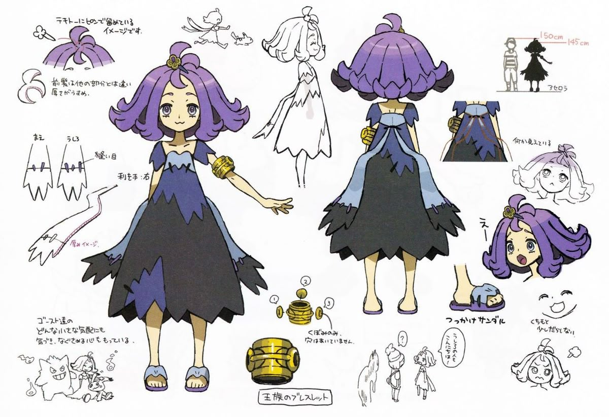

**Origem:** anexo do usuário. Original: `codex-clipboard-85707c4e-0119-400a-a77e-27acfb125b60.png`. Dimensões: 1200 x 823 px.

**Silhueta e proporção.** Cabelo em arco, pontas laterais e saia ampla recortada formam uma sequência de ondas e dentes. A massa larga fica abaixo da cintura, em contraste com braços finos abertos. O topo tem um pequeno prolongamento reconhecível.

**Cor e hierarquia de valores.** Violeta, preto e azul dessaturado definem camadas amplas; amarelo metálico fica concentrado na pulseira. Não há necessidade de textura complexa para sugerir um tema noturno. A separação de valores evita que saia e cabelo se fundam.

**Construção, vistas e acessórios.** A prancha resolve costas, costura/amarração e a construção da pulseira por peças. O acessório tem volume e orientação, não é apenas um anel pintado. As barras irregulares se repetem com organização suficiente para permanecerem consistentes entre vistas.

**Expressão e atuação.** Olhos arredondados e sorriso pequeno suavizam a roupa escura. As expressões de susto e dúvida tornam o personagem acessível, em vez de rigidamente sinistro. O desenho mostra que tema visual e temperamento não precisam ser a mesma coisa.

**Continuidade e custo de animação.** Barras recortadas têm custo de continuidade; limitar os pontos principais é melhor que redesenhar dentes aleatórios a cada frame. O cabelo precisa de massa traseira coerente. Pulseira e saia podem sobrepor o braço em poses, exigindo ordem de camadas explícita.

**Aplicação original ao PipaKlub.** Para uma NPC ligada a histórias antigas do bairro, usar um contraste entre figurino atmosférico e atuação cordial. Recortes de papel e um único objeto herdado podem construir tema sem empilhar caveiras, correntes e efeitos mágicos.

**O que não transferir.** Não reproduzir vestido, penteado e pulseira em conjunto. Não usar violeta como atalho obrigatório para vilania. Preservar proporções apropriadas ao personagem do PipaKlub, em vez de transplantar a base da referência.

**Critérios de revisão.** Testar preto sobre fundo noturno e vegetação escura. Fixar número e posição dos recortes principais e mostrar pulseira em pelo menos duas orientações; verificar se o rosto continua sendo o primeiro foco.

#### REF-06 - Olivia: assimetria controlada e acessório com engenharia

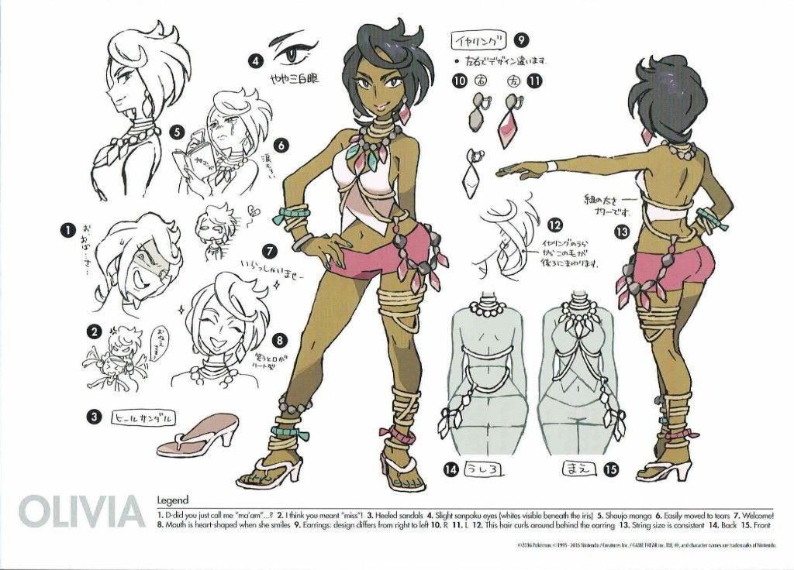

**Origem:** anexo do usuário. Original: `codex-clipboard-5fd769bb-e6a3-4939-8f17-c0b6efc146d5.png`. Dimensões: 1024 x 736 px.

**Silhueta e proporção.** A prancha identificada como Olivia combina cabelo curto volumoso, postura apoiada em uma perna e linha diagonal de acessórios. O corpo permanece legível sob uma distribuição assimétrica de detalhes. As áreas livres equilibram as áreas ornamentadas.

**Cor e hierarquia de valores.** Rosa e creme ocupam a roupa; turquesa e dourado aparecem em pontos menores. A pele e o cabelo não são apenas fundos para acessórios: participam das massas de valor. Detalhes não têm a mesma intensidade visual em todo o corpo.

**Construção, vistas e acessórios.** Os brincos são desenhados separadamente e apresentam diferença entre lados. As correntes/faixas têm percurso documentado na frente e nas costas. O calçado tem salto e sola que mudam o apoio do pé. A folha registra essas particularidades para evitar improviso do animador.

**Expressão e atuação.** Olhar oblíquo, sorriso lateral e variações mais abertas sustentam segurança com amplitude emocional. A pose de mão na cintura se relaciona ao desenho do braço e da roupa; não é somente uma expressão facial aplicada a um corpo neutro.

**Continuidade e custo de animação.** Assimetria impede espelhamento indiscriminado. Correntes pequenas e múltiplas pulseiras virariam ruído no chibi; escolher um sinal principal e documentar a redução. Salto altera a linha de apoio, mas não deve ser importado para um NPC que precisa correr em terreno irregular sem justificativa.

**Aplicação original ao PipaKlub.** Para adultos do clube, combinar atitude corporal madura com um objeto de identidade forte: um carretel antigo, crachá de ofício ou ferramenta de reparo. No Sr. Assis, preservar jaleco, polo azul, calça marrom, cabelo preto com fios brancos, rosto sem barba e óculos de aviação na testa; esta referência não autoriza substituí-los por joias.

**O que não transferir.** Não associar maturidade a excesso de adorno ou a um tipo corporal único. Não repetir assimetria complexa em todos os NPCs. O nome Olivia é legível na folha; não há atribuição individual de designer confirmada nos anexos.

**Critérios de revisão.** Criar mapa esquerdo/direito dos acessórios e versão reduzida aprovada. Confirmar apoio dos pés, continuidade das faixas e que o detalhe principal sobreviva no retrato sem disputar com olhos e boca.

#### REF-07 - Figura formal azul-clara: economia e hierarquia de detalhes

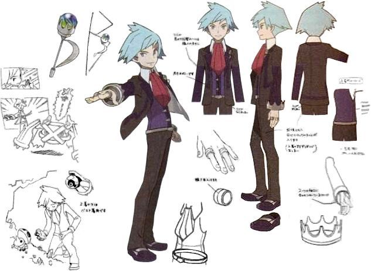

**Origem:** anexo do usuário. Original: `codex-clipboard-a87a6b29-f519-4150-8d27-10aaebe7fae5.png`. Dimensões: 633 x 462 px.

**Silhueta e proporção.** Cabelo em cunha lateral, paletó longo e pernas estreitas fazem uma figura alta e angular. A extensão de uma mão com objeto cria uma ação clara, enquanto a outra permanece relaxada. A forma geral funciona sem o desenho interno da roupa.

**Cor e hierarquia de valores.** Tons escuros próximos mantêm o traje como massa única; cabelo claro separa a cabeça e vermelho no pescoço conduz o olhar ao rosto. Há contraste localizado, não contorno luminoso em toda a figura.

**Construção, vistas e acessórios.** Detalhes de mão, anel e pequeno objeto recebem ampliações. Mangas, lapela e barra do paletó apresentam hierarquia: alguns pontos exigem precisão, o restante pode permanecer simples. A baixa resolução da imagem limita a leitura de notas e formas muito pequenas.

**Expressão e atuação.** A postura transmite compostura; pequenas variações faciais dão leveza. A mão estendida é um convite/gesto de apresentação visualmente observável; não permite afirmar intenção narrativa oficial apenas pela prancha.

**Continuidade e custo de animação.** O paletó precisa separar tronco e abas na caminhada; uma massa rígida que gira inteira perde naturalidade. Em chibi, conservar cunha de cabelo, lapela e acento do pescoço; anel provavelmente fica só no retrato ou close de história.

**Aplicação original ao PipaKlub.** Um organizador de campeonato pode comunicar organização por linhas limpas e um único objeto de cerimônia, sem armadura ou insígnia exagerada. Roupa e gesto devem ter relação com o clube de bairro, não importar o traje reconhecível da referência.

**O que não transferir.** Não ampliar a imagem e inventar detalhes ausentes como se fossem oficiais. Não deixar o cabelo claro ser o único sinal de autoridade nem repetir o mesmo paletó em personagens de funções distintas.

**Critérios de revisão.** Verificar lapela e caimento de costas, mão segurando o objeto e versão sem esse objeto. Marcar anel e detalhes minúsculos como opcionais na escala de overworld; preservar leitura do rosto em primeiro lugar.

#### REF-08 - Dupla de viajantes: família visual e diferenças individuais

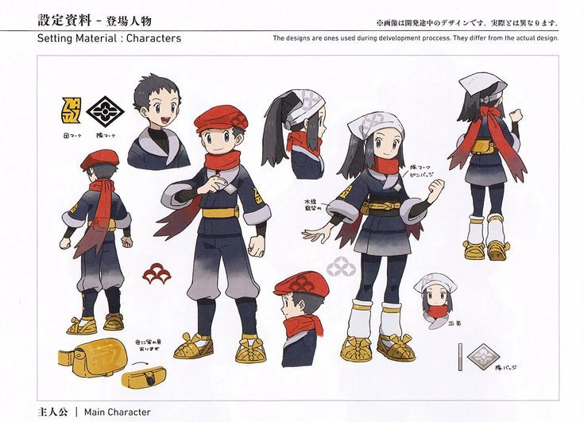

**Origem:** anexo do usuário. Original: `codex-clipboard-7ccbb9eb-5650-47cc-86f6-4f9c33794da1.png`. Dimensões: 735 x 531 px.

**Silhueta e proporção.** Dois personagens compartilham roupa em camadas, faixa na cintura, calçado robusto e tecido longo no pescoço. Um usa cobertura vermelha baixa; o outro, faixa clara e cabelo preso. A família é reconhecível sem tornar as cabeças intercambiáveis.

**Cor e hierarquia de valores.** Azul escuro e cinza organizam o uniforme; vermelho e amarelo criam acentos comuns. A continuidade das cores comunica pertencimento, enquanto a distribuição na cabeça e na parte inferior distingue cada figura.

**Construção, vistas e acessórios.** A folha mostra costas, amarrações, bolsa e pequenos objetos. O próprio cabeçalho informa que são materiais de desenvolvimento e podem diferir do desenho final. Portanto, esta é evidência de processo e coerência interna desta folha, não confirmação do modelo final dos jogos.

**Expressão e atuação.** Olhos e boca simples deixam espaço para energia nas poses. Inclinação de cabeça, mão próxima ao peito e tecido projetado sugerem movimento sem exigir distorção anatômica extrema. A dupla compartilha linguagem, mas não precisa repetir a mesma expressão base.

**Continuidade e custo de animação.** Cachecol/tecido longo necessita origem e comprimento constantes, com separação do torso. Bolsas mudam de vista sem mudar de lado. O tamanho das cabeças pode orientar uma etapa intermediária entre retrato de história e chibi, sem adotar exatamente essa proporção.

**Aplicação original ao PipaKlub.** Definir uma família de membros do clube com marca comum pequena, material e regra de acento, mantendo profissão, idade, cabelo e postura próprios. Para Kael, usar os atlas aprovados como identidade; para Tyler, documentar as mechas brancas e a relação visual com o Sr. Assis sem fazê-lo um Kael recolorido.

**O que não transferir.** Não converter todos os moradores em uniforme genérico. Não copiar símbolos, faixa, bolsa ou combinação completa da dupla. Não tratar o aviso de desenvolvimento como garantia de autorização para reutilizar a arte.

**Critérios de revisão.** Fazer matriz com os dois lado a lado, com e sem chapéu e em escala chibi. Conferir pertencimento pela linguagem de roupa e individualidade pela cabeça/gesto. Etiquetar explicitamente a folha como referência de desenvolvimento.

#### REF-09 - Lusamine: massa dominante, repetição e pose contida

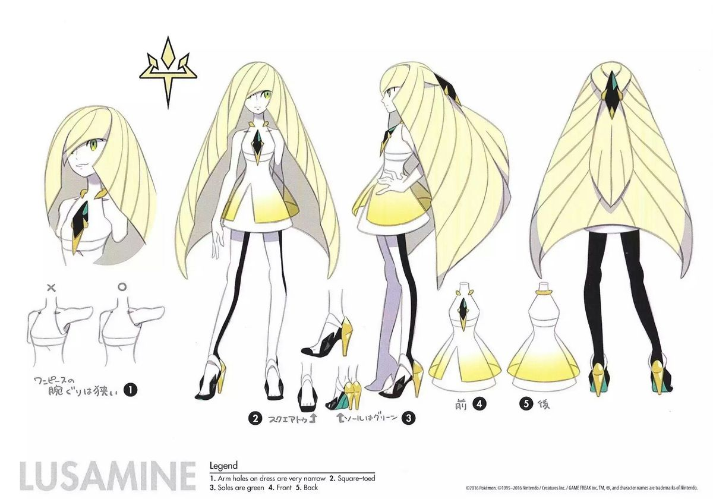

**Origem:** anexo do usuário. Original: `codex-clipboard-78e30c3f-b66b-4ac9-878a-9fea25e50c89.png`. Dimensões: 1200 x 840 px.

**Silhueta e proporção.** O cabelo forma uma grande campânula que envolve o corpo. Vestido curto estreito e pernas longas criam contraste entre massa superior muito ampla e apoios finos. A ponta central e o losango escuro reiteram direção vertical.

**Cor e hierarquia de valores.** Branco, amarelo muito claro e preto constroem uma escala de valores controlada; um pequeno verde aparece na região central e no calçado. A franja clara não se separa da pele só por cor: depende também de contorno e desenho das mechas.

**Construção, vistas e acessórios.** A folha nomeada Lusamine mostra frente, perfil, costas e detalhes do vestido/sapato. As faixas no cabelo seguem superfícies e convergem em pontos definidos. O recorte da manga/abertura do braço é tratado como regra de construção, não detalhe improvisável.

**Expressão e atuação.** O olhar parcialmente coberto, boca pequena e postura vertical produzem distanciamento. Essa leitura é uma interpretação visual, não diagnóstico de personalidade. Pouca atuação na folha torna a definição de expressões adicionais ainda mais importante antes de animar.

**Continuidade e custo de animação.** A massa capilar pode esconder braços e coluna; o giro exige um volume traseiro estável. Muitas linhas paralelas no chibi virariam listras confusas. Reduzir a divisões maiores e preservar espaço negativo entre mão e cabelo.

**Aplicação original ao PipaKlub.** Um personagem cerimonial pode ter uma massa dominante clara e poucos focos escuros, com motivo repetido em roupa e objeto. Traduzir essa estrutura para papel, pano e vento do clube. A base alongada deve ser redesenhada para as proporções aprovadas, especialmente no overworld.

**O que não transferir.** Não copiar cabelo-campânula, vestido e losango em conjunto. Não aplicar o mesmo grau de monumentalidade a NPCs cotidianos; o contraste só funciona dentro de um elenco variado.

**Critérios de revisão.** Revisar braço visível em perfil e três quartos, separação do cabelo em fundo claro e versão em miniatura. Definir quais mechas são estruturais e quais são linhas de superfície dispensáveis na redução.

#### REF-10 - Figura de óculos e cabelo verde: profissão por organização

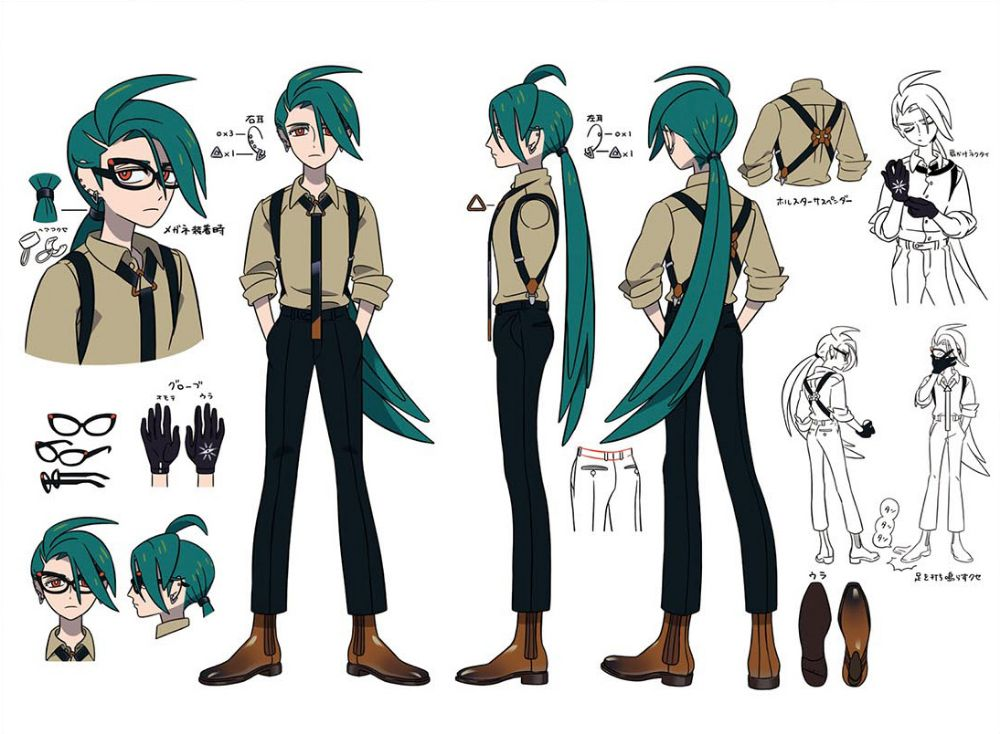

**Origem:** anexo do usuário. Original: `codex-clipboard-482a33c2-e4ee-47c4-8460-5a04481bff6e.png`. Dimensões: 1000 x 734 px.

**Silhueta e proporção.** Camisa simples, suspensórios, calça reta e cauda longa de cabelo produzem uma figura vertical de poucos blocos. Uma mecha deslocada e os óculos concentram identidade na cabeça. A massa posterior não depende de uma capa adicional.

**Cor e hierarquia de valores.** Verde escuro no cabelo, bege na camisa, preto na parte inferior e marrom no calçado formam uma paleta contida. A diferença de valor entre camisa e calça é suficiente para separar torso e pernas sem textura extra.

**Construção, vistas e acessórios.** Suspensórios se cruzam nas costas e ligam-se à cintura. A folha detalha óculos, luvas e sapato. Há estudos de mãos realizando gestos cotidianos; isso explica o uso de acessórios além da pose de catálogo. Não inferir cargo oficial a partir do figurino.

**Expressão e atuação.** Olhar lateral por trás das lentes, rosto estreito e gestos econômicos sugerem atenção. Óculos não podem substituir olhos e sobrancelha na atuação: os estudos mostram que a direção do olhar continua necessária.

**Continuidade e custo de animação.** Mecha longa, aro dos óculos e suspensórios devem conservar espessura coerente. Luvas são um estado de mão que precisa aparecer igualmente nas vistas. Em chibi, óculos podem exigir traço ampliado, mas não uma moldura que apague os olhos.

**Aplicação original ao PipaKlub.** Para alguém que registra torneios ou conserta instrumentos, usar roupa de trabalho organizada e gestos precisos, com um elemento pessoal em vez de múltiplos ícones. No professor, este estudo orienta clareza de acessórios; não troca os óculos de aviação na testa por óculos de leitura.

**O que não transferir.** Não importar cruzamento, cabelo e paleta completos. Não converter aparência austera em vilania automática. Evitar oferecer como detalhe legível no sprite aquilo que só existe num close da prancha.

**Critérios de revisão.** Testar rosto com e sem óculos em retrato, caminho dos suspensórios e lado das mechas. Mostrar mão vazia e segurando ferramenta, sem modificar comprimento dos dedos ou desenho da luva entre estados.

#### REF-11 - Figura de capuz: enquadramento do rosto e repetição de acentos

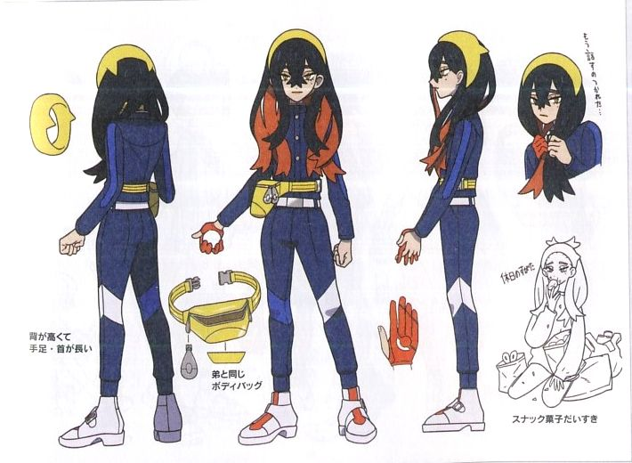

**Origem:** anexo do usuário. Original: `codex-clipboard-71a658e3-981d-40fa-b53a-8638eb410c03.png`. Dimensões: 710 x 520 px.

**Silhueta e proporção.** Capuz arredondado, mechas longas que saem pela frente e roupa de pernas estreitas formam um contorno compacto. O cabelo corta a simetria do capuz e cria uma direção diagonal perto dos olhos. A bolsa lateral amplia um lado do quadril sem alterar o torso.

**Cor e hierarquia de valores.** Azul escuro funciona como campo contínuo; amarelo marca cabeça e bolsa; vermelho-alaranjado aparece no cabelo e luva. As pequenas áreas claras nos joelhos/calçado quebram a coluna escura e indicam articulação sem exigir joelheiras volumosas.

**Construção, vistas e acessórios.** Há bolsa isolada, luva e estado sem o volume principal da roupa, úteis para entender o que é peça removível. Costas e perfil mostram como o capuz envolve a cabeça. Elementos assimétricos necessitam ficha de lado, não podem depender de espelhamento livre.

**Expressão e atuação.** Olhos estreitos e queixo ligeiramente baixo fazem uma leitura reservada; a vinheta sentada introduz um comportamento cotidiano. Observar postura e mãos evita limitar o personagem a uma expressão séria permanente.

**Continuidade e custo de animação.** O capuz precisa acompanhar a cabeça sem colar o cabelo à gola. Bolsa e fio/zíper devem ter amplitude controlada para não parecer flutuação. Em fundo escuro, massa de cabelo e roupa podem se fundir: o rosto precisa de separação de valor.

**Aplicação original ao PipaKlub.** Um pipeiro reservado pode ter uma peça que enquadra o rosto e uma bolsa funcional para linha/fitas. Criar o figurino original conforme clima e rotina do Morro, com marcas de uso localizadas. Não assumir que a referência define sistema de equipamentos ou inventário do jogo.

**O que não transferir.** Não usar capuz e olhos ocultos como fórmula única de personagem tímido. Não repetir o desenho das mechas, a combinação de cores e a bolsa da folha. Roupa escura precisa continuar legível em cenário noturno.

**Critérios de revisão.** Comparar cabeça em frente/perfil/costas com capuz alto e baixo, se ambos forem usados. Validar bolsa no mesmo lado e reconhecer a figura em silhueta sem suas cores de acento.

#### REF-12 - Jovem de cabelo pontudo: simplicidade sustentada por atuação

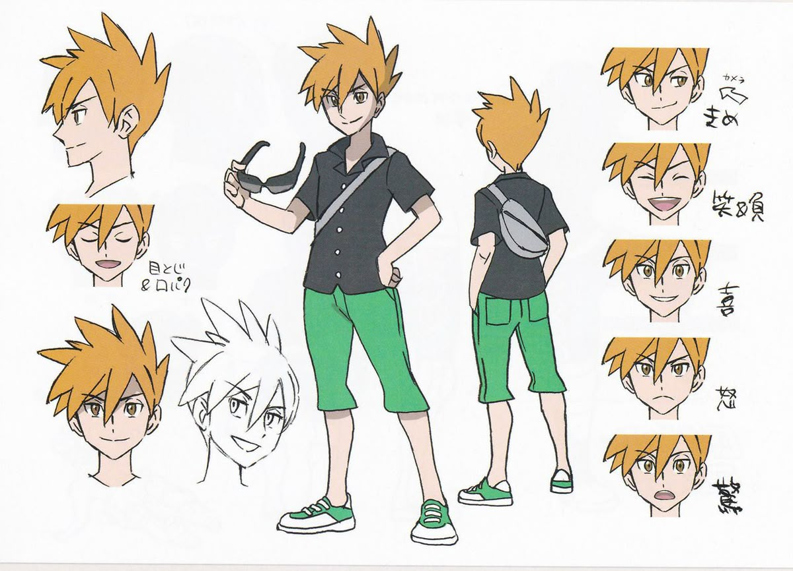

**Origem:** anexo do usuário. Original: `codex-clipboard-ea950bb2-1d37-4d04-a1be-dccb48108e12.png`. Dimensões: 1200 x 866 px.

**Silhueta e proporção.** Cabelo em grandes pontas, camisa de manga curta e bermuda estabelecem uma figura esportiva sem muitos acessórios. A alça diagonal da bolsa desenha o torso e se repete nas costas. Mão na cintura e ombros relaxados dão energia à base simples.

**Cor e hierarquia de valores.** Cabelo amarelo-alaranjado domina o foco; cinza escuro neutraliza o torso e verde ocupa a parte inferior. O calçado recupera o verde sem adicionar uma nova família cromática. A cabeça continua focal mesmo quando o corpo está inteiro na prancha.

**Construção, vistas e acessórios.** Frente/costas esclarecem a bolsa e os bolsos; o objeto na mão é separado do rosto. O cabelo tem contorno com número limitado de pontas principais. Os pequenos recortes de cabeça mostram como a mesma estrutura suporta ângulos distintos.

**Expressão e atuação.** É a folha mais diretamente útil para repertório facial: olhos fechados em sorriso, alegria ampla, neutralidade, irritação e surpresa. Mudam sobrancelha, abertura da mandíbula e olho, mas o volume do crânio, a implantação da orelha e a franja permanecem reconhecíveis.

**Continuidade e custo de animação.** Pontas principais do cabelo precisam de mapa de rotação; não podem trocar de quantidade aleatoriamente. A alça fica presa a ombro e quadril mesmo no braço levantado. Uma expressão de susto não deve aumentar a cabeça inteira nem deslocar a orelha.

**Aplicação original ao PipaKlub.** Usar este princípio na expansão das expressões de Kael e Tyler: figurino legível e atuação rica. Tyler mantém suas mechas brancas específicas; Kael mantém o rosto, cabelo e roupa dos atlas aprovados. Para a animação de diálogo, produzir pares de olhos/boca compatíveis com a mesma cabeça.

**O que não transferir.** Não equiparar cabelo pontudo a personalidade pronta. Não copiar silhueta do penteado ou combinação da roupa. Evitar que cada emoção vire um redesenho de identidade ou que todo rival use a mesma pose de mão na cintura.

**Critérios de revisão.** Sobrepor cabeças das expressões para conferir olhos, orelhas e mandíbula. Aprovar neutro, alegria, irritação, preocupação, surpresa e determinação antes do spritesheet; verificar cada rosto no tamanho de diálogo e no ícone.

#### REF-13 - Canídeo bípede: ameaça pela postura e pelo peso frontal

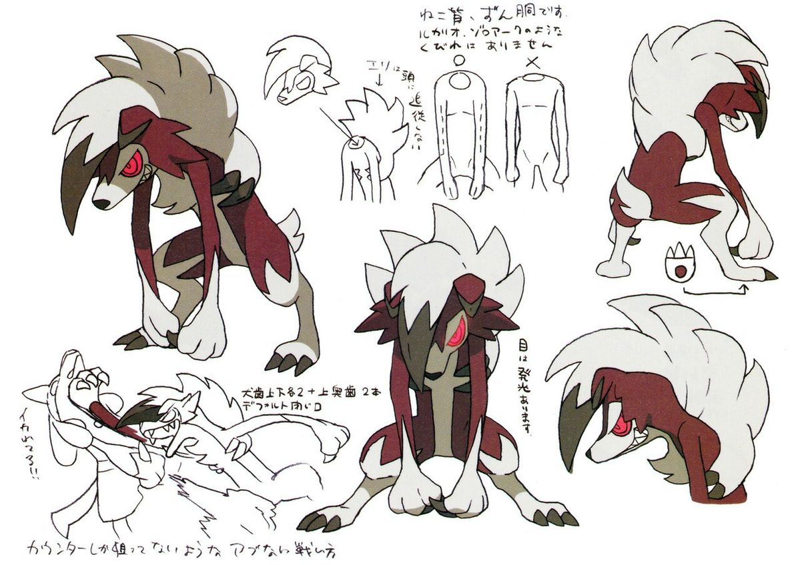

**Origem:** anexo do usuário. Original: `codex-clipboard-391fcf14-4236-4e58-b2ab-687b1fb73613.png`. Dimensões: 1199 x 847 px.

**Silhueta e proporção.** Costas curvadas, cabeça baixa, braços longos e juba arqueada concentram massa à frente. Pernas curtas e mãos grandes diferenciam a criatura de um humano fantasiado. O vão entre braços e corpo sustenta a postura mesmo em preto.

**Cor e hierarquia de valores.** Branco da juba e extremidades contrasta com vermelho escuro no corpo e cinza no focinho. O olho rosa é um foco pequeno de alto contraste. A paleta evita distribuir brilho por toda a criatura; ameaça nasce mais da estrutura que de efeitos.

**Construção, vistas e acessórios.** A prancha compara troncos e aponta diferenças de volume: a curva das costas e o torso compacto são parte do modelo. Frente, costas e perfil de cabeça esclarecem juba, orelha e projeção do focinho. Patas têm massas próprias, não mãos humanas com garras coladas.

**Expressão e atuação.** O olho estreito e a boca com dentes produzem tensão, mas a pose baixa define tanto quanto o rosto. O estudo de interação junto a um humano ajuda a perceber escala relativa; não fornece uma medida universal para Pipamons.

**Continuidade e custo de animação.** A marcha precisa sustentar o peso frontal e evitar alongar o torso para caber em pose padrão. Juba deve acompanhar cabeça/pescoço como massas conectadas. Abaixar a cabeça não pode fazer o focinho atravessar o peito. Ataque pede antecipação, contato e recuperação legíveis.

**Aplicação original ao PipaKlub.** Para uma criatura agressiva de papel, derivar costas arqueadas e ritmo de massa, usando placas dobradas, patas com vincos e rabiola ancorada. Para o tigre dente-de-sabre de Tyler, escolher proporção e personalidade próprias; pétalas podem ser módulos de rabiola conectados por linha, não partículas soltas que substituem a cauda.

**O que não transferir.** Não fazer uma cópia do canídeo com textura de papel. Não usar olho vermelho e garras como única definição de agressividade. Não corrigir pose encurvada esticando artificialmente pescoço e cintura.

**Critérios de revisão.** Aprovar silhueta neutra/ataque/recuperação, base de apoio e ligação entre juba e cabeça. Verificar continuidade da rabiola em todos os frames e leitura dos dentes no tamanho real, sem preencher a boca com ruído.

#### REF-14 - Réptil vegetal: órgão principal transforma a leitura da espécie

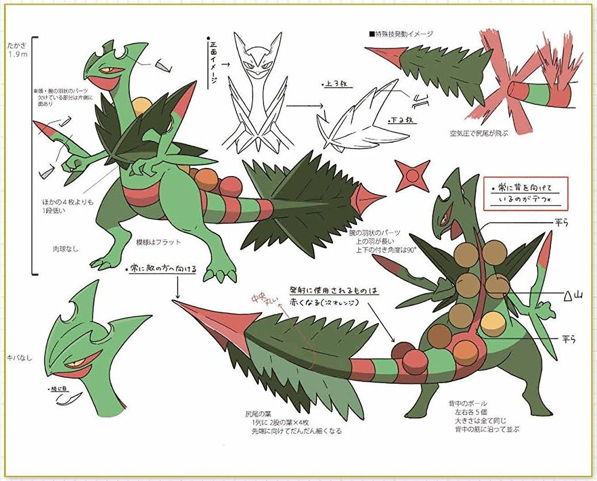

**Origem:** anexo do usuário. Original: `codex-clipboard-b44c815f-31fc-4512-b982-b9e41ca32351.png`. Dimensões: 1038 x 836 px.

**Silhueta e proporção.** Torso estreito, lâminas laterais e cauda enorme criam uma diagonal traseira. A cauda é parte dominante da identidade e não um apêndice genérico. Braços relativamente finos deixam esse órgão e o rosto comandarem a leitura.

**Cor e hierarquia de valores.** Verdes em valores diferentes separam corpo, lâminas e massa traseira. Vermelho reaparece na barriga e em trechos da cauda, enquanto volumes arredondados contrastam com pontas. Repetição de motivo liga as partes sem exigir a mesma geometria em todas elas.

**Construção, vistas e acessórios.** A folha desmonta cauda, lâminas dos braços, vista traseira e um estado de projeção/abertura. O mesmo componente é descrito em repouso e ação. Isso documenta uma mudança de estado visual; não devemos importar uma habilidade só porque o desenho a sugere.

**Expressão e atuação.** A face pequena usa pálpebra baixa e boca longa para comunicar confiança. Mesmo com cauda muito detalhada, o olho continua marcado. As pontas direcionais do corpo orientam a postura e evitam que a criatura pareça simétrica por obrigação.

**Continuidade e custo de animação.** Um órgão tão longo exige célula larga, pivot definido e teste de enquadramento. Não reduzir só o corpo para acomodar a cauda dentro de uma vitrine estreita. A conexão cauda/quadril e a quantidade de módulos precisam permanecer estáveis durante abertura e ataque.

**Aplicação original ao PipaKlub.** Desenhar um Pipamon em torno de uma estrutura de pipa principal: vela posterior, leque ou rabiola de folhas de papel. Dar a ela estado de repouso, tensão e uso da skill, cada um claramente conectado ao corpo. A mecânica e o alcance continuam definidos no sistema de combate, não no tamanho ilustrado.

**O que não transferir.** Não reaproveitar cauda, lâminas e padrão cromático reconhecíveis da espécie. Não somar um leque, chifres e armadura a qualquer monstro para torná-lo raro. Uma grande estrutura deve ter função de composição e construção.

**Critérios de revisão.** Criar diagrama de conexão, vista de cima/trás e três estados do órgão dominante. Testar atlas, portrait, vitrine da Dex e arena sem recorte. Separar área visual da colisão e do alcance efetivo.

#### REF-15 - Combatente aviário: assinatura de ação e materiais contrastantes

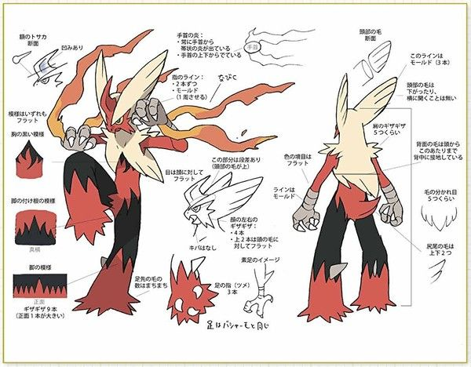

**Origem:** anexo do usuário. Original: `codex-clipboard-0116be6e-b8e8-4050-a565-4a771efc4806.png`. Dimensões: 600 x 468 px.

**Silhueta e proporção.** Pernas muito largas, tronco estreito e crista alongada geram um ritmo de baixo para cima. Braços e mãos ficam preparados para ação; extensões dos punhos direcionam o movimento. O contorno de chute precisa diferir do repouso antes de adicionar fogo.

**Cor e hierarquia de valores.** Vermelho, creme e preto são massas amplas. O preto na parte inferior e pontas recortadas articula o peso das pernas; creme isola cabeça e peito. A energia aparece como prolongamento localizado, não como filtro que ilumina o corpo inteiro.

**Construção, vistas e acessórios.** A folha detalha punho, cabeça, joelho e limites dos recortes de cor. Diferencia superfícies lisas, extensões rígidas e efeito de fogo. O padrão gráfico das pernas segue a peça; não deve escorregar livremente sobre a anatomia.

**Expressão e atuação.** Olho estreito, bico/face angular e punhos elevados concentram intenção de combate. Para produzir personalidade fora da luta, o nosso modelo precisaria também de repouso e curiosidade; esta folha prioriza a construção de ação.

**Continuidade e custo de animação.** Pernas largas exigem espaço negativo em corrida e chute para não virar uma coluna única. A emissão nos punhos tem âncora corporal; a forma do efeito pode variar, mas o ponto de origem não. A pose não deve precisar do brilho para explicar direção de ataque.

**Aplicação original ao PipaKlub.** Para uma espécie veloz, escolher um gesto de combate e um órgão que o comunique: nó de tensão no punho, vela que dobra ou faixa que estala. Desenhar o estado de preparação e recuperação sem partículas primeiro; depois acrescentar efeito que preserve o ponto crítico da linha visível na arena.

**O que não transferir.** Não copiar crista, recortes de pernas ou combinação exata de cores. Não confundir familiaridade marcial com boa leitura em batalha de pipas: silhueta e gesto precisam funcionar na vista realmente usada pelo jogo.

**Critérios de revisão.** Revisar gesto em três poses sem VFX, depois com VFX. Conferir âncoras, cruzamento das pernas e limites do atlas. Uma mudança visual de ataque não altera cooldown ou dano sem implementação separada.

#### REF-16 - Criatura lunar alada: asa como superfície gráfica principal

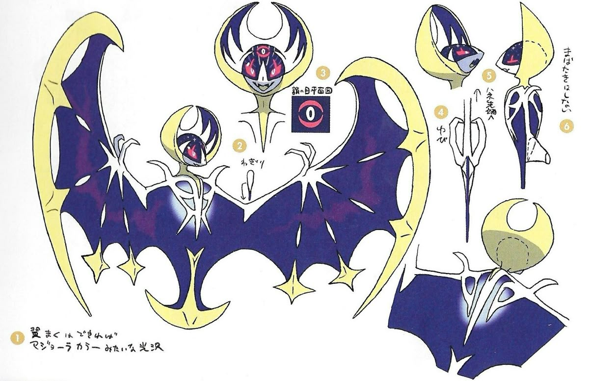

**Origem:** anexo do usuário. Original: `codex-clipboard-30d509c5-2037-44bc-bd0b-51e1a98b829d.png`. Dimensões: 1200 x 777 px.

**Silhueta e proporção.** Asas em crescente dominam quase toda a largura; corpo central é fino e funciona como eixo. A borda clara e os recortes internos fazem a criatura parecer expansiva sem exigir torso grande. A versão recolhida muda drasticamente o contorno, mas mantém cabeça e motivo lunar.

**Cor e hierarquia de valores.** Amarelo pálido envolve campos azul-violeta; branco define estrutura e rosa marca rosto/olho. A área escura grande é respiro para pequenos acentos. Os elementos estrelados não são todos iguais em tamanho ou posição.

**Construção, vistas e acessórios.** A folha inclui frente, perfil, dorso, membrana e posições da cabeça. Mostra espessura e como as asas fecham em volta do eixo. A distribuição gráfica pertence à membrana e deve acompanhar sua deformação. Não é uma estampa de fundo colocada atrás do corpo.

**Expressão e atuação.** O rosto é pequeno diante das asas; olhos e motivo central precisam carregar identidade mesmo quando a criatura está aberta. O olho simbólico maior tem papel gráfico diferente de um olho anatômico comum; isso exige um close separado para evitar interpretação inconsistente.

**Continuidade e custo de animação.** A abertura requer hierarquia de dobras e extremos claros. Ampliar/reduzir uma imagem inteira não simula batimento de asas. A moldura da Dex deve aceitar uma espécie larga sem cortar pontas. O pivot do corpo central continua estável durante a abertura.

**Aplicação original ao PipaKlub.** É a referência mais próxima da lógica de vela: uma espécie pode ser desenhada a partir de membrana de papel tensionada por varetas, com nó central e pequenas rabiolas de equilíbrio. Para os morcegos de Hamelim, reforçar cabeça, orelhas e ritmo próprios; o campo da asa pode levar um grafismo original do universo.

**O que não transferir.** Não reproduzir crescente, constelações e rosto identificáveis como um conjunto. Não converter todas as criaturas voadoras em cópias desta mesma asa. Não preencher as velas com efeitos que escondem as linhas do adversário.

**Critérios de revisão.** Entregar asa aberta, meia abertura, fechada e vista traseira com âncoras. Testar membrana contra céu claro/escuro e fundo da Dex. Conferir nó central, pivôs e continuidade do grafismo entre frames.

#### REF-17 - Felino solar: hierarquia radial e transformação do foco

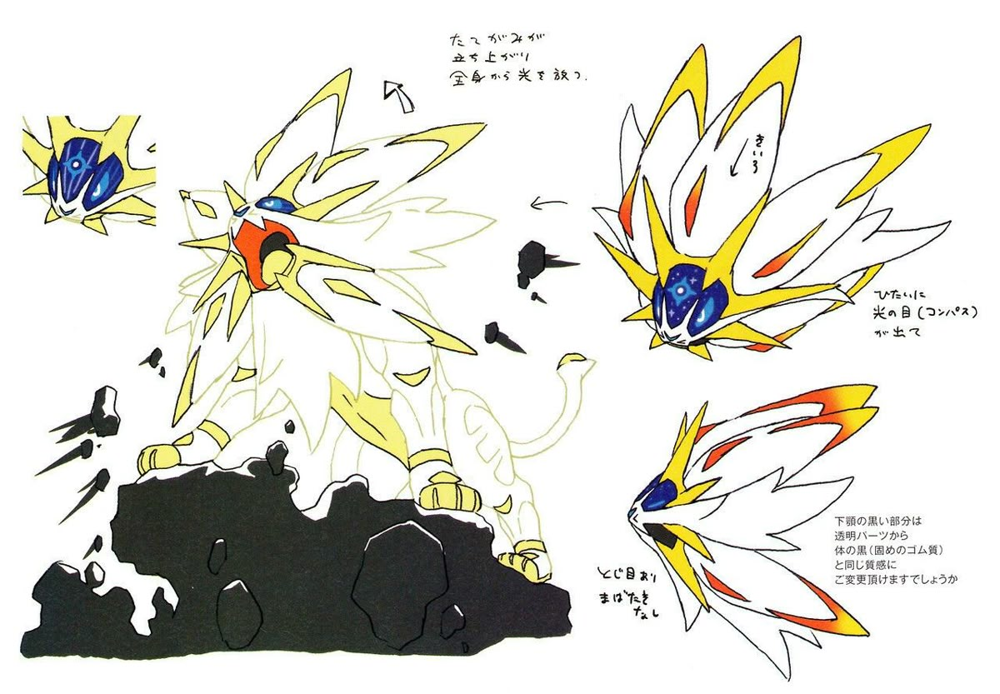

**Origem:** anexo do usuário. Original: `codex-clipboard-aed87d20-4a67-47e0-a935-8a71b5f2d76c.png`. Dimensões: 1200 x 833 px.

**Silhueta e proporção.** Corpo quadrúpede robusto sustenta uma juba radial muito maior que a cabeça. Patas pesadas e cauda fina equilibram o foco frontal. As pontas da juba têm hierarquia: poucas principais, grupos secundários menores e um rosto central preservado.

**Cor e hierarquia de valores.** Branco domina a área; amarelo contorna grupos de pontas, vermelho-alaranjado aparece em intervalos e azul escuro concentra o foco na testa/rosto. O contraste mais forte está onde o olhar deve parar. A prancha também mostra um estado mais luminoso; não é evidência de que brilho permanente melhore legibilidade.

**Construção, vistas e acessórios.** Frente, perfil e cabeça aberta explicam como as pontas se sobrepõem. O focinho continua volumétrico apesar do grafismo radial. O detalhe azul não substitui olhos, mandíbula e implantação das orelhas. A criatura apoia o peso no terreno, não flutua por causa da luz.

**Expressão e atuação.** Rugido, perfil calmo e face frontal mudam o estado sem redesenhar toda a juba. A abertura da boca precisa de volume interno e linha de mandíbula. As pontas podem acentuar energia, mas não precisam mudar de quantidade em cada emoção.

**Continuidade e custo de animação.** Massa radial enorme tende a vibrar quando cada ponta é redesenhada livremente. Agrupar mechas e definir sobreposição reduz instabilidade. O corpo branco precisa de contraste em fundo claro. Aura e partículas de level não devem apagar olhos nem transformar o desenho base em outro personagem.

**Aplicação original ao PipaKlub.** No tigre dente-de-sabre com cerejeira, manter a espécie por focinho, presas e postura; concentrar pétalas em uma rabiola física coerente e talvez um pequeno ritmo de crina, sem coroar todo o corpo. Usar uma região focal no rosto e reservar emissão aos estados previstos pelo jogo.

**O que não transferir.** Não copiar a juba solar, marca facial ou estado cósmico. Não fazer cada Pipamon especial depender de ouro, sino e coroa. Raridade não significa maximizar pontas, partículas ou tamanho em todas as direções.

**Critérios de revisão.** Mostrar corpo sem aura e cabeça sem rugido; ambos devem funcionar. Fixar grupos principais da juba, contato dos pés e rabiola. Testar os brilhos dos marcos de level sobre a mesma identidade e com redução de movimento.

#### REF-18 - Dragão alongado: curvas amigáveis e mudança de temperamento

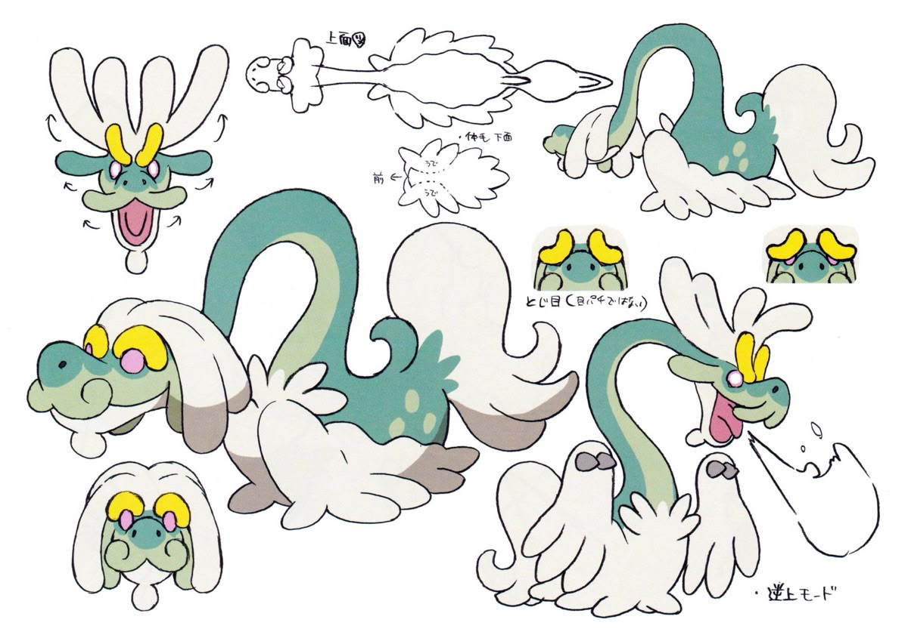

**Origem:** anexo do usuário. Original: `codex-clipboard-f670d6df-e484-4c7a-8b09-0487b55517dc.png`. Dimensões: 1200 x 841 px.

**Silhueta e proporção.** Pescoço muito longo em arco, corpo baixo, tufos arredondados e cauda enrolada geram um ritmo macio e serpentino. As patas pequenas sustentam a massa inferior, enquanto cabeça e pescoço ocupam o topo. O corpo não é apenas uma serpente com quatro pés desenhados ao acaso.

**Cor e hierarquia de valores.** Verde azulado e creme formam as duas massas dominantes; amarelo marca sobrancelhas/chifres e rosa concentra olho e boca. Valores próximos deixam a transição suave, enquanto o contorno mantém separação. Poucos pontos circulares não cobrem toda a superfície.

**Construção, vistas e acessórios.** A folha apresenta vista superior, corpo posterior, cabeça frontal e estados de olhos/boca. Os tufos seguem regiões específicas: cabeça, peito, patas e cauda. O pescoço nasce do tronco em um ponto definido, mesmo quando a curva muda.

**Expressão e atuação.** A transição de rosto dócil para boca aberta e sobrancelha tensa altera a leitura sem trocar paleta ou anatomia. Mudança de temperamento é mostrada como estado; não permite afirmar regras de transformação do PipaKlub. A posição das sobrancelhas ajuda a atuação em miniatura.

**Continuidade e custo de animação.** Curvas longas exigem controle de comprimento e espessura; o pescoço não pode esticar a cada pose. As patas e o torso precisam de apoio consistente durante reação e ataque. Tufos não devem se separar em ilhas soltas nem encobrir a conexão cauda/corpo.

**Aplicação original ao PipaKlub.** Um Pipamon guardião pode alternar acolhimento e defesa por sobrancelha, abertura das velas e tensão da rabiola. Traduzir tufos para bordas dobradas ou franjas de papel com volume limitado; construir o pescoço com segmentos claros em vez de uma fita que muda de comprimento.

**O que não transferir.** Não copiar corpo, rosto e tufos reconhecíveis em conjunto. Não infantilizar todas as criaturas amigáveis com a mesma cabeça redonda. Não usar um estado bravo como desculpa para trocar a identidade inteira ou inventar outra espécie.

**Critérios de revisão.** Entregar repouso dócil, alerta, ataque e recuperação com comprimento do pescoço estável. Conferir vista superior e traseira, posição das patas e conexão de tufos. Testar se a emoção é compreensível em preto e branco e sem partículas.

### Aplicações propostas para o elenco

#### Kael e Tyler: protagonistas com identidades separadas

Kael usa o atlas aprovado como referência de identidade, não o figurino de nenhuma folha deste acervo. Tyler é filho do Sr. Assis e tem mechas brancas: fixar forma, posição e quantidade visual dessas mechas. Propor gestos e distribuição de massa diferentes para os dois. A semelhança familiar pode vir de uma atitude ou pequeno detalhe, sem fazê-los recolorizações.

#### Sr. Assis: reconhecimento antes do detalhe

Homem de 45 anos, sem barba, cabelo preto com fios brancos, óculos de aviação na testa, jaleco com crachá, polo azul e calça marrom. Esse contrato vem do projeto. No chibi, rosto, jaleco e óculos dominam; o texto do crachá não precisa ser legível. Usar as referências para estudar camadas e gestos de professor, sem substituir sua roupa.

#### Rivais e moradores do Morro

Partir dos designs atuais de Zeca, Bia, Juninho, Lia e Tião. Antes de redesenhar, montar uma comparação lado a lado de silhueta, gesto, paleta e função no bairro. Alterações que mudem rosto/roupa exigem uma proposta explícita; este benchmark não aprova mudanças silenciosas no elenco. NPCs de trabalho têm objeto, pega e rotina próprios.

#### Tigre de Tyler: presas e rabiola de cerejeira

A espécie deve ser lida por quadrupedia, focinho, presas e distribuição de peso, não por coroas e joias. Definir uma rabiola com módulos de pétalas presos a linha contínua, ponto de origem no corpo e ritmo de vento. Separar cauda corporal de rabiola se ambas existirem. Tirar partículas e ainda reconhecer o Pipamon é um critério de aceitação.

#### Ornitorrinco do antagonista: astúcia observável

Manter bico, cauda achatada e corpo do ornitorrinco como prioridades. Atitude astuta pode aparecer no centro de gravidade, olhar lateral e proteção de um objeto, sem estereotipar morador, roupa periférica ou tom de pele como criminalidade. Integrar membranas/placas de papel à anatomia e definir o repouso além da pose de ataque.

#### Morcegos de Hamelim: família, variação e voo

Usar o design aprovado de Flautrevo e o contexto narrativo já existente. Agrupar membranas em superfícies legíveis, manter cabeça e orelhas próprias e documentar varetas/pivôs. Variações de grupo podem vir de tamanho e ritmo, sem fabricar espécies novas por geração aleatória. A REF-16 ensina abertura de superfície, não um desenho de asa a copiar.

### Contrato de próxima produção

#### 1. Briefing e identidade

Nome/ID, papel narrativo, traços aprovados, referência de identidade e referência técnica separadas. Para existente, apontar atlas/manifesto consumidor; para novo, registrar o que ainda é proposta.

#### 2. Exploração de forma

Comparar poucas alternativas de silhueta antes do acabamento. Proposta: três direções com a mesma função; escolher a mais legível e justificar. Não é obrigatório entregar três se o usuário já aprovou um conceito.

#### 3. Modelo de construção

Frente, três quartos, perfil e costas conforme as vistas usadas; volumes e linha de apoio comuns; acessórios isolados e lados marcados. Criatura inclui diagrama de rabiola, membrana ou outro órgão dominante.

#### 4. Atuação e estados

Humanos: neutro, alegria, preocupação, irritação, surpresa e determinação como repertório inicial proposto. Criaturas: repouso, alerta, antecipação, ação, recuperação e dano conforme animações reais do consumidor.

#### 5. Redução para jogo

Fazer provas de retrato, corpo inteiro e overworld na escala vigente. Separar microdetalhes de história dos sinais que sobrevivem no chibi. Não inventar uma célula universal de 64 ou 128 px sem consultar os atlas atuais.

#### 6. Atlas e inspeção

Dimensões, alpha, frames, duração, pivô, margens, orientação, filtro e nomes vêm do consumidor. Conferir animação sobre cenário real, cauda contínua e ausência de recorte. Prancha estática não aprova movimento.

#### 7. Integração e registro

Registrar arquivo, origem, revisão, status artístico/técnico, consumidor e screenshot. Separar aprovado, integrado localmente e publicado. Nenhum novo design deste capítulo foi gerado ou integrado ao game.

### Ficha de auditoria

#### Identidade e silhueta

Reconhecível sem cor, objeto ou aura; distinto dos vizinhos do elenco.

#### Proporção e volume

Mesmas massas, comprimento e apoio entre vistas e poses.

#### Cor e leitura

Foco facial e valores funcionam sobre o fundo de uso.

#### Construção

Lados, conexões, camadas e materiais inequívocos.

#### Atuação

Emoções/ações compreensíveis sem trocar a identidade.

#### Originalidade

Princípio reinterpretado; ausência de combinação reconhecível copiada.

#### Contrato técnico

Tamanho, alpha, pivô, tempos e nomes conferidos com o consumidor.

#### Uso real

Retrato, vitrine, overworld ou arena inspecionados conforme o destino.

A ficha usa os estados pendente, revisar ou aprovado com evidência. Não há pontuação automática: cauda desconectada, identidade trocada, alpha inadequado ou recorte de partes necessárias impedem aprovação técnica, mesmo que a ilustração seja bonita. As recomendações não concedem personagens, itens, skills ou raridades ao jogador.

### Encaminhamento

Consultar este capítulo junto do `MANUAL-DE-ASSETS.md` e da skill local `pipaklub-production`. Usar a prancha aprovada do próprio personagem como referência de identidade. Este estudo orienta futuras criações; não substitui o modelo vigente nem aprova redesenhos automaticamente.
