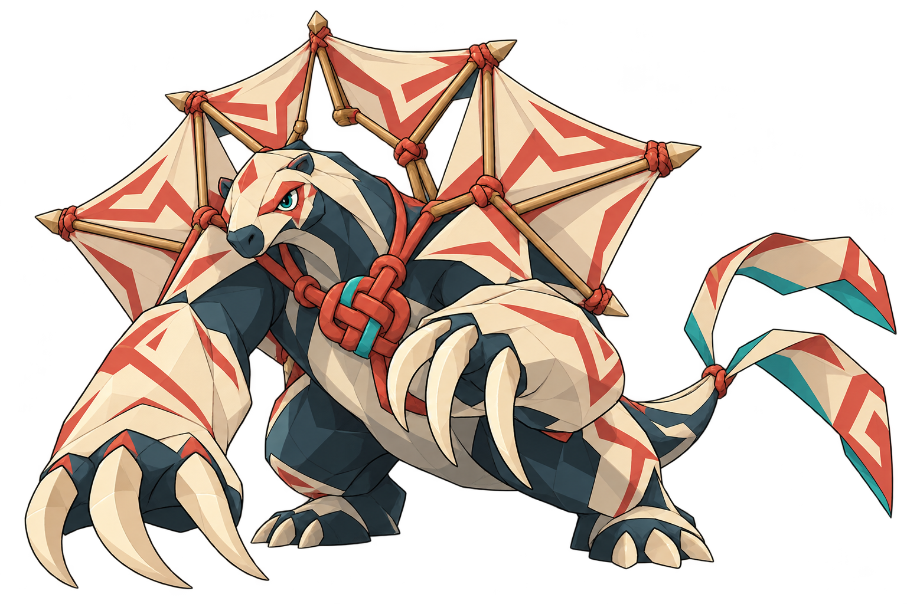

# Eremor — O Elo Sepultado

**Soulmonsters: Elo das Ruínas · Conceito v1 · 21/10/2026**

Nome e história propostos, sujeitos à aprovação. Imagem de conceito para o boss central e criatura de destaque da capa; não é uma capa final, spritesheet ou personagem integrado.

## A ideia

Uma besta ancestral inspirada na preguiça-gigante **Eremotherium**, representante da megafauna extinta com registros no território brasileiro. A base foi conferida no [Museu Nacional/UFRJ](https://www.museunacional.ufrj.br/dir/exposicoes/paleontologia/pale033.html) e no [guia de preguiças-gigantes](https://museunacional.ufrj.br/guiaMN/Guia/paginas/2/12preguica.htm). Não é uma espécie exclusiva do Brasil. A imagem é fantasia original, não uma reconstrução paleontológica; velas, marcas, cores e nó não são características atribuídas ao animal real.

**Frase de apresentação:** “Antes das ruínas, já existia um elo.”

Eremor transmite força antiga e intenção. Sua expressão é vigilante; não depende de rugido, violência ou excesso de partículas para parecer poderoso. Ao vê-lo, o jogador deve perceber uma criatura capaz de erguer o próprio lugar onde está.

O nome de trabalho combina a referência a Eremotherium com uma sonoridade grave e curta. Não é apresentado como palavra indígena nem tradução de uma língua real.

## Três assinaturas de design

1. **Braços e garras de fundação.** Antebraços enormes e três garras curvas por mão. As garras lembram varetas tensionadas; o peso do corpo sustenta a ameaça antes do efeito de ataque. A postura baixa também permite que ele se erga sem mudar de anatomia.
2. **Velas de portal.** Cinco grandes segmentos dorsais, com papel claro, varetas e conexões visíveis. Sua abertura enquadra a cabeça como um portal ancestral. São parte da anatomia; as dobras do corpo e dos membros repetem a mesma construção de pipa. A próxima ficha deve esclarecer os pontos de inserção em perfil e costas, para impedir que a estrutura pareça uma mochila colocada sobre um animal.
3. **Nó do Elo.** Grande nó entrelaçado no peito, em terracota, com pequeno acento turquesa. É o ponto proposto de conexão da linha que manifesta a criatura. O brilho deve destacar a conexão, sem apagar sua construção física.

Os dois segmentos largos de rabiola continuam ligados à cauda e repetem as cores das velas. Não são asas soltas nem fitas flutuantes sem origem.

## Paleta e acabamento

- Marfim envelhecido: grandes massas de papel e garras.
- Azul-petróleo / ardósia: corpo e separação entre volumes.
- Terracota: nó, amarrações e poucos grafismos grandes.
- Turquesa: olhar e pequeno sinal do Elo.

Essa distribuição é uma proposta de cor, sem amostragem HEX definitiva. Os grafismos são geométricos ficcionais; não lhes atribuir origem em povo ou cultura real por suposição.

O acabamento buscado é anime 2D de aventura: linha controlada, massas grandes e sombra em planos. A primeira imagem ainda possui facetas internas no corpo e nas garras; revisar sua redução numa futura prancha de modelo para aproximar do padrão mais simples do jogo. Poder e antiguidade não exigem textura realista, uma armadura metálica ou dezenas de cristais.

## Por que serve como criatura de capa

A silhueta tem largura e peso na base, uma cabeça relativamente pequena e um grande gesto dorsal reconhecível. As garras criam direção no primeiro plano; o nó oferece o ponto de maior interesse narrativo. A combinação permite uma leitura de lendário sem depender de ouro, coroa ou auréola.

Na futura composição de capa, reservar espaço para o título e usar as velas para enquadrar o encontro entre criatura e protagonista. Uma linha humana chegando ao nó pode conectar os dois focos. A capa deve mostrar relação e escala; a imagem atual isola o design para avaliá-lo antes de criar cenário e tipografia.

## Proposta de história — ficção do projeto

Eremor guardava o primeiro vínculo daquela região. Quando a antiga cidade perdeu esse elo, ele fechou suas velas e permaneceu sob o lugar que havia jurado proteger. Com o tempo, pedra e história encobriram o guardião.

Quem explora as ruínas acredita ter encontrado uma besta aprisionada. O conflito revela outra possibilidade: ele permaneceu ali para impedir que o vínculo se rompesse por completo. O confronto testa se o protagonista entende o que está tentando despertar.

“Elo Sepultado” designa a memória preservada por ele; não define maldade ou corrupção. A decisão final de roteiro ainda não foi tomada.

**Nota proposta de Assis:** “Ruínas são o que sobra quando esquecemos para que construímos. Ele parece não ter esquecido.”

## Ideias para o confronto — não implementadas

- Garras marcam direções de tensão no chão e na arena, anunciadas antes da ação.
- Velas recolhidas indicam defesa; a abertura revela o percurso da linha até o nó.
- O jogador precisa ler esse percurso e encontrar a janela do Elo, em vez de atacar continuamente.
- A ação final pode representar estabilizar o vínculo, conforme o roteiro escolhido.

Não há atributos, drops, aquisição, raridade de banco, condições de captura ou fases implementadas por esta ficha.

## Próxima passagem de produção

Validar primeiro animal-base, silhueta, rosto e paleta com o responsável pelo jogo. Depois produzir frente/perfil/costas, detalhe das inserções das velas, conexão da linha, corpo com velas fechadas e abertas e expressão neutra/alerta/confronto. Só então derivar capa, sprite de combate e versão de overworld.

O arco incompleto foi uma intenção do briefing; a primeira imagem resultou em um leque contínuo de velas, com abertura abaixo do segmento superior. Decidir na revisão se mantemos esse leque ou tornamos a interrupção do arco mais explícita. Não tratar a imagem como cinco vistas tecnicamente resolvidas de uma criatura animada.

## Registro da geração

Ferramenta: image_gen integrada. Prompt integral em `prompt.txt`. Referências: Hiponilo do projeto para material e conexões de pipa; REF-17 do benchmark para estudo de silhueta e desenho em planos de uma criatura lendária. Essas referências não definem a espécie de Eremor. A autoria editorial individual da referência externa não foi verificada.

PNG de conceito 1536×1024, RGBA. Alpha medido de 0 a 254; recorte do primeiro plano acima do limiar 32 em (41, 17)–(1519, 999). Preservado sem alteração dos pixels gerados. Essa medição confirma dimensões e presença de transparência, não aprova anatomia ou animação.

Estado: **conceito em revisão**, sem integração nem publicação.
