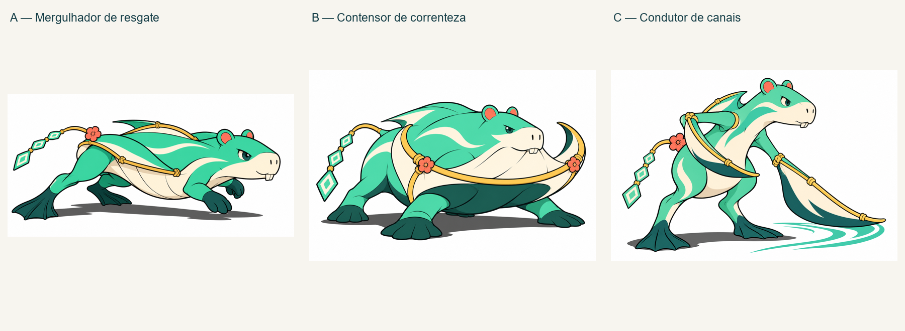

# Piloto de evolução jovem do Capiboia

Três alternativas de aplicação do benchmark Ultimate/Mega; não são três rotas canônicas já decididas. Preserva chart existente e Capibaluarte aprovado.

- [A: mergulhador de resgate](a-mergulhador/concept.png): propulsão traseira, corpo horizontal, custo proposto de menor estabilidade parado.
- [B: contensor de correnteza](b-quebra-corrente/concept.png): peito quebra-mar e base larga; custo proposto de manobra lenta. Recomendado para aprofundar pela clareza funcional.
- [C: condutor de canais](c-condutor/concept.png): postura semiereta e membros-remo, precisão em troca de velocidade; precisa integrar melhor antebraço e membrana.

Cada pasta conserva brief, prompt, revisão e manifesto. Apenas concepts estáticos, sem mudança no jogo. Artes geradas pela ferramenta integrada; só a arte autoral da criança entrou como input.

## Alternativas jovens aprovadas — 2026-11-04

Autor: “Gosto de B e C useos como evos alternativas”.

Capiboia → **B — Contensor de correnteza** ou **C — Condutor de canais**, além da Remansa já proposta. B e C são evoluções alternativas de estágio jovem (III Arraia), não sequência uma da outra. Descrições são rótulos de trabalho, não nomes definitivos. Marévia e Capibaluarte permanecem preservados; nenhuma ligação automática deles com B/C foi aprovada. Requisitos, números e habilidades não foram definidos.

A alternativa A permanece estudo não selecionado. Aprovação visual e de ramificação não equivale a rig, animação ou integração.
