# Mapa-múndi — Soulmonsters: Elo das Ruínas

**Fase 0 · PROPOSTA PARA APROVAÇÃO · 29/10/2026**

Este é um plano espacial, não um mapa já implementado. Nenhuma planta, regra, save ou asset do jogo foi alterado. Nomes, ordem dos bairros novos, biomas, portões e dimensões estimadas são propostas. IDs existentes permanecem intactos. As conexões atuais foram lidas dos TMJ; ligações novas têm estado explícito no JSON anexo.

**Atualização regional:** a Fase 0 foi sucedida pelo lote de plantas do Parque A/B/C em `art/overworld/briefs/parque-dos-ventos-abc.md`. As dimensões existentes da tabela são lidas das plantas atuais. A nova regra de regiões com pelo menos três partes está em `art/overworld/REGIOES-E-PARTES.md`; o desdobramento de Caverna, Coração e demais regiões futuras ainda exige revisão do mapa-múndi. A frase anterior descreve o escopo original da Fase 0, não nega as alterações de planta posteriores.

## Decisão mais recente do criador

“Preservar a missão mas deixar ela mais profunda também.” Nina e Lacertubo continuam na primeira excursão da demo, antes de exigir três bairros concluídos. A missão recebe preparação emocional, rastros e escolhas de exploração. Conteúdo profundo das Ruínas abre depois. Os acontecimentos novos descritos abaixo são propostas de execução dessa decisão, não falas ou eventos já aprovados.

## Fontes e divergências

- História consultada sem merge: `origin/claude/historia`, commit `18dec6b87808a45ec23853ff4eb526c37a331b9a`, arquivo `documentation/historia/BIBLIA-DA-HISTORIA.md` (v1). Seus rótulos Decidido/Canônico/Proposta permanecem válidos; a estrutura dos capítulos é proposta.
- Contratos locais: AGENTS.md, continuidade-terreno-isometrico.md, ESPECIFICACAO-MAPAS.md, INVENTARIO-CODEX.md, estilo/README.md, WORLD-ART-DIRECTION.md e WORLD-EXPLORATION.md. O roteiro de Tyler continua marcado como proposta de one-shot; o mural não prova sozinho uma cosmologia definitiva.
- A bíblia sugere Jardim/Clareira/Veredas após bairros 1/2/3. A decisão acima prevalece: acesso inicial preservado; cenas tardias e passagens profundas ficam separadas do primeiro percurso. Nada disso foi aplicado ao jogo nesta entrega.
- Guia `documentation/overworld/godot-tilesets-profundidade.md` e os kits extensos existem na branch de história, mas não nesta árvore de trabalho. Aqui há kits `comum` e `morro`; os demais exigem integração e conferência antes de serem considerados disponíveis. O guia remoto foi consultado, sem alterar o motor.
- Inventário gerado lista nove áreas; há também `veredas-piloto.tmj`, sem `cena_jogo`. É laboratório de validação, não décima área de campanha. Não foi apagado nem renomeado.
- Documentos antigos citam campanha conectada e mapas como imagem única. A decisão posterior de Godot com campanha offline e a produção modular prevalecem. A linguagem é mangá 2D, cores planas e uma sombra por material; não maquete 3D.
- Beira-Mar e Campanários já existem como Trilhas/identidades legadas (designs.json e CAMPANHA-CIDADE.md). Propõe-se aproveitá-las nos bairros 2/3; isso não migra nem renomeia os IDs das Trilhas, nem confirma seus campeões nesta expansão.

## Leitura do mundo

Uma espinha urbana avança pelos 12 bairros. O parque é um ramo acessível cedo que vai ganhando profundidade, com voltas por atalhos. Bairro não precisa virar um corredor: eixo seguro, ruas em laço, arena lateral e travessia natural compõem cada conjunto. O diagrama é topológico; posições não fixam distância nem orientação geográfica final.

```mermaid
flowchart LR
  R[Rua dos Ventos] --- M[B1 Morro do Sol]
  M -->|Mikka| B2[B2 Beira-Mar]
  B2 --> B3[B3 Campanários]
  B3 --> B4[B4 Feira das Fitas]
  B4 --> B5[B5 Vila das Oficinas]
  B5 --> B6[B6 Canais da Argila]
  B6 --> B7[B7 Lagoa do Junco]
  B7 --> B8[B8 Serra do Apito]
  B8 --> B9[B9 Buritizal]
  B9 --> B10[B10 Pedra Bordada]
  B10 --> B11[B11 Alto dos Varais]
  B11 --> B12[B12 Nascente do Vento]
  R --- J[Jardim das Pipas]
  J --- C[Clareira do Papel]
  C --- V[Veredas: Nina e Lacertubo]
  V -->|B3| G[Galeria dos Apitos]
  G -->|B4| CM[Caverna do Mural]
  CM -->|B11| CC[Caminho dos Canais Antigos]
  B11 -->|atalho após vitória| CC
  CC --- H[Coração: investigação B11]
  H -->|B12 e Rato derrotado| S[Santuário do Lendário]
  B12 -->|Rato derrotado| S
  S -->|lendário derrotado| E[Estádio: Jamile]
  B6 -. atalho de retorno .-> R
  B10 -. atalho de retorno .-> R
```

Setas urbanas exigem vencer o campeão anterior, não simplesmente chegar à área. O combate de Rato ocorre somente depois dos 12 bairros, embora a investigação do Coração possa abrir no 11. Retornos são bidirecionais após abertura. Arestas completas, condições e IDs estão no JSON; cada conjunto urbano se expande em eixo, ruas, arena e travessia na tabela.

## Catálogo de áreas

Trajetória 1 = campeonato; 2 = família/Ruínas. “Encontros” significa encontro aleatório: **somente no mato**. Duelos de capangas, campeões, boss e eventos não são encontros aleatórios. Praças, descansos, Nina e rampas de transição são seguros. Dimensões são células 64×32; cada arquivo fica abaixo de 96×96.

| id | nome | trajetória | bioma | libera_apos | conecta_com | função na história | encontros | tamanho estimado | estado |
|---|---|---|---|---|---|---|---|---|---|
| rua-dos-ventos | Rua dos Ventos | ambas | Bairro inicial | primeira criação com Assis | morro-praca-da-chegada, jardim-das-pipas, canais-da-argila-eixo, pedra-bordada-eixo | Base de preparação; portas de casa, ateliê e loja | não | 44×33 | EXISTENTE; papel futuro em proposta |
| morro-praca-da-chegada | Praça da Chegada | 1 | Morro do Sol | acesso ao Morro | morro-escadaria-da-sombra, rua-dos-ventos | Entrada do circuito; Zeca | não | 24×16 | EXISTENTE; papel futuro em proposta |
| morro-escadaria-da-sombra | Escadaria da Sombra | 1 | Morro do Sol | acesso ao Morro | morro-praca-da-chegada, morro-laje-dos-ventos | Bia; pausa e subida | não | 24×16 | EXISTENTE; papel futuro em proposta |
| morro-laje-dos-ventos | Laje dos Ventos | 1 | Morro do Sol | acesso ao Morro | morro-escadaria-da-sombra, morro-mirante-da-caixa-dagua | Juninho e Lia; treino de leitura do vento | não | 24×16 | EXISTENTE; papel futuro em proposta |
| morro-mirante-da-caixa-dagua | Mirante da Caixa-d’água | 1 | Morro do Sol | acesso ao Morro | morro-laje-dos-ventos, morro-parque-dos-ventos | Tião; antecipar visualmente o parque | não | 24×16 | EXISTENTE; papel futuro em proposta |
| morro-parque-dos-ventos | Parque dos Ventos · Morro | 1 | Morro do Sol | acesso ao Morro; duelo de Mikka conforme qualificação | morro-mirante-da-caixa-dagua, beira-mar-eixo | Fecho do bairro 1; marco do coreto | não | 24×16 | EXISTENTE; papel futuro em proposta |
| jardim-das-pipas | Jardim das Pipas | ambas | Parque dos Ventos | início da missão de Nina; sem exigir três bairros | rua-dos-ventos, clareira-do-papel | Ouvir Nina, estabelecer o vínculo com Carcará e seguir rastros | sim, somente no mato | 60×44 | EXISTENTE; papel futuro em proposta |
| clareira-do-papel | Clareira do Papel | ambas | Parque dos Ventos | seguir a busca de Nina | jardim-das-pipas, veredas-do-encanamento | Escolha entre trilha segura e exploração; descanso antes das Veredas | sim, somente no mato | 64×48 | EXISTENTE; papel futuro em proposta |
| veredas-do-encanamento | Veredas do Encanamento | ambas | Vereda e arenito | busca de Nina; acesso profundo separado após bairro 3 | clareira-do-papel, galeria-dos-apitos | Lacertubo, recuperação de Carcará e primeira entrada vedada das Ruínas | sim, somente no mato | 64×48 | EXISTENTE; papel futuro em proposta |
| beira-mar-eixo | Beira-Mar · eixo central | ambas | Cais, restinga e vila de pescadores | vitória permanente no bairro 1 | morro-parque-dos-ventos, beira-mar-ruas, beira-mar-travessia | Entrada segura, descanso e primeiro capanga; marco: Farol baixo | não | 40×32 | PROPOSTA |
| beira-mar-ruas | Beira-Mar · ruas | 1 | Cais, restinga e vila de pescadores | vitória permanente no bairro 1 | beira-mar-eixo, beira-mar-arena | Outros três capangas, laço opcional com baú e retorno curto ao eixo | não | 48×40 | PROPOSTA |
| beira-mar-arena | Beira-Mar · arena | 1 | Cais, restinga e vila de pescadores | vitória permanente no bairro 1; desafio do campeão após quatro qualificações | beira-mar-ruas | Campeão ainda sem nome aprovado; arena no ponto simbólico | não | 32×28 | PROPOSTA |
| beira-mar-travessia | Beira-Mar · travessia natural | ambas | Cais, restinga e vila de pescadores | vitória no bairro 2; retorno preservado após abertura | beira-mar-eixo, campanarios-eixo | Ligação ao próximo bairro, mato contornável e atalho de retorno | sim, somente no mato | 48×36 | PROPOSTA |
| campanarios-eixo | Campanários · eixo central | ambas | Colina histórica e jardins de igreja | vitória permanente no bairro 2 | beira-mar-travessia, campanarios-ruas, campanarios-travessia | Entrada segura, descanso e primeiro capanga; marco: Torre dos sinos | não | 40×32 | PROPOSTA |
| campanarios-ruas | Campanários · ruas | 1 | Colina histórica e jardins de igreja | vitória permanente no bairro 2 | campanarios-eixo, campanarios-arena | Outros três capangas, laço opcional com baú e retorno curto ao eixo | não | 48×40 | PROPOSTA |
| campanarios-arena | Campanários · arena | 1 | Colina histórica e jardins de igreja | vitória permanente no bairro 2; desafio do campeão após quatro qualificações | campanarios-ruas | Campeão ainda sem nome aprovado; arena no ponto simbólico | não | 32×28 | PROPOSTA |
| campanarios-travessia | Campanários · travessia natural | ambas | Colina histórica e jardins de igreja | vitória no bairro 3; retorno preservado após abertura | campanarios-eixo, feira-das-fitas-eixo | Ligação ao próximo bairro, mato contornável e atalho de retorno | sim, somente no mato | 48×36 | PROPOSTA |
| feira-das-fitas-eixo | Feira das Fitas · eixo central | ambas | Mercado aberto e pomares de quintal | vitória permanente no bairro 3 | campanarios-travessia, feira-das-fitas-ruas, feira-das-fitas-travessia | Entrada segura, descanso e primeiro capanga; marco: Cobertura de feira | não | 40×32 | PROPOSTA |
| feira-das-fitas-ruas | Feira das Fitas · ruas | 1 | Mercado aberto e pomares de quintal | vitória permanente no bairro 3 | feira-das-fitas-eixo, feira-das-fitas-arena | Outros três capangas, laço opcional com baú e retorno curto ao eixo | não | 48×40 | PROPOSTA |
| feira-das-fitas-arena | Feira das Fitas · arena | 1 | Mercado aberto e pomares de quintal | vitória permanente no bairro 3; desafio do campeão após quatro qualificações | feira-das-fitas-ruas | Campeão ainda sem nome aprovado; arena no ponto simbólico | não | 32×28 | PROPOSTA |
| feira-das-fitas-travessia | Feira das Fitas · travessia natural | ambas | Mercado aberto e pomares de quintal | vitória no bairro 4; retorno preservado após abertura | feira-das-fitas-eixo, vila-das-oficinas-eixo | Ligação ao próximo bairro, mato contornável e atalho de retorno | sim, somente no mato | 48×36 | PROPOSTA |
| vila-das-oficinas-eixo | Vila das Oficinas · eixo central | ambas | Vila operária e galpões artesanais | vitória permanente no bairro 4 | feira-das-fitas-travessia, vila-das-oficinas-ruas, vila-das-oficinas-travessia | Entrada segura, descanso e primeiro capanga; marco: Chaminé desativada | não | 40×32 | PROPOSTA |
| vila-das-oficinas-ruas | Vila das Oficinas · ruas | 1 | Vila operária e galpões artesanais | vitória permanente no bairro 4 | vila-das-oficinas-eixo, vila-das-oficinas-arena | Outros três capangas, laço opcional com baú e retorno curto ao eixo | não | 48×40 | PROPOSTA |
| vila-das-oficinas-arena | Vila das Oficinas · arena | 1 | Vila operária e galpões artesanais | vitória permanente no bairro 4; desafio do campeão após quatro qualificações | vila-das-oficinas-ruas | Campeão ainda sem nome aprovado; arena no ponto simbólico | não | 32×28 | PROPOSTA |
| vila-das-oficinas-travessia | Vila das Oficinas · travessia natural | ambas | Vila operária e galpões artesanais | vitória no bairro 5; retorno preservado após abertura | vila-das-oficinas-eixo, canais-da-argila-eixo | Ligação ao próximo bairro, mato contornável e atalho de retorno | sim, somente no mato | 48×36 | PROPOSTA |
| canais-da-argila-eixo | Canais da Argila · eixo central | ambas | Olarias e canais rasos de barro | vitória permanente no bairro 5 | vila-das-oficinas-travessia, canais-da-argila-ruas, canais-da-argila-travessia, rua-dos-ventos | Entrada segura, descanso e primeiro capanga; marco: Roda de água | não | 40×32 | PROPOSTA |
| canais-da-argila-ruas | Canais da Argila · ruas | 1 | Olarias e canais rasos de barro | vitória permanente no bairro 5 | canais-da-argila-eixo, canais-da-argila-arena | Outros três capangas, laço opcional com baú e retorno curto ao eixo | não | 48×40 | PROPOSTA |
| canais-da-argila-arena | Canais da Argila · arena | 1 | Olarias e canais rasos de barro | vitória permanente no bairro 5; desafio do campeão após quatro qualificações | canais-da-argila-ruas | Campeão ainda sem nome aprovado; arena no ponto simbólico | não | 32×28 | PROPOSTA |
| canais-da-argila-travessia | Canais da Argila · travessia natural | ambas | Olarias e canais rasos de barro | vitória no bairro 6; retorno preservado após abertura | canais-da-argila-eixo, lagoa-do-junco-eixo | Ligação ao próximo bairro, mato contornável e atalho de retorno | sim, somente no mato | 48×36 | PROPOSTA |
| lagoa-do-junco-eixo | Lagoa do Junco · eixo central | ambas | Lagoa e palafitas baixas | vitória permanente no bairro 6 | canais-da-argila-travessia, lagoa-do-junco-ruas, lagoa-do-junco-travessia | Entrada segura, descanso e primeiro capanga; marco: Passarela da lagoa | não | 40×32 | PROPOSTA |
| lagoa-do-junco-ruas | Lagoa do Junco · ruas | 1 | Lagoa e palafitas baixas | vitória permanente no bairro 6 | lagoa-do-junco-eixo, lagoa-do-junco-arena | Outros três capangas, laço opcional com baú e retorno curto ao eixo | não | 48×40 | PROPOSTA |
| lagoa-do-junco-arena | Lagoa do Junco · arena | 1 | Lagoa e palafitas baixas | vitória permanente no bairro 6; desafio do campeão após quatro qualificações | lagoa-do-junco-ruas | Campeão ainda sem nome aprovado; arena no ponto simbólico | não | 32×28 | PROPOSTA |
| lagoa-do-junco-travessia | Lagoa do Junco · travessia natural | ambas | Lagoa e palafitas baixas | vitória no bairro 7; retorno preservado após abertura | lagoa-do-junco-eixo, serra-do-apito-eixo | Ligação ao próximo bairro, mato contornável e atalho de retorno | sim, somente no mato | 48×36 | PROPOSTA |
| serra-do-apito-eixo | Serra do Apito · eixo central | ambas | Serra de mata atlântica e nascentes | vitória permanente no bairro 7 | lagoa-do-junco-travessia, serra-do-apito-ruas, serra-do-apito-travessia | Entrada segura, descanso e primeiro capanga; marco: Pedra assobiadora | não | 40×32 | PROPOSTA |
| serra-do-apito-ruas | Serra do Apito · ruas | 1 | Serra de mata atlântica e nascentes | vitória permanente no bairro 7 | serra-do-apito-eixo, serra-do-apito-arena | Outros três capangas, laço opcional com baú e retorno curto ao eixo | não | 48×40 | PROPOSTA |
| serra-do-apito-arena | Serra do Apito · arena | 1 | Serra de mata atlântica e nascentes | vitória permanente no bairro 7; desafio do campeão após quatro qualificações | serra-do-apito-ruas | Campeão ainda sem nome aprovado; arena no ponto simbólico | não | 32×28 | PROPOSTA |
| serra-do-apito-travessia | Serra do Apito · travessia natural | ambas | Serra de mata atlântica e nascentes | vitória no bairro 8; retorno preservado após abertura | serra-do-apito-eixo, buritizal-eixo | Ligação ao próximo bairro, mato contornável e atalho de retorno | sim, somente no mato | 48×36 | PROPOSTA |
| buritizal-eixo | Buritizal · eixo central | ambas | Cerrado e vereda de buritis | vitória permanente no bairro 8 | serra-do-apito-travessia, buritizal-ruas, buritizal-travessia | Entrada segura, descanso e primeiro capanga; marco: Buriti solitário | não | 40×32 | PROPOSTA |
| buritizal-ruas | Buritizal · ruas | 1 | Cerrado e vereda de buritis | vitória permanente no bairro 8 | buritizal-eixo, buritizal-arena | Outros três capangas, laço opcional com baú e retorno curto ao eixo | não | 48×40 | PROPOSTA |
| buritizal-arena | Buritizal · arena | 1 | Cerrado e vereda de buritis | vitória permanente no bairro 8; desafio do campeão após quatro qualificações | buritizal-ruas | Campeão ainda sem nome aprovado; arena no ponto simbólico | não | 32×28 | PROPOSTA |
| buritizal-travessia | Buritizal · travessia natural | ambas | Cerrado e vereda de buritis | vitória no bairro 9; retorno preservado após abertura | buritizal-eixo, pedra-bordada-eixo | Ligação ao próximo bairro, mato contornável e atalho de retorno | sim, somente no mato | 48×36 | PROPOSTA |
| pedra-bordada-eixo | Pedra Bordada · eixo central | ambas | Escarpa de arenito e casario de bordadeiras | vitória permanente no bairro 9 | buritizal-travessia, pedra-bordada-ruas, pedra-bordada-travessia, rua-dos-ventos | Entrada segura, descanso e primeiro capanga; marco: Arco de arenito | não | 40×32 | PROPOSTA |
| pedra-bordada-ruas | Pedra Bordada · ruas | 1 | Escarpa de arenito e casario de bordadeiras | vitória permanente no bairro 9 | pedra-bordada-eixo, pedra-bordada-arena | Outros três capangas, laço opcional com baú e retorno curto ao eixo | não | 48×40 | PROPOSTA |
| pedra-bordada-arena | Pedra Bordada · arena | 1 | Escarpa de arenito e casario de bordadeiras | vitória permanente no bairro 9; desafio do campeão após quatro qualificações | pedra-bordada-ruas | Campeão ainda sem nome aprovado; arena no ponto simbólico | não | 32×28 | PROPOSTA |
| pedra-bordada-travessia | Pedra Bordada · travessia natural | ambas | Escarpa de arenito e casario de bordadeiras | vitória no bairro 10; retorno preservado após abertura | pedra-bordada-eixo, alto-dos-varais-eixo | Ligação ao próximo bairro, mato contornável e atalho de retorno | sim, somente no mato | 48×36 | PROPOSTA |
| alto-dos-varais-eixo | Alto dos Varais · eixo central | ambas | Morro urbano denso e lajes comunitárias | vitória permanente no bairro 10 | pedra-bordada-travessia, alto-dos-varais-ruas, alto-dos-varais-travessia, caminho-dos-canais-antigos | Entrada segura, descanso e primeiro capanga; marco: Reservatório pintado | não | 40×32 | PROPOSTA |
| alto-dos-varais-ruas | Alto dos Varais · ruas | 1 | Morro urbano denso e lajes comunitárias | vitória permanente no bairro 10 | alto-dos-varais-eixo, alto-dos-varais-arena | Outros três capangas, laço opcional com baú e retorno curto ao eixo | não | 48×40 | PROPOSTA |
| alto-dos-varais-arena | Alto dos Varais · arena | 1 | Morro urbano denso e lajes comunitárias | vitória permanente no bairro 10; desafio do campeão após quatro qualificações | alto-dos-varais-ruas | Campeão ainda sem nome aprovado; arena no ponto simbólico | não | 32×28 | PROPOSTA |
| alto-dos-varais-travessia | Alto dos Varais · travessia natural | ambas | Morro urbano denso e lajes comunitárias | vitória no bairro 11; retorno preservado após abertura | alto-dos-varais-eixo, nascente-do-vento-eixo | Ligação ao próximo bairro, mato contornável e atalho de retorno | sim, somente no mato | 48×36 | PROPOSTA |
| nascente-do-vento-eixo | Nascente do Vento · eixo central | ambas | Cabeceira do rio e campo de altitude | vitória permanente no bairro 11 | alto-dos-varais-travessia, nascente-do-vento-ruas, nascente-do-vento-travessia, estadio-do-championship | Entrada segura, descanso e primeiro capanga; marco: Crista do Primeiro Vento | não | 40×32 | PROPOSTA |
| nascente-do-vento-ruas | Nascente do Vento · ruas | 1 | Cabeceira do rio e campo de altitude | vitória permanente no bairro 11 | nascente-do-vento-eixo, nascente-do-vento-arena | Outros três capangas, laço opcional com baú e retorno curto ao eixo | não | 48×40 | PROPOSTA |
| nascente-do-vento-arena | Nascente do Vento · arena | 1 | Cabeceira do rio e campo de altitude | vitória permanente no bairro 11; desafio do campeão após quatro qualificações | nascente-do-vento-ruas | Campeão ainda sem nome aprovado; arena no ponto simbólico | não | 32×28 | PROPOSTA |
| nascente-do-vento-travessia | Nascente do Vento · travessia natural | ambas | Cabeceira do rio e campo de altitude | vitória no bairro 12; retorno preservado após abertura | nascente-do-vento-eixo, santuario-do-lendario | Ligação ao próximo bairro, mato contornável e atalho de retorno | sim, somente no mato | 48×36 | PROPOSTA |
| galeria-dos-apitos | Galeria dos Apitos | 2 | Ruínas rasas de arenito | bairro 3 + missão inicial de Nina concluída | veredas-do-encanamento, caverna-do-mural | Investigar danos além do pátio; Grampo evidencia o contraste entre preservar e arrancar | sim, somente no mato exterior | 40×32 | PROPOSTA |
| caverna-do-mural | Caverna do Mural | 2 | Caverna de arenito e canais | bairro 4; acesso pela galeria | galeria-dos-apitos, caminho-dos-canais-antigos | Tyler mostra o primeiro laço; reação da Rabiola Antiga, sem explicar o Elo | não; conflito roteirizado separado | 48×40 | PROPOSTA |
| caminho-dos-canais-antigos | Caminho dos Canais Antigos | 2 | Ruínas e nascente | bairro 11 | caverna-do-mural, coracao-das-ruinas, alto-dos-varais-eixo | Preparação, descanso e vista do coração; equipamento arrancado antecipa ocupação | sim, somente no mato | 48×36 | PROPOSTA |
| coracao-das-ruinas | Coração das Ruínas | 2 | Canais, arenito e câmara do ovo | bairro 11 para investigar; Rato só após bairro 12 | caminho-dos-canais-antigos, santuario-do-lendario | Bando invade; união da família; confronto com Rato respeita a ordem final | não; confrontos roteirizados | 64×56 | PROPOSTA |
| santuario-do-lendario | Santuário do Lendário | ambas | Ruína aberta e cabeceira de rio | 12 bairros + Rato derrotado | coracao-das-ruinas, nascente-do-vento-travessia | Teste do lendário; identidade e espécie não definidas | não; duelo do lendário | 48×40 | PROPOSTA |
| estadio-do-championship | Estádio do Championship | 1 | Equipamento público e praça de acesso | 12 bairros + Rato + lendário, nessa ordem | nascente-do-vento-eixo | Final com Jamile; arquibancada reúne família, professor e Tyler | não | 64×48 | PROPOSTA |

## Missão de Nina: proposta em duas profundidades

| Etapa | Local e experiência | O que muda / limite |
|---|---|---|
| Primeiro contato | Jardim: Nina num recuo seguro, com carretel danificado e o espaço vazio do parceiro. Ela conta o essencial; sem monólogo explicativo. | A busca nasce de uma pessoa, não de uma lista de marcadores. O significado do Carcará vem antes da recompensa. |
| Seguir o rastro | Clareira: primeiro vestígio no caminho e um segundo num desvio contornável; trilha principal de 3–5 células. | Dois caminhos se reencontram. Um leva a recurso de preparação, outro a pista. Nenhum item de missão exige encontro aleatório. |
| Preparação | Veredas: vista antecipada do pátio, bica/banco seguro e atalho que pode ser aberto pelo lado interno. | Jogador reconhece o objetivo e decide explorar um patamar com baú antes de entrar. Não há escalada inventada nem saltos. |
| Encontro | Lacertubo no pátio dos canos; a rabiola de Nina é distinguível da recompensa do boss. | Depois da vitória ele desaparece; o brilho no chão é a rabiola de Carcará de Nina. A própria rabiola de Lacertubo é recompensa separada, não substituta. Não reaparece como guardião de revanche. |
| Devolução | Retorno curto até Nina, sem novo labirinto; Carcará e a reação dela dão fecho emocional. | Entrega inicial e recompensa são únicas. Nenhum tamanho ou tipo novo de recompensa foi fixado neste plano. |
| Releitura após B1 | Retorno ao Jardim com Nina: rabiola recuperada e rastros de cerol permitem suspeitar de interferência humana. | A causa é investigada depois do resgate, não justifica culpar automaticamente Lacertubo. Revelação factual final depende de roteiro aprovado. |
| Releitura após B2 | Clareira: apresentação de Tyler e Rai, depois de um vislumbre anterior sem explicação da origem. | Mantém a apresentação proposta pela bíblia sem bloquear a Clareira inteira. Se houver vislumbre, não revelar laboratório, DNA ou Elo. |
| Abertura após B3 | Passagem além do pátio até Galeria dos Apitos: marcas de retirada e primeiro confronto com Grampo. | Lacertubo já não está lá. Ruínas profundas permanecem fechadas antes do portão; o primeiro resgate não se repete. |

Não transformar Nina em simples guia de tutorial. Proposta: ela toma parte na devolução e acompanha a inspeção segura do rastro, mas não recebe profissão, parentesco, habilidade ou arco final inventado. O resgate, a suspeita e a descoberta do responsável são momentos separados. A ligação causal entre Bando e a batalha de Nina aguarda roteiro; a bíblia afirma o cerol, mas não detalha como o confronto se deu.

## Portas dos interiores (não criar plantas aqui)

| Porta externa | Interior / gatilho proposto | Sigilo |
|---|---|---|
| Rua dos Ventos: casa de Kael | `kael-home` já referenciado; casa e quarto no Iso Studio | Confissão noturna após B8, proposta conservadora dentro da faixa B7–8 da bíblia; gatilho final por aprovar. |
| Rua dos Ventos: ateliê de Assis | `professor-home` já referenciado; oficina e criação | Arquivo após B6 (faixa B5–6), com foto da expedição. Porta interna não se confunde com saída de mapa. |
| Dentro do ateliê | Laboratório sob o ateliê, após B10 (faixa B9–10) | Sem visibilidade de cenário interno antes do portão. Acesso proposto após B10; nunca antes de B9. |
| Rua dos Ventos: loja | `kite-shop` já referenciado | Serviço existente; não criar interior novo nesta fase. |
| Eixo de cada bairro | Portas decorativas ou serviços somente após brief aprovado | Não prometer 12 casas exploráveis nem desenhar interiores sem escopo. |

## Marcos e identidade dos bairros — todos em proposta

- **B2 · Beira-Mar:** cais, restinga e vila de pescadores; marco farol baixo; família azul-petróleo e areia. Um eixo de respiro, até 4–6 fachadas por enquadramento, ruas em laço e arena de Beira-Mar.
- **B3 · Campanários:** colina histórica e jardins de igreja; marco torre dos sinos; família ocre e creme. Um eixo de respiro, até 4–6 fachadas por enquadramento, ruas em laço e arena de Campanários.
- **B4 · Feira das Fitas:** mercado aberto e pomares de quintal; marco cobertura de feira; família coral e verde-folha. Um eixo de respiro, até 4–6 fachadas por enquadramento, ruas em laço e arena de Feira das Fitas.
- **B5 · Vila das Oficinas:** vila operária e galpões artesanais; marco chaminé desativada; família tijolo e azul-gasto. Um eixo de respiro, até 4–6 fachadas por enquadramento, ruas em laço e arena de Vila das Oficinas.
- **B6 · Canais da Argila:** olarias e canais rasos de barro; marco roda de água; família terracota e turquesa. Um eixo de respiro, até 4–6 fachadas por enquadramento, ruas em laço e arena de Canais da Argila.
- **B7 · Lagoa do Junco:** lagoa e palafitas baixas; marco passarela da lagoa; família verde-junco e lilás. Um eixo de respiro, até 4–6 fachadas por enquadramento, ruas em laço e arena de Lagoa do Junco.
- **B8 · Serra do Apito:** serra de mata atlântica e nascentes; marco pedra assobiadora; família verde-escuro e pedra-fria. Um eixo de respiro, até 4–6 fachadas por enquadramento, ruas em laço e arena de Serra do Apito.
- **B9 · Buritizal:** cerrado e vereda de buritis; marco buriti solitário; família terra-vermelha e amarelo-palha. Um eixo de respiro, até 4–6 fachadas por enquadramento, ruas em laço e arena de Buritizal.
- **B10 · Pedra Bordada:** escarpa de arenito e casario de bordadeiras; marco arco de arenito; família areia e vermelho-tecido. Um eixo de respiro, até 4–6 fachadas por enquadramento, ruas em laço e arena de Pedra Bordada.
- **B11 · Alto dos Varais:** morro urbano denso e lajes comunitárias; marco reservatório pintado; família creme e tecido-multicor. Um eixo de respiro, até 4–6 fachadas por enquadramento, ruas em laço e arena de Alto dos Varais.
- **B12 · Nascente do Vento:** cabeceira do rio e campo de altitude; marco crista do primeiro vento; família azul-claro e verde-seco. Um eixo de respiro, até 4–6 fachadas por enquadramento, ruas em laço e arena de Nascente do Vento.

## Ritmo, relevo e retorno

- Todo bairro: entrada segura → primeiro capanga → escolha de ruas → descanso → campeão. Qualificação dos quatro adversários é estado separado de caminhada. Os NPCs existentes do Morro são preservados; a adequação à regra de quatro qualificações não será feita removendo Juninho, Lia ou outro personagem.
- Toda travessia natural: dois níveis mínimos com rampa útil, dois caminhos que se reencontram, um desvio recompensado, um descanso e um atalho aberto do lado de dentro. Regiões amplas são divididas em arquivos, não comprimidas na câmera.
- Uma ponte física exige apoio nas duas margens; uma ligação no diagrama não autoriza ponte suspensa. Água obedece à cota. Cachoeira somente se houver poço e diferença de nível na planta.
- Nomes e marcos guiam a descoberta pelo cenário. Nada de sinalizar todos os lugares no minimapa. Mostrar portas das Ruínas antes de abri-las, sem permitir contato prematuro com gatilhos narrativos.
- Um marco principal por área e até dois secundários. Cerca de 60% aberto / 40% denso é meta visual proposta, não medição existente. Escala e largura só são aprovadas após movimento real na planta.
- Atalhos B6/B10 voltam à Rua e retornam apenas a destinos já abertos; não deixam um jogador entrar em bairro futuro pelo caminho inverso. A perda de um título não deve apagar vitórias históricas nem fechar passagem em torno do jogador.

## Ordem de produção depois da aprovação

1. Primeiro brief: aprofundamento da missão de Nina nas três áreas existentes. Não substituir suas plantas antes da revisão de escopo. Preservar resgate, desaparecimento do boss e separação dos dois drops.
2. Primeiro bairro novo: B2, com eixo/ruas/arena/travessia. Fazer a planta e conferir antes de conceito ou kit. Beira-Mar e Campanários requerem decisão sobre aproveitamento dos nomes e NPCs legados.
3. B3 e Galeria dos Apitos; depois B4 e Caverna do Mural. Seguir até B12 em lotes, com portas e cenas narrativas dos capítulos intermediários registradas no brief.
4. Fechar Rato → lendário → Jamile na ordem decidida. A câmara do ovo não explica nem resolve o fio de Tyler neste jogo.

## Pedidos ao integrador — não implementados aqui

- Resolver `libera_apos` e `trajetoria` para condições estáveis de campanha; não usar apenas o nome de bairro num save. Distinguir acesso físico, cena por visita, qualificação, conclusão histórica e título atual.
- Cenários novos e transições bidirecionais precisam de IDs de cena próprios e pontos de entrada persistíveis. `cidade` é um hub externo citado pelos TMJ, não uma planta encontrada nesta pasta.
- A Rua não tem saída TMJ direta para Morro/Jardim; há retornos desses ramos e ligações via fluxo do jogo. Manter isso visível como trabalho de integração, sem alegar conectividade de planta completa.
- Separar `nina_resgate`, `nina_devolucao`, investigação e abertura profunda; recompensa idempotente. O nome dos estados é sugestão, não alteração de schema.
- Remover o boss do mundo após derrota e deixar recompensa de missão coletável sem repetir combate. Compatibilizar saves da demo já concluídos antes de mudar portões; nunca bloquear ou apagar recompensa já obtida.
- Chão, rampas, obstáculos, ocupantes e ordenação devem compartilhar geometria. Rever o guia remoto de profundidade na integração, sem presumir que um novo kit já está instalado nesta branch.

## Conferência desta entrega

O gerador confere IDs únicos, destinos internos existentes e conexão de todas as áreas no grafo sem portões. Isso não prova ausência de bloqueios narrativos nem acessibilidade física. A progressão descrita acima precisa de simulação de eventos pelo integrador, especialmente retornos, derrotas e saves antigos.

Leitura das saídas TMJ preservada em `mapa-mundi.proposta.json`. Nenhum importador foi executado; nenhum `kit.json` foi reescrito; nenhuma suíte do jogo foi necessária para um documento. Capturas geométricas e teste com Kael pertencem à fase da planta e estão **pendentes**, não aprovados por este diagrama.

Arte de revisão: `MAPA-MUNDI-PREVIA.png` é um esquema de conexões, não conceito de cenário nem captura do jogo. A tabela e o JSON são a fonte completa; a imagem agrupa as subáreas urbanas para legibilidade.

## Decisões para a revisão do dono

1. Aprovar ou ajustar a espinha dos bairros, seus nomes/biomas e a reutilização de Beira-Mar/Campanários.
2. Revisar a proposta de aprofundamento de Nina: resgate cedo, pistas posteriores e abertura profunda em B3. O desejo de preservar e aprofundar já foi confirmado; essas etapas específicas ainda são proposta.
3. Confirmar os marcos dos arquivos/falas nos pares B5–6, B7–8 e B9–10. O plano usa provisoriamente B6/B8/B10, sem fixar novo cânone.

Nenhuma área nova será desenhada antes da aprovação deste mapa-múndi. Não há merge, push ou publicação nesta entrega.
