# Auditoria da jornada da demo - PipaKlub

A abertura e os cinco encontros do Morro do Sol foram concluídos. O ciclo de parceiro, combate, desbloqueio, recompensa, salvamento e invocação já funciona. A demo ainda não está pronta para lançamento: falta delimitar seu conteúdo, dar um encerramento próprio e recuperar uma sessão multiplayer interrompida.

## Método

Auditoria local em 20/10/2026, usando um slot novo (.local/demo-journey-audit-20261020). Kael começou sem parceiros; o segundo cliente usou a fixture Ana com coleção preexistente. Navegação por botões reais, mouse e teclado. Nos duelos, sequências de comandos se orientaram pelos avisos visíveis de cruzamento e ameaça; não houve alteração de vitória, inventário ou estado interno para avançar. Isso não substitui playtests humanos e não mede dificuldade pelo número de tentativas.

Duas correções pontuais foram feitas para continuar a auditoria: respeito ao atributo hidden nos diálogos do piloto e apresentação de convite para conta autenticada. A segunda tem um teste de regressão novo. A retomada do assento não foi implementada.

Os IDs DEMO abaixo são locais deste relatório; nenhum ticket ou comentário foi publicado no Linear. Nenhum push, deploy ou migração de produção foi realizado.

## Resultado jogável

- Brisa nasceu, recebeu o nome escolhido e permaneceu único após as recargas.
- Zeca e Bia foram vencidos; a dupla teve derrota e revanche; Tião e Mikka foram vencidos. Os caminhos foram liberados na ordem.
- A líder não estava revelada antes da liberação do último encontro.
- As primeiras vitórias do bairro confirmaram 25 + 30 + 36 + 41 + 68 = 200 moedas nesta sessão. Brisa chegou ao nível 7.
- A rabiola de Raio de sol apareceu uma vez na mochila após recarregar e depois foi usada com sucesso. A coleção final contém dois parceiros.
- No casual com duas contas, a coleção do convidado permaneceu com dois exemplares. A conta do protagonista recebeu XP por corte entre contas.

## Cobertura

| Área | Resultado | Evidência / limite |
|---|---|---|
| Abertura | Concluído | TV, desenhos, bancada, última vareta, presente, nascimento, nome e saída de casa. |
| Persistência inicial | Concluído | Retomada antes da invocação, nome Brisa e saída do quarto preservados. Um parceiro após recargas. |
| Primeiro voo | Concluído | Cinco lições feitas com comandos reais. Saída e retomada verificadas na terceira lição. |
| Morro do Sol | Concluído | Vitórias reais contra Zeca, Bia, Juninho/Lia, Tião e Mikka; derrotas e revanches também percorridas. |
| Recompensas e save | Concluído | 200 moedas das primeiras vitórias do bairro nesta sessão; Brisa nível 7; rabiola única verificada após recarga. |
| Segundo parceiro | Concluído | Rabiola do chefe usada no ritual; feitiço consultado e lançado pelo teclado; coleção final com Brisa e Raio de sol. |
| Sala privada | Parcial | Duas contas na mesma sala, movimentos/ataques do anfitrião e coleção casual preservada. Não foi concluída uma partida privada completa de duas pessoas ativas. |
| Recarga online | Reprovado | Tela vazia corrigida e retestada; recuperação do mesmo assento ainda bloqueada por “Você já entrou nesta sala”. |
| Partida rápida | Concluído no fluxo | Busca, preenchimento com bots, partida e resultado observados. Não é teste de latência real ou capacidade. |
| Layout | Amostras | Jornada em 1280 x 720; convite, ritual e coleção também em 1920 x 1080. Sem aprovação global de todos os estados ou dispositivos. |
| Fora do recorte | Reprovado | Beira-Mar liberada e encerramento aponta ao segundo bairro. A política de demo ainda precisa existir. |
| Cadastro e e-mail reais | Não testado | Autenticação local de fixtures; sem cadastro, senha real, SMTP ou confirmação de e-mail de produção. |
| Rede real, controle e celular | Não testado | Sem duas redes físicas, latência artificial, teste de carga, controle físico, Steam Input ou auditoria completa em celular. |

## Problemas e recomendações

### DEMO-01 - P0 - Recarga do convite deixava a tela sem interface

**Corrigido parcialmente · Defeito funcional**

**Observado:** Na sala com duas contas, recarregar a página com ?sala= deixou apenas o fundo e a faixa do ambiente local. O quintal, a abertura e a tela de amigos estavam ocultos, sem erro no console.

**Efeito para o jogador:** Um jogador que abre um convite ou recarrega pode achar que o jogo parou e abandonar a demo.

**Correção / recomendação:** Foi adicionada offerRoomInvitation(): a sessão autenticada recebe a tela de entrada com código preenchido e pode cancelá-la para voltar ao quintal. A recuperação do assento é o problema separado DEMO-02.

**Critério de aceite:** Abrir um convite autenticado, recarregar e cancelar sempre deixa um caminho visível. Reteste visual e teste de regressão passaram.

**Implementação relacionada:** src/courtyard-client.js:40; art.test.mjs: signed-in room invitation

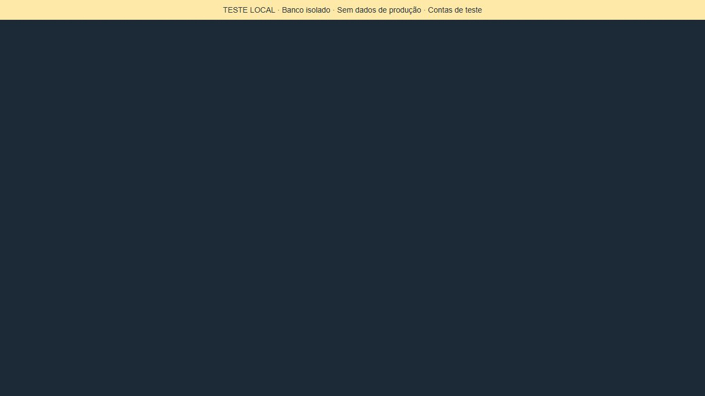

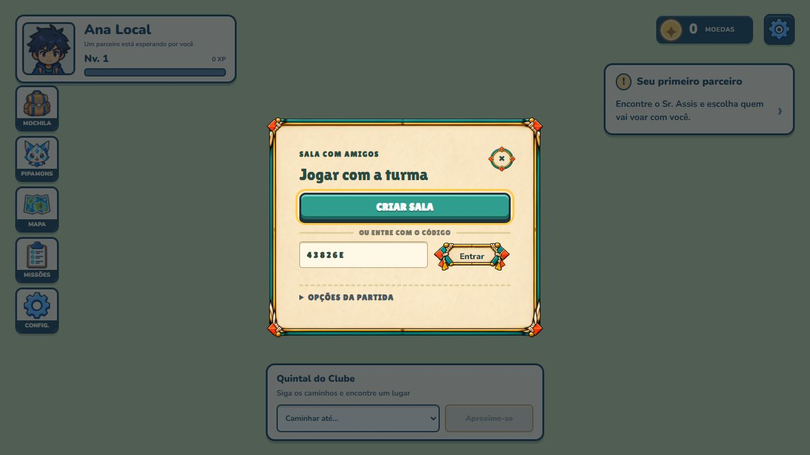

### DEMO-02 - P1 - Reentrada não recupera o jogador da partida

**Aberto · Defeito funcional**

**Observado:** Após entrar, recarregar e tentar Entrar novamente, a mesma conta recebe “Você já entrou nesta sala”. O anfitrião continua vendo a partida até o convidado expirar; não há retomada automática do controle.

**Efeito para o jogador:** A demo online não tem um fluxo confiável para uma interrupção comum de navegador. O convite voltar a aparecer não resolve a continuidade da partida.

**Correção / recomendação:** Implementar retomada autenticada do mesmo assento, vinculada à conta, preservando rodada e placar. Se o assento expirou, explicar e oferecer retorno ou nova entrada. Nunca devolver controle a outra conta.

**Critério de aceite:** Duas contas: atualizar a aba por 1 s e por mais tempo, reconectar sem duplicar jogador e sem transferir assento. Testar também sala encerrada e código expirado.

**Implementação relacionada:** src/index.html: online(action); src/courtyard-client.js: offerRoomInvitation

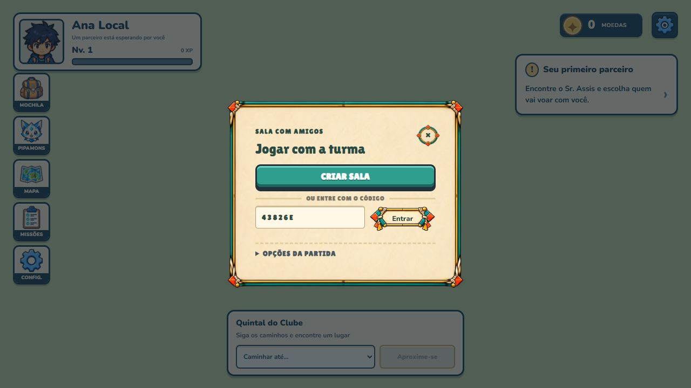

### DEMO-03 - P1 - A versão atual libera conteúdo além da demo

**Aberto · Escopo de lançamento**

**Observado:** Após Mikka, Beira-Mar foi selecionada e liberada no mapa, com Explorar Beira-Mar disponível. A missão do quintal também passou a apontar para essa trilha.

**Efeito para o jogador:** O recorte “início + primeiro bairro + online” ainda não existe no produto; esconder um botão não seria uma barreira suficiente.

**Correção / recomendação:** Criar uma política de conteúdo da demo compartilhada por navegação e servidor. Permitir Morro do Sol e os modos online aprovados; recusar fases fora do recorte sem apagar progresso ou coleções.

**Critério de aceite:** Um pedido direto a uma fase fora da demo também é recusado. Reabrir conta antiga ou usar link não contorna o limite. Jogar online continua disponível.

**Implementação relacionada:** src/trails.js; src/courtyard-client.js: openCity; src/backend.js

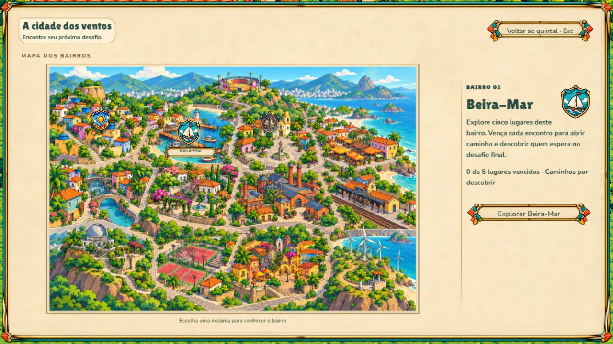

### DEMO-04 - P1 - O final do bairro promete continuação imediata

**Aberto · Experiência da demo**

**Observado:** O texto de vitória de Mikka diz que há outro vento chamando na Beira-Mar e que o bairro seguinte espera pelo jogador. As ações são invocador, caminho e mapa; não há conclusão específica da demo.

**Efeito para o jogador:** A pessoa termina sem saber que completou a amostra e pode perceber o limite futuro como conteúdo faltando.

**Correção / recomendação:** Criar um encerramento da demo depois da recompensa, com resumo do vínculo e do bairro, salvamento confirmado e ações claras para online, explorar novamente e voltar ao clube. Só mostrar links de comunidade ou loja que já existam.

**Critério de aceite:** O jogador identifica que concluiu a demo, sabe o que ainda pode jogar e pode voltar à conclusão sem ganhar prêmios duplicados.

**Implementação relacionada:** src/encounter-story-client.js; src/trails.js: história de morro-5

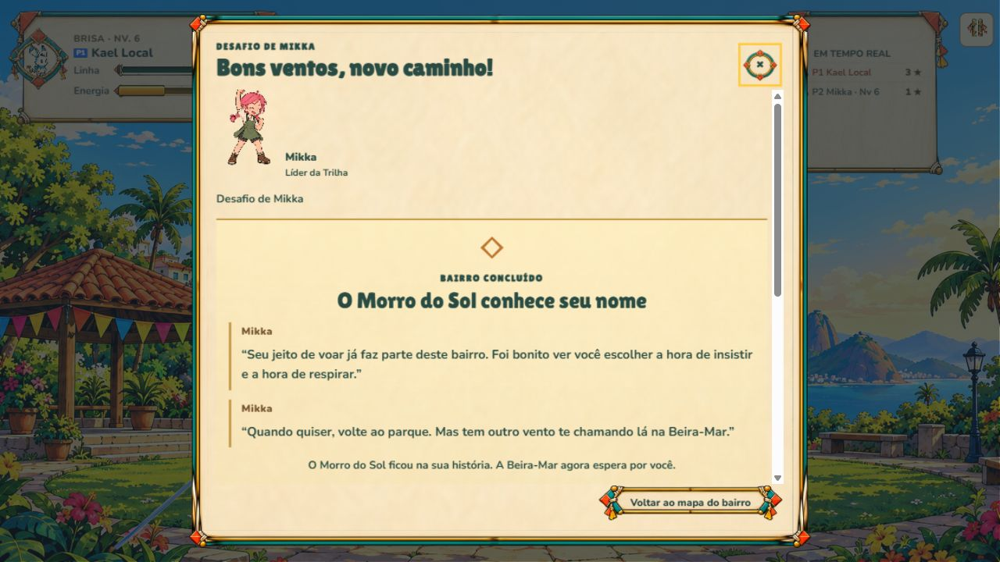

### DEMO-05 - P1 - Ataque e rebicada usam nomes que se confundem

**Aberto · Aprendizado**

**Observado:** A segunda lição chama o ataque com Espaço de rebique. A HUD tem Puxão no R, enquanto as regras também falam em ATACAR, uma ação que não aparece como botão no leque atual.

**Efeito para o jogador:** O iniciante pode tentar cumprir a lição usando R, sem entender por que o ataque de Espaço é outra ação.

**Correção / recomendação:** Fixar um vocabulário único: ataque/corte básico, manobra de linha/rebicada, habilidade do parceiro e esquiva. Mostrar o comando de ataque na HUD ou em uma ajuda sempre acessível.

**Critério de aceite:** Um jogador novo consegue explicar a diferença entre Espaço, R, Q/E e Shift após o tutorial, sem consultar uma parede de regras.

**Implementação relacionada:** src/first-flight.js: lessons; src/index.html: showRules; src/switch-ui-client.js: action fan

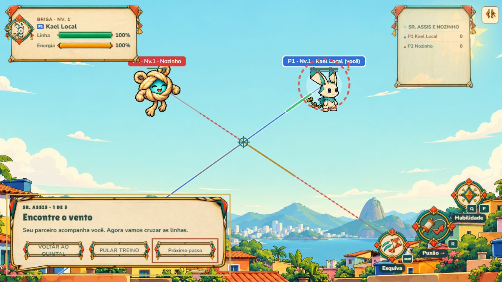

### DEMO-06 - P1 - A esquiva é cobrada antes de ser praticada

**Aberto · Aprendizado**

**Observado:** As cinco lições cobrem movimento, ataque, recuperação, habilidade e um corte contra Nozinho parado. Zeca já apresenta anel de ameaça e recomenda esquivar; a dupla acrescenta seleção de alvo e cruzamentos simultâneos.

**Efeito para o jogador:** Há um salto de leitura entre o treino seguro e os desafios. As derrotas desta auditoria, sozinhas, não medem dificuldade: o teste automatizado tem tempos de reação próprios.

**Correção / recomendação:** Ensinar uma esquiva guiada e o significado do anel antes do primeiro rival. Antes da dupla, apresentar um exemplo curto de escolha de cruzamento e alvo. Preservar desafio após o aprendizado.

**Critério de aceite:** A pessoa executa ao menos uma esquiva e identifica um ataque válido antes de entrar na primeira disputa real.

**Implementação relacionada:** src/first-flight.js; src/trails.js: morro-1 e morro-3

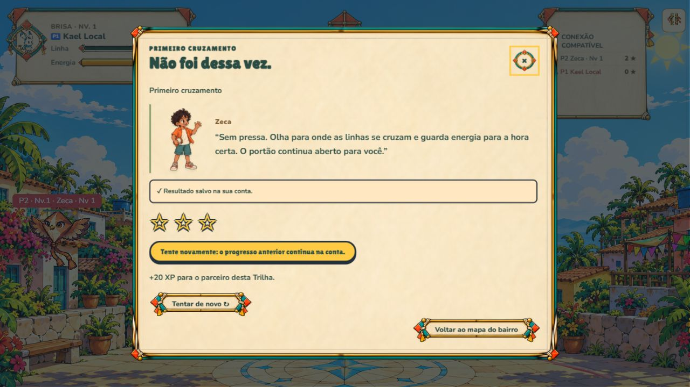

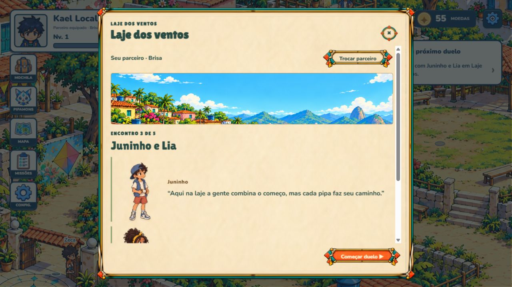

### DEMO-07 - P1 - A primeira habilidade é aprovada só por apertar a tecla

**Aberto · Aprendizado**

**Observado:** A quarta lição termina quando a habilidade entra em recarga. A conclusão diz que cada parceiro tem seu jeito, mas não explica ali o Puxão preciso de Brisa nem pede aproveitar seu efeito.

**Efeito para o jogador:** O jogador conhece a tecla, mas pode não entender custo, benefício, duração ou momento de uso.

**Correção / recomendação:** Mostrar nome e efeito da habilidade do parceiro equipado e pedir um uso que demonstre seu benefício. Distinguir animação de efeito válido no combate.

**Critério de aceite:** A lição mostra o efeito específico e deixa claro quando ele começou, terminou e ficou disponível de novo.

**Implementação relacionada:** src/first-flight.js: lesson 4; src/engine.js: types

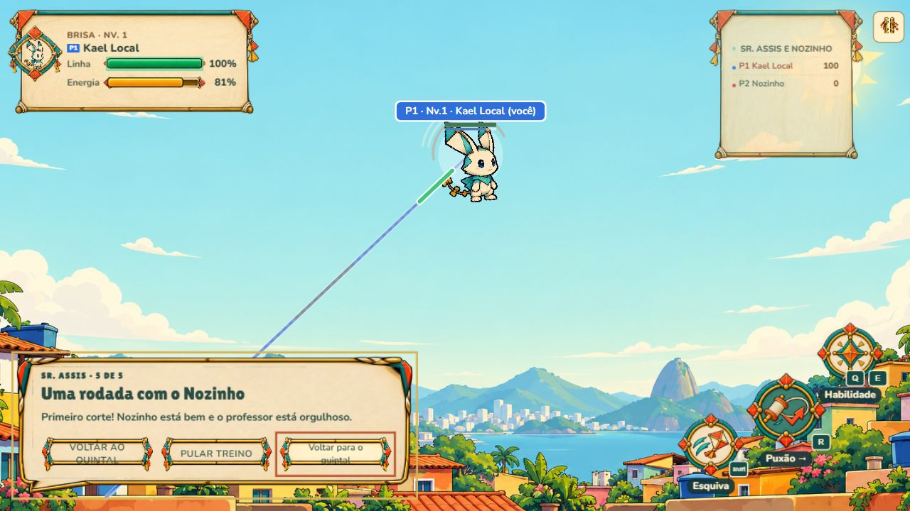

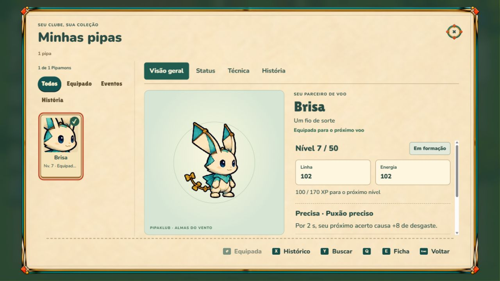

### DEMO-08 - P1 - Diálogo fechado continuava cobrindo o bairro

**Corrigido · Defeito visual e funcional**

**Observado:** Ao entrar no Morro, o diálogo do Sr. Assis continuava visível e citava o quintal. O DOM tinha hidden=true, mas .pilot-dialogue forçava display:grid!important e vencia o estado fechado.

**Efeito para o jogador:** Uma grande parte do cenário e dos controles ficava encoberta na primeira chegada ao bairro.

**Correção / recomendação:** Adicionada uma regra específica para .pilot-dialogue[hidden]. Reteste mostrou display:none e permitiu conversar com Zeca pelo fluxo normal.

**Critério de aceite:** Diálogo aberto é visível; fechar, mudar de área e iniciar combate escondem a camada por completo, inclusive os controles.

**Implementação relacionada:** src/pilot-ui.css: .pilot-dialogue[hidden]

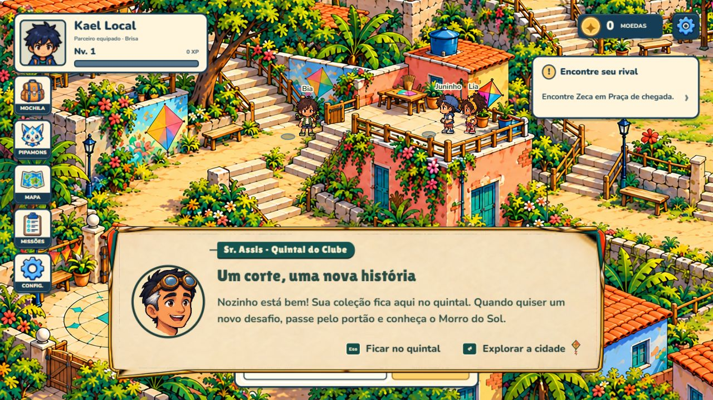

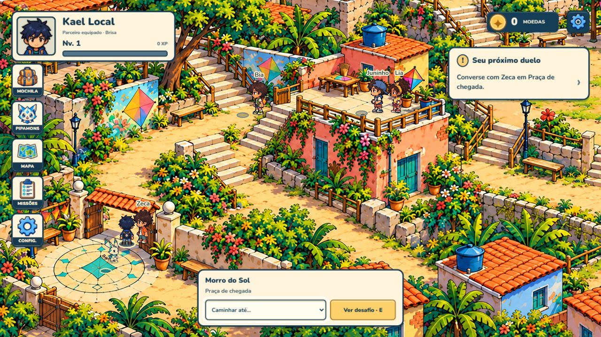

### DEMO-09 - P2 - As instruções de caminhada somem na abertura

**Aberto · Orientação**

**Observado:** No quarto e na sala, o painel mostra lugares e Examinar/E, mas não mostra as instruções de movimento; o piloto esconde #openingHint.

**Efeito para o jogador:** É possível avançar pelos nomes dos lugares, porém a exploração com o personagem não fica evidente para quem chega sem conhecer os comandos.

**Correção / recomendação:** Exibir uma ajuda curta de movimento e interação na primeira exploração e após troca de dispositivo. Reduzir a ajuda depois que a pessoa demonstra a ação.

**Critério de aceite:** WASD/setas, clique para caminhar e E/confirmar são descobertos sem depender de conhecimento anterior.

**Implementação relacionada:** src/pilot-ui.css: #openingHint; src/opening-room-client.js

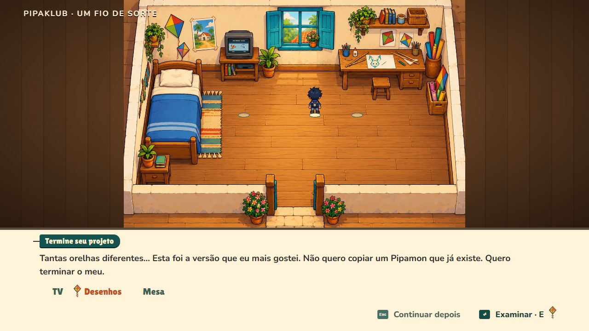

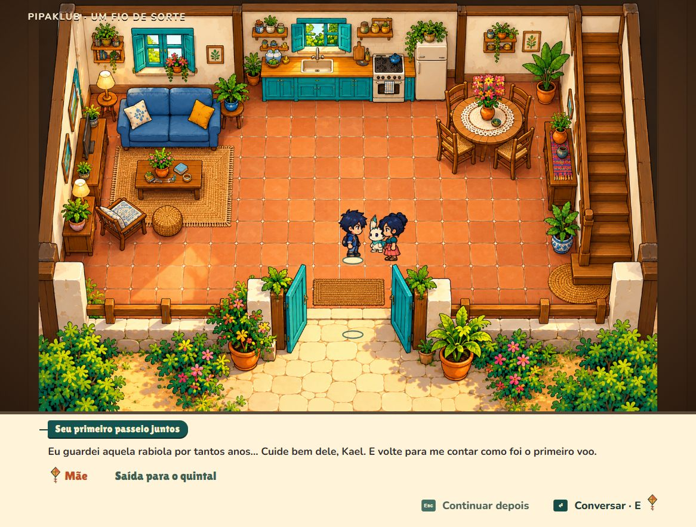

### DEMO-10 - P2 - Nível do pipeiro e do parceiro parecem contraditórios

**Aberto · Clareza de progressão**

**Observado:** Depois dos cinco encontros, Brisa estava no nível 7, mas o cabeçalho do jogador continuava no nível 1. A ficha mostrava “Histórico: 0 conquistas”, embora o bairro estivesse vencido; esse contador representa outro tipo de conquista.

**Efeito para o jogador:** O progresso é persistido, mas os nomes podem fazer a pessoa pensar que suas vitórias não contaram.

**Correção / recomendação:** Rotular Nível do pipeiro e Nível do Pipamon, explicar como cada um evolui e nomear o contador de capturas/transferências de forma específica. Mostrar vitórias de trilha em um lugar próprio.

**Critério de aceite:** O jogador distingue XP de conta, XP individual, vitórias e capturas de propriedade.

**Implementação relacionada:** src/pipamon-level-client.js; src/menu-ui.js: inventoryCaptures; src/plaza-client.js: refreshPlazaHUD

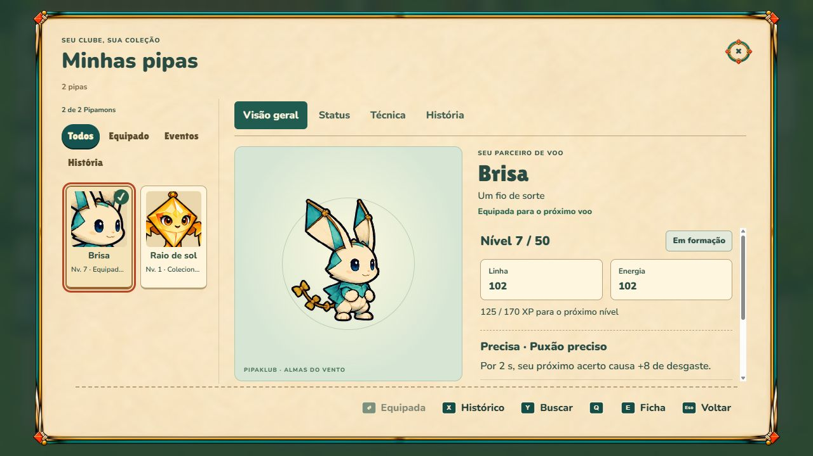

### DEMO-11 - P2 - Resultados abrem com foco em fechar

**Aberto · Navegação**

**Observado:** Nas telas de vitória e derrota, o foco inicial foi para o X. O caminho útil, revanche ou próximo encontro, fica em outra região.

**Efeito para o jogador:** Quem joga por teclado ou controle precisa procurar a ação principal após cada duelo.

**Correção / recomendação:** Definir foco contextual em Tentar novamente, Ver meu caminho ou encerramento da demo, preservando a opção de sair e o retorno de foco.

**Critério de aceite:** Confirmar depois do resultado executa a ação destacada e esperada, sem fechar por engano.

**Implementação relacionada:** src/index.html: modal; src/results-client.js; src/encounter-story-client.js

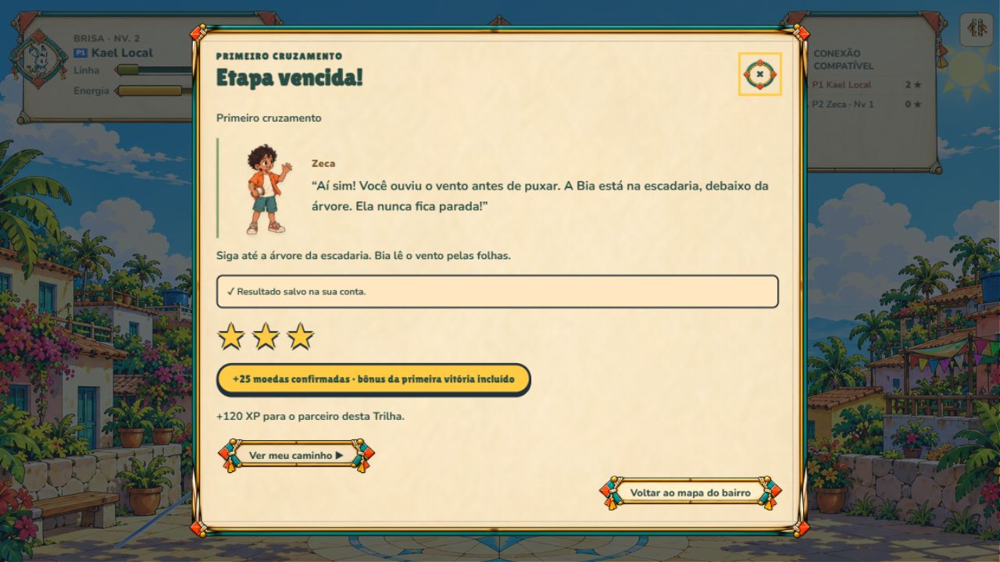

### DEMO-12 - P2 - Código da sala quebra em linhas na HUD

**Aberto · Layout**

**Observado:** Em 1280 x 720, o chip lateral do código dividiu os seis caracteres em mais de uma linha. O código completo continuou disponível no menu da partida.

**Efeito para o jogador:** Ler ou ditar o convite pela HUD fica mais difícil.

**Correção / recomendação:** Usar uma área suficiente para seis caracteres, sem quebra, e uma ação de copiar claramente identificada. Preservar o código inteiro no menu.

**Critério de aceite:** Seis caracteres e o rótulo cabem em 720p e 1080p, com escala de texto maior.

**Implementação relacionada:** src/battle-hud-painted.css: .room-chip

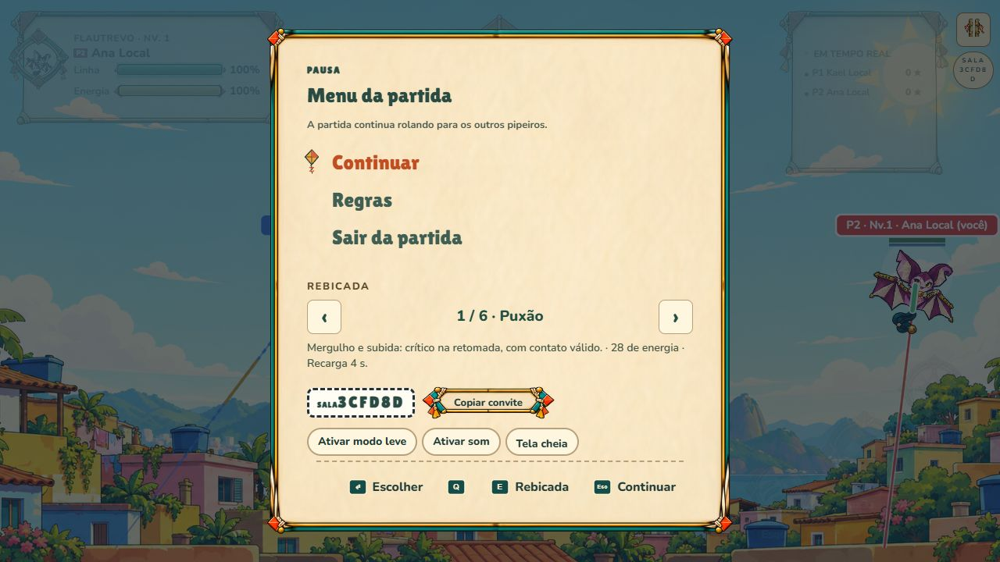

### DEMO-13 - P2 - Validação do código e foco do convite são genéricos

**Aberto · Entrada online**

**Observado:** Digitar 123 e confirmar exibiu a validação genérica do navegador. No convite corrigido, o código veio preenchido, mas o foco inicial ainda foi para Criar sala.

**Efeito para o jogador:** Um convidado pode não entender o formato ou criar outra sala em vez de entrar na recebida.

**Correção / recomendação:** Informar “Código de 6 caracteres” e erro contextual. Em link de convite, focar Entrar e priorizar essa ação; no acesso normal pelo menu, manter Criar sala.

**Critério de aceite:** Código curto, inexistente, expirado e sala cheia produzem mensagens úteis. Confirmar em um convite entra na sala recebida.

**Implementação relacionada:** src/courtyard-client.js: offerRoomInvitation; src/index.html: joinForm e openSheet

### DEMO-14 - P2 - Fila rápida mistura espera por pessoas e entrada de bots

**Aberto · Clareza do online**

**Observado:** A busca mostrou contagem e aviso de que bots completariam a sala, junto da mensagem de que a partida começa quando alguém entrar. A sala foi preenchida por Zeca, Bia e Nando.

**Efeito para o jogador:** A pessoa pode interpretar que depende de outro humano para começar ou não distinguir os bots no placar.

**Correção / recomendação:** Usar estados próprios para busca, preenchimento por IA e contagem de início. Marcar IA/bot no placar da partida rápida, preservando os nomes narrativos nas Trilhas.

**Critério de aceite:** A UI comunica de forma consistente quantas pessoas e bots estão na sala e quando a partida começa.

**Implementação relacionada:** src/index.html: combatReadout e banner; src/engine.js: QUICK e fillBots

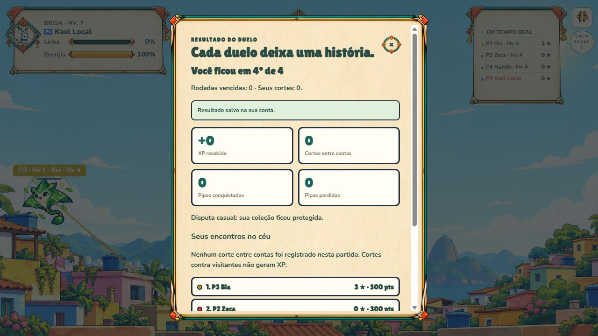

### DEMO-15 - P1 - A primeira recompensa pode ser perdida num ritual ainda novo

**Aberto · Risco de experiência**

**Observado:** A invocação avisa antes de iniciar que consome a rabiola, permite três tentativas e danifica o item ao fechar ou recarregar. O ritual foi concluído com sucesso pelo teclado nesta auditoria; não foi testada a perda do item.

**Efeito para o jogador:** A única rabiola do primeiro chefe pode virar uma frustração antes de o jogador conhecer a mecânica. É um risco de desenho da demo, não um bug de consumo comprovado.

**Correção / recomendação:** Oferecer uma primeira invocação guiada, consulta do feitiço antes do consumo e um caminho claro de recuperação da recompensa. Definir a política antes de publicar.

**Critério de aceite:** O jogador entende a mecânica e a consequência antes de gastar sua primeira recompensa. Testar falha, interrupção, reenvio e eventual recuperação.

**Implementação relacionada:** src/summon-client.js: summonNotice; migrations 007/008/014

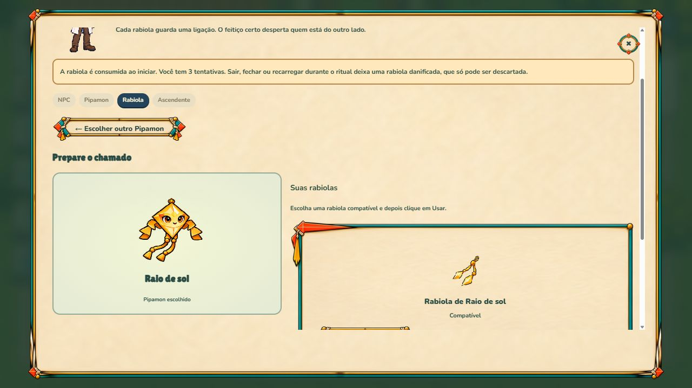

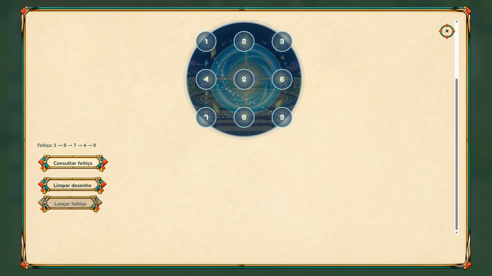

### DEMO-16 - P2 - Sucesso de invocação não leva ao parceiro novo

**Aberto · Conclusão de recompensa**

**Observado:** Raio de sol foi confirmado na coleção, mas a tela não ofereceu uma ação principal direta de Ver parceiro ou Equipar. Foi necessário fechar e abrir a coleção.

**Efeito para o jogador:** O momento de descoberta termina em navegação administrativa, enfraquecendo o vínculo com o segundo parceiro.

**Correção / recomendação:** Adicionar Ver parceiro e Equipar como ações claras, com equipamento confirmado pelo servidor. Manter Brisa equipada até a escolha explícita.

**Critério de aceite:** A conquista leva à ficha correta e equipar funciona sem duplicar nem consumir outra rabiola.

**Implementação relacionada:** src/summon-client.js: updateSummonRun

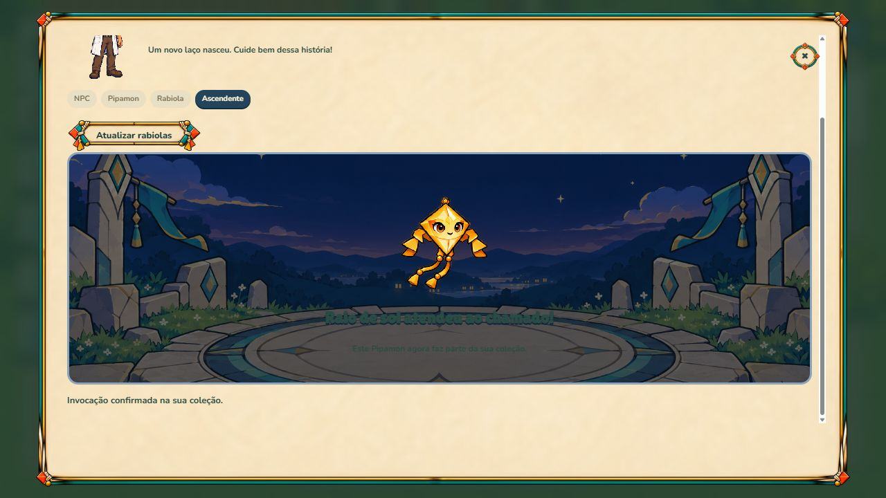

### DEMO-17 - P3 - A apresentação do presente reaparece na retomada

**Aberto · Polimento de continuidade**

**Observado:** Recarregar depois de guardar o presente e antes de levá-lo à mesa repetiu a apresentação da Rabiola Antiga. Não foi observada duplicação de parceiro ou recompensa.

**Efeito para o jogador:** A retomada parece repetir uma aquisição já confirmada, embora seja apenas a cena.

**Correção / recomendação:** Persistir ou reconstruir o momento de apresentação com uma frase de retomada, sem simular novo recebimento.

**Critério de aceite:** A retomada deixa claro o objetivo atual e não sugere entrega repetida.

**Implementação relacionada:** src/opening-client.js; src/opening-room-client.js

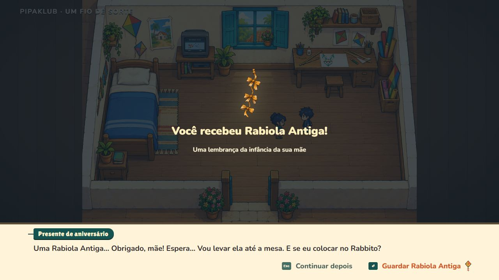

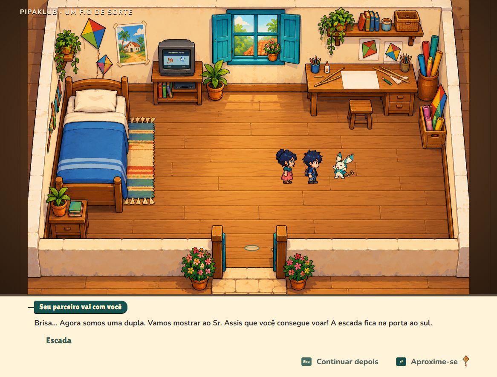

## O que manter

A identidade brasileira do bairro, as falas dos moradores, o nascimento do parceiro, o nome individual, os rostos da coleção e o ritmo de desbloqueio em cinco encontros formam uma base coerente. O salvamento confirmado e a proteção explícita do casual comunicam regras úteis. A mudança de páginas das fichas melhora a consulta sem esconder o Pipamon.

## Ordem de trabalho para a demo

1. Recuperação online: restaurar o assento autenticado após recarga, com sala encerrada, expiração, retorno e placar corretos.
2. Recorte real da demo: política no servidor e na navegação para início + Morro do Sol + modos online aprovados, sem apagar progresso existente.
3. Encerramento: trocar o convite imediato à Beira-Mar por conclusão da demo, recompensa e caminhos para online/replay.
4. Tutorial: alinhar os nomes das ações, praticar esquiva e demonstrar o efeito da habilidade antes do primeiro rival.
5. Recompensa: primeiro ritual guiado e saída de sucesso para a ficha do novo parceiro.
6. Reteste de lançamento: cadastro real em homologação, duas máquinas/redes, latência e desconexão, controle físico, 720p/1080p e fluxo completo sem ferramentas de desenvolvimento.

## Verificação técnica após as correções

Builds Worker e Pages concluídos. Suíte: 270 testes, 269 aprovados na execução padrão e um teste de socket bloqueado por EACCES do sandbox. Esse teste de WebSocket passou isoladamente com permissão para o socket local. git diff --check não apontou erros. Console da sessão do protagonista sem erros capturados; a tela vazia era um problema de navegação, não uma exceção JavaScript.

## Limites e pendências

Não houve validação de cadastro/e-mail reais, entrega SMTP, migração em homologação, Render, build instalado de Windows, Steam Input, controle físico, duas redes, oito jogadores, degradação de rede ou uso prolongado. Não foi testada a falha das três tentativas de invocação nesta passagem; o sucesso foi confirmado. Os testes automatizados não equivalem a uma aprovação da demo com pessoas.

A primeira mensagem de sessão da abertura não se repetiu após isolar abas de outros servidores locais. Ela fica registrada como interferência de ambiente a investigar, sem ser contabilizada como defeito de produção.

Os prints originais foram mantidos. Alguns nomes de arquivos refletem o momento de captura; o manifesto descreve o estado efetivamente observado.