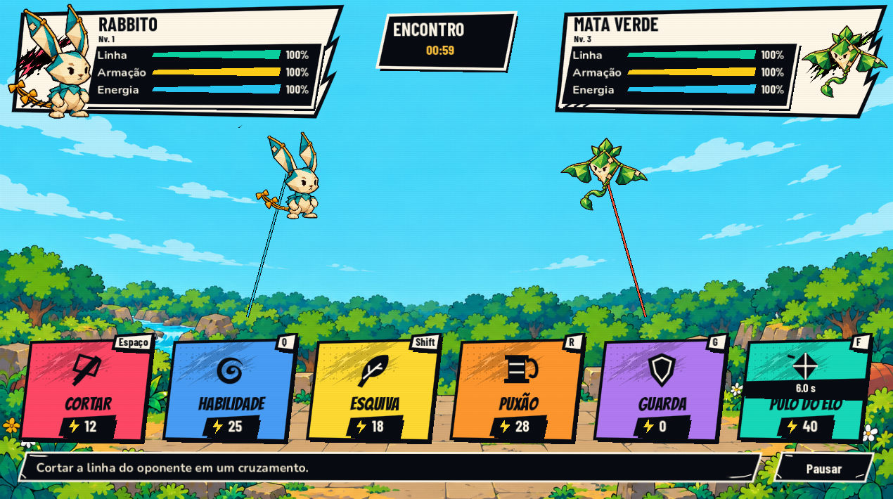
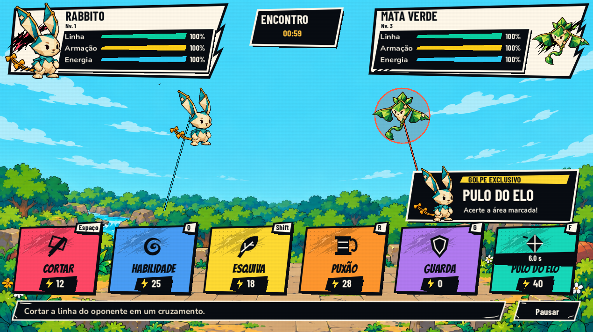
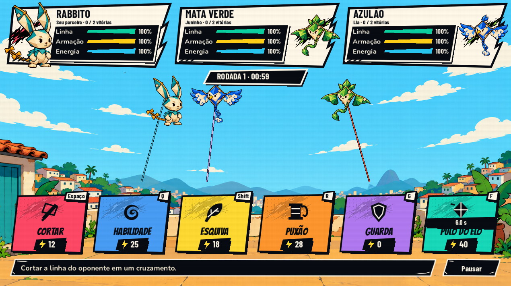

# HUD de batalha — Battle Ink

Implementação da direção dos dois rascunhos enviados em 26/10/2026.

## Composição integrada

- Retratos dos monstros nas extremidades, extraídos das próprias artes existentes, com enquadramento sem a margem transparente do spritesheet.
- Placar em papel claro, corpo de nanquim, recortes assimétricos, tinta e barras de linha verde, armação amarela e energia azul. Nome, nível, porcentagens e resultados vêm do estado real.
- Cartas de Cortar, Habilidade, Esquiva, Puxão, Guarda e Pulo do Elo com seis cores e seis silhuetas próprias. Tecla atual, custo, recarga e falta de energia são informações separadas da arte.
- Descrição contextual por ponteiro/foco. Alertas do adversário, pausa e erro ao salvar têm precedência sobre a descrição da carta.
- Fundo ocupa a tela; cartas ficam sobre a arena, sem o painel contínuo que ocupava o rodapé. Faixa de descrição e pausa usam pontas fixas em três/nove regiões.
- Criaturas no campo usam uma região comum às animações para aproveitar melhor a área visível, preservando proporção e coordenadas das regras. Não foi alterado dano, alcance, energia, IA ou salvamento.
- Composição para dois participantes com identificação central do encontro/rodada. No Morro, os três participantes mantêm placares próprios e a rodada/tempo aparecem numa faixa adicional.
- Pulo do Elo recebe apresentação durante a preparação real do golpe. É uma camada visual, sem bloquear entrada, acrescentar pausa ou mudar a duração da habilidade.
- Estados de preparação, intervalo de rodada e parceiro eliminado são indicados nos comandos. Custos e disponibilidade continuam vindo do modelo.

## Assets e montagem

Família: `godot/assets/campaign/battle-ink/`. Procedência e recortes no `manifest.json`.

- Prancha de pinceladas gerada por `image_gen`, com refinamento de transparência. A seleção v2 foi inspecionada sobre o céu e as cartas; o original foi preservado. O canal alpha tem intervalo 0–254, e não se declara opacidade binária perfeita.
- Seis ícones SVG originais, editáveis, em 64×64.
- Duas faixas SVG, papel e tinta, com pontas de tamanho fixo.
- Regiões de retrato e limites compartilhados das animações em JSON. São metadados de enquadramento das artes existentes, sem redesenhar os monstros.
- Nomes, barras, teclas e custos são desenhados em tempo de execução. Nenhuma captura de mockup foi usada como interface inteira.

Implementação: `battle_ink.gd`, `hud_action.gd`, `encounter_view.gd` e `morro_battle_view.gd`. A família é específica de batalha; os menus de exploração não foram substituídos por essa composição.

## Validação

- 70 capturas de dez estados de batalha em sete resoluções.
- 35 capturas adicionais para nomes longos, golpe exclusivo, preparação do boss, energia insuficiente e combate normal.
- Resoluções efetivas: 960×540, 1024×768, 1270×710, 1280×720, 1280×800, 1920×1080 e 2560×1080.
- Nenhum corte/sobreposição geométrica detectado pelas medições. Inspeção visual complementar em tamanho de jogo, inclusive dos textos desenhados diretamente no canvas, que não são cobertos integralmente pelo detector de widgets.
- Regressões isoladas aprovadas: interface/ações de arte (6), fluxo de UI (7), telas da campanha (30) e efeitos (18).
- Percurso completo no pacote exportado: **337 verificações, zero falhas**, incluindo Morro, boss, devolução para Nina e salvar/retomar. Arquivos de teste e configurações isolados.
- Não representa teste físico de controle, Steam Deck ou uma sessão humana às cegas. As capturas de estado especial são fixtures visuais; a execução do percurso usa combate e progressão reais.

Build: `godot/exports/battle-ink-2026-10-26/PipaKlub.exe`. Manter o `.pck` e as licenças ao lado. Não publicada na Steam e não enviada ao Git nesta etapa.
