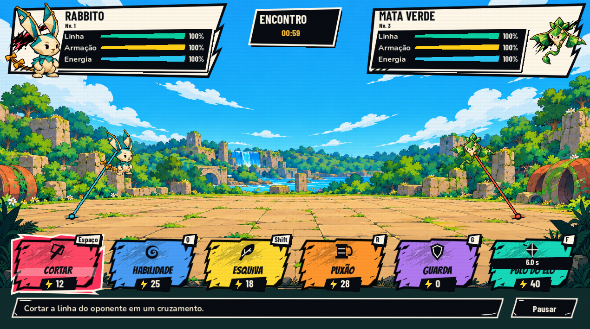
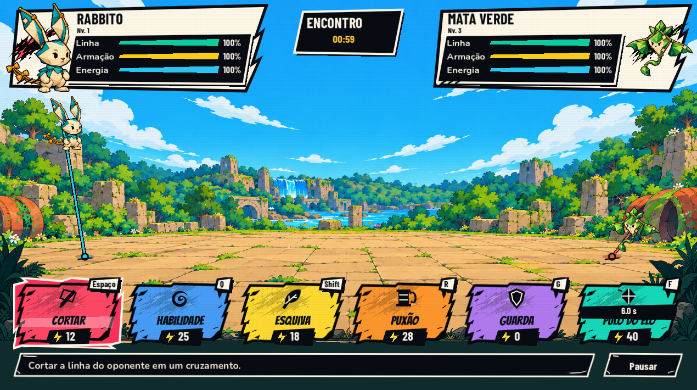
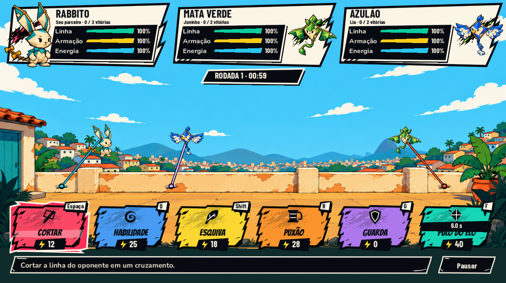

# Arena ampla e HUD de cartas rasgadas

Revisão de 26/10/2026 baseada no último rascunho enviado pelo usuário.

## Alterações

- Novo fundo das Veredas com pátio aberto, piso visível, ruínas e queda-d’água distante. Nova variante urbana com o mesmo espaço de chão para os encontros do Morro.
- Projeção do confronto ocupa mais de 80% da largura da tela, em lugar da transformação uniforme limitada pela altura que mantinha os participantes numa faixa estreita. As posições dos efeitos e linhas acompanham a projeção.
- Sprites compensam essa projeção para manter suas proporções. Textos, placares, cartas e apresentações especiais permanecem em uma camada independente, sem esticamento horizontal. As regras lógicas de alcance, colisão, velocidade, custo e dano não foram alteradas.
- Espaço reservado sob os placares e sob a faixa de rodada nos encontros com três participantes. Ancoragens terminam no chão, 30 unidades de interface acima das cartas, e recebem um pequeno apoio visual.
- Cartas de 132 unidades de altura, frente a 163 anteriormente. O rodapé acompanha a altura real do conteúdo, incluindo pausa, resultado e erro ao salvar.
- Nova arte vetorial de papel rasgado, com pontas e dentes fixos. Preenchimento, ícone, tecla, custo, recarga e efeito de seleção são camadas independentes.
- Seleção persistente recebe explosão de recorte branco/coral e faixa clara atrás do nome. Foco de teclado continua indicado mesmo quando diferente da seleção apontada pelo mouse.
- Vegetação frontal gerada como PNG com transparência: folhas e pedras nas laterais, centro baixo, sombra escura na base. Renderizada atrás dos controles, sem colisão e sem capturar cliques. Laterais mantêm proporção; o centro baixo é repetido para acomodar a largura.

## Assets

- `godot/assets/campaign/veredas-arena-wide-v2.png`
- `godot/assets/campaign/rooftop-arena-wide-v2.png`
- `godot/assets/campaign/battle-ink/foreground-veredas-v1.png`
- `godot/assets/campaign/battle-ink/card-ripped-v2.svg`

Procedência, dimensões, recortes e notas de validação estão no manifesto da família Battle Ink. Fundos e vegetação foram gerados com `image_gen`, copiados para o projeto e inspecionados dentro do jogo. A moldura das cartas é uma fonte SVG própria, editável. As artes anteriores permanecem disponíveis.

## Validação desta revisão

- 84 capturas iniciais de 12 estados em sete resoluções.
- 35 capturas adicionais após reservar o limite superior de voo, cobrindo confronto normal, extremos de posição, Morro, golpe especial e anúncio do boss.
- Resoluções: 960×540, 1024×768, 1270×710, 1280×720, 1280×800, 1920×1080 e 2560×1080.
- Nenhum corte/sobreposição geométrica de widgets detectado. Inspeção visual complementar das cartas, sprites e textos desenhados no canvas.
- Onze verificações específicas aprovadas: prompt, clique de habilidade, gasto de energia, liberação do comando, custo exclusivo, faixa horizontal projetada, ancoragens e limites de voo fora das regiões de HUD.
- Regressões aprovadas: fluxo de UI (7), telas da campanha (30) e efeitos (18).
- Percurso no pacote Windows exportado: **337 verificações e zero falhas**, incluindo Morro, boss, missão da Nina, salvar/retomar e reparo. Saves e configurações isolados.

As capturas de estados são fixtures visuais; o percurso separado usa regras e progressão reais. Não foi teste com controle físico ou jogador humano às cegas. Logs em `tmp/battle-wide-*.log` e medições em `tmp/player-audit-2026-10-26/battle-wide-*`.

Build: `godot/exports/battle-wide-2026-10-26/PipaKlub.exe`, com `.pck` e licenças ao lado. Sem publicação na Steam ou envio ao Git nesta etapa.
