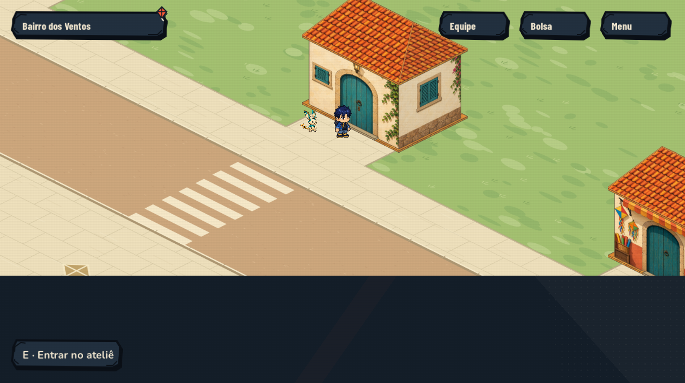
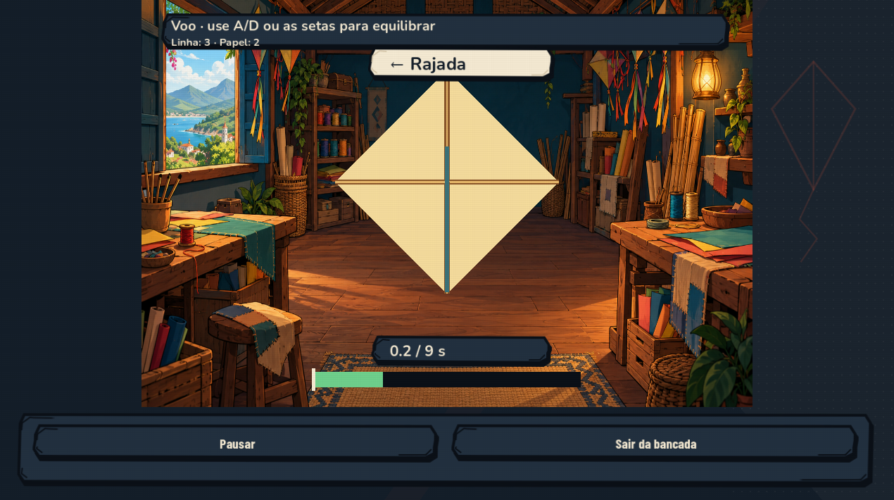
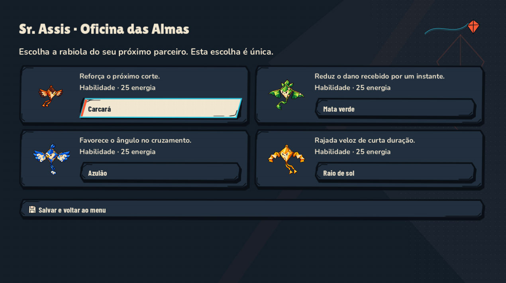
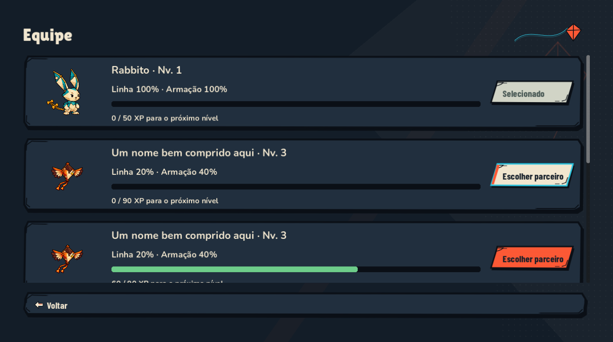
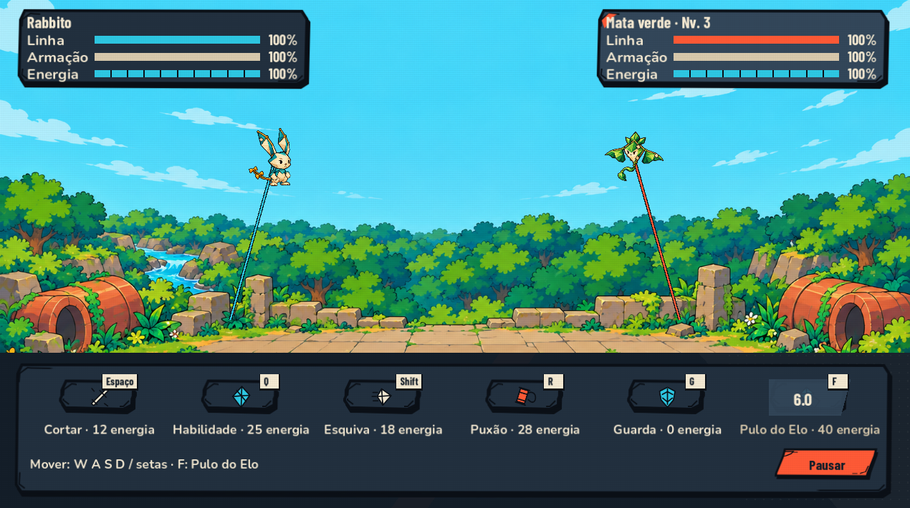
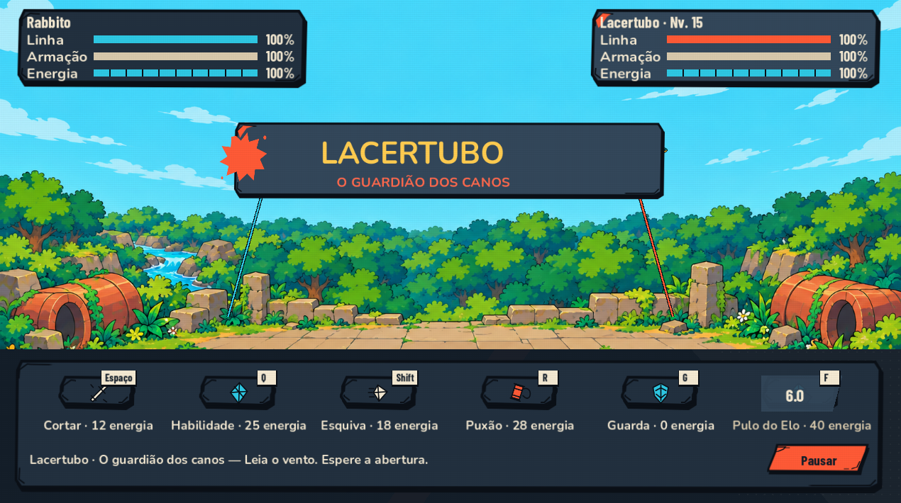

# Correções da revisão de arte — Godot

Implementação de 26/10/2026, a partir de `DIRECAO-DE-ARTE-REVIEW-2026-10-26.md`.

## Entregue no jogo

- Prompt de interação da rua e do professor sem quebra por letra; moldura oculta quando não há interação próxima. As instruções de caminhada da abertura continuam visíveis.
- Vento e cronômetro da oficina em suportes de contraste estável.
- Molduras com sombra de nanquim e menos filetes; retiradas as placas ciano dos cantos. Cortes de 24 px preservados em nove partes.
- Atalhos de navegação neutros; seleção clara em papel. Removida a pipa grande repetida no fundo de todas as telas e o adorno sobre a caixa de diálogo.
- Campo ilustrado ocupa a largura disponível, com recorte proporcional. Barras de combate desenhadas numa camada de escala própria, nomes identificáveis e nível do rival. No Morro, placar de rodadas preservado.
- Criaturas maiores no campo; comandos mais compactos e acionáveis por ponteiro. Toque rápido e comando mantido têm tratamentos próprios; pausa e saída do alvo liberam a entrada. Espaço continua sendo o comando de corte, sem acionar acidentalmente o cartão focado.
- Pulo do Elo como sexto comando de Rabbito, custo real de **40 energia**, recarga real e tecla vinculada. As regras de dano, custo, alcance e tempo não foram alteradas.
- Escolha inicial em quatro cards com retrato, característica da habilidade e custo, mantendo confirmação e nomes dos botões usados pelo fluxo existente.
- Equipe com retratos maiores, cards menores e botão de seleção lateral. A criatura equipada continua marcada; membros continuam acessíveis por rolagem/foco.
- Seis ícones vetoriais de itens, com cores e perfis distintos; rabiola da Nina identificada como missão. Item selecionado mantém estado visual mesmo quando o foco sai da lista.
- Resultado com a pose real de vitória/derrota junto à progressão, usando os frames existentes. Movimento reduzido mantém pose estática. Véu do resultado acompanha a largura do campo, sem um retângulo escuro isolado no centro.
- Faixa do Lacertubo em tinta/recorte, substituindo a placa metálica. Nova arena das Veredas, com canos, vegetação e área de céu mais limpa.
- Nova arena de terraço para treino e Morro, seguindo a família 2D da arena das Veredas. As artes anteriores permanecem no projeto.
- Minimap com fundo verde discreto, sem adorno sobre a cartografia e legenda “Você · caminhos”. Não acrescenta marcadores de segredos.
- Configurações mostram **Ligado/Desligado**, além do interruptor. Falha ao gravar restaura também o estado visual.
- Diálogos com avanço compacto; retrato e fala mantêm o protagonismo. Pausa mostra parceiro equipado, condição e indicação de reparo em lugar da frase genérica.

## Evidência

| Interação | Oficina |
| --- | --- |
|  |  |

| Escolha inicial | Equipe |
| --- | --- |
|  |  |

| Combate | Boss |
| --- | --- |
|  |  |

## Validação desta entrega

- 119 capturas: 17 estados em sete resoluções (960×540, 1024×768, 1270×710, 1280×720, 1280×800, 1920×1080, 2560×1080).
- 21 capturas adicionais após o ajuste final do véu do resultado e da legenda do minimap.
- Nenhum P1/P2 geométrico detectado nessas medições. Permanecem cinco ocorrências P3 de item parcialmente visível na borda de lista rolável; foco e acesso às linhas continuam verificados.
- Regressão específica: seis verificações aprovadas, incluindo clique recebido pelo cartão, habilidade executada pelo modelo real, gasto de energia, liberação do comando e custo do Pulo do Elo.
- Fluxo de UI: 7; telas da campanha: 30; efeitos: 18; HUD: 58 — sem falhas.
- Percurso gráfico com controles e cliques: 337 verificações sem falhas. Repetição no pacote Windows: 337 verificações sem falhas, até devolver a rabiola da Nina, retomar o save e reparar com o professor. Saves e configurações isolados.
- Logs e medições em `tmp/art-*.log` e `tmp/player-audit-2026-10-26/art-*`. Capturas inspecionadas no tamanho de jogo. Não foi teste humano às cegas ou teste de controle físico.

## O que continua aberto na direção geral

Esta entrega resolve os dois P1 e o refinamento de interface; não declara todos os 18 itens artísticos encerrados.

- **AD-07, parcial:** arenas alinhadas; rua e interiores ainda precisam de arte ambiental mais coesa. Não se alteraram colisões ou caminhos para disfarçar diferenças de acabamento.
- **AD-14, parcial:** leitura do minimap melhorada; um mapa de exploração dedicado, com regiões visitadas e descoberta persistente, ainda não foi implementado. O comportamento de ampliar a visão existente permanece.
- **AD-17:** nome PipaKlub mantido. A relação da marca com Soulmonsters não foi presumida ou renomeada.
- **AD-18, parcial:** barras separadas da escala do campo; opção global de tamanho de texto e validação em televisão/Steam Deck físico ainda não fazem parte desta entrega.

Artes novas e procedência: `godot/assets/campaign/arena-art-provenance.json`; família vetorial e revisão do material no manifesto `godot/assets/campaign/ui-recorte/manifest.json`. SVGs continuam reproduzíveis pelo gerador local. Não há texto de interface embutido nas arenas.

Build Windows: `godot/exports/art-direction-2026-10-26/PipaKlub.exe`, junto do `.pck` e das licenças. Não publicada na Steam ou enviada ao Git nesta etapa.
