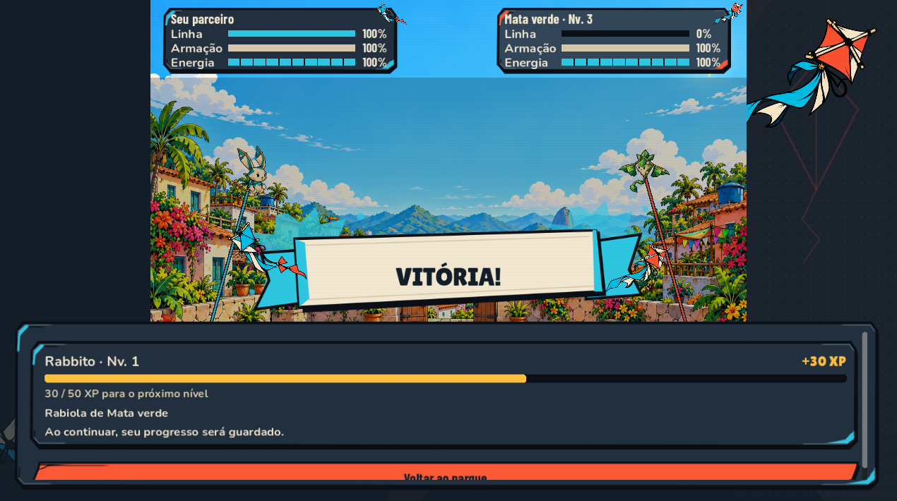
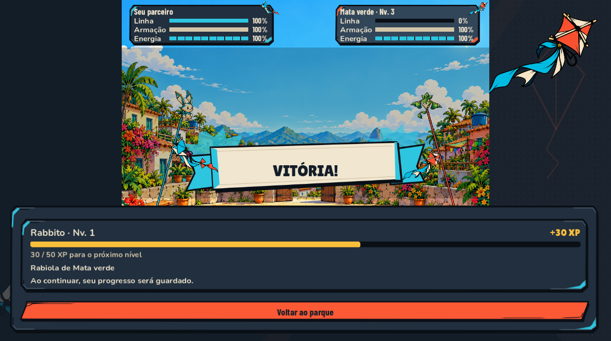
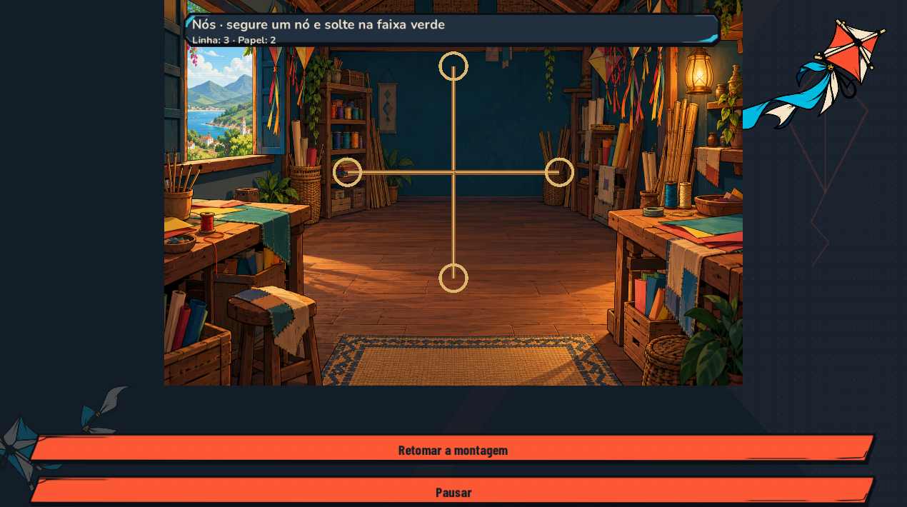
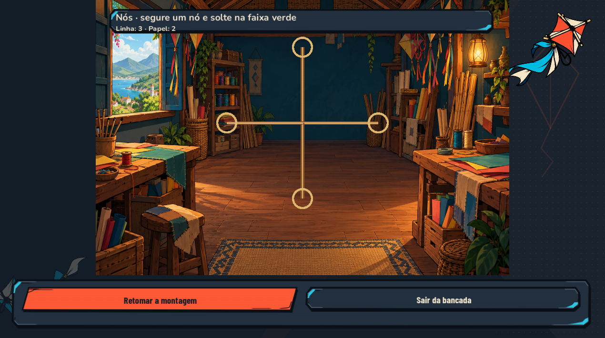
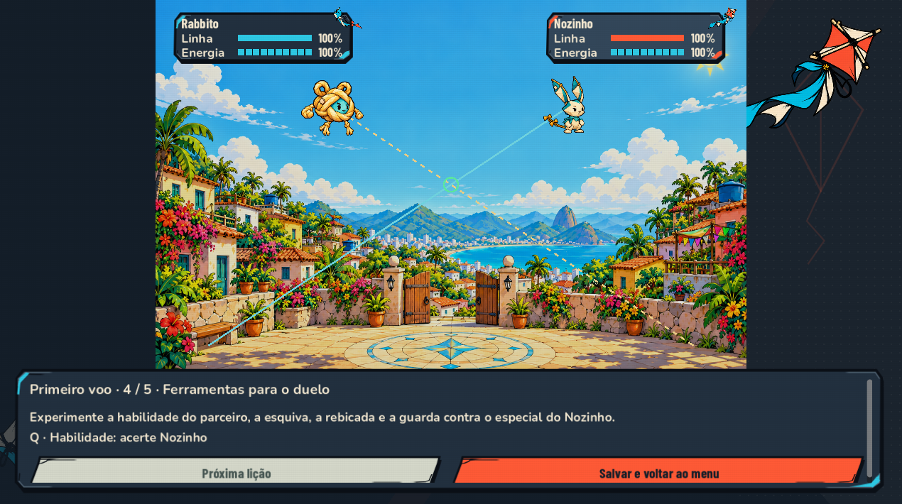
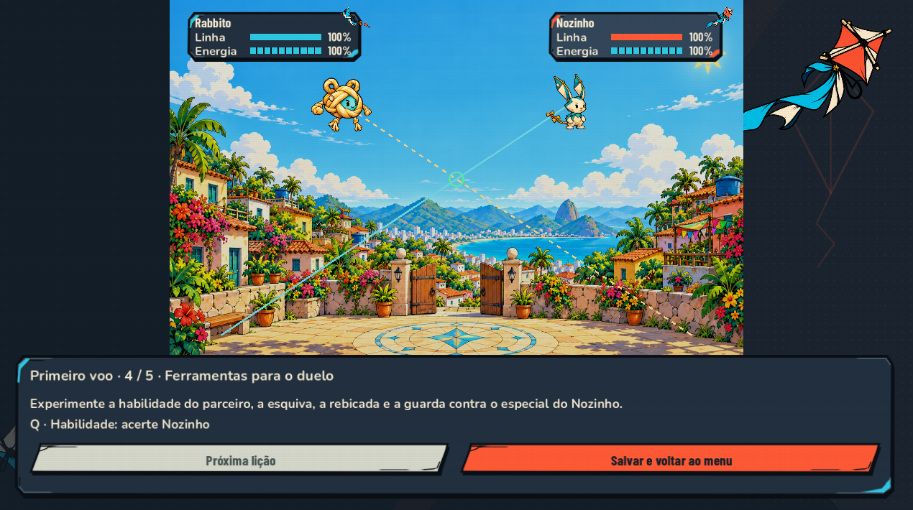

# Playtest da campanha Godot — 26/10/2026

## Resultado

O problema da captura enviada foi reproduzido: em 1270 × 710, apenas 59% do botão de retorno da vitória ficava visível. A mesma estratégia de layout também cortava comandos no tutorial, na oficina e em outros resultados. Esses cortes foram corrigidos com rodapés que respeitam a altura real do conteúdo, sem deformar as bordas dos painéis.

O percurso automatizado completo terminou com **337 verificações e nenhuma falha**, incluindo criação do primeiro parceiro, cinco desafios do Morro, exploração do parque, batalha contra o Lacertubo, coleta, devolução para Nina, salvamento, retomada e reparo com o professor. Isso confirma o percurso da demo exercitado; não significa que toda combinação possível de escolhas ou toda máquina esteja validada.

## Como o teste foi feito

- Execução gráfica do Godot 4.7.2, com imagens realmente renderizadas. Os botões principais e confirmações receberam eventos de ponteiro e tiveram a recepção do clique verificada; navegação e troca de teclas receberam eventos de teclado.
- Movimento e combate usam roteiros conhecidos e os controladores/regras reais, com avanço controlado da simulação. Não foram concedidos inventário, parceiro, vitória ou recompensa para completar o percurso. Não foi uma sessão humana às cegas nem controle físico do desktop.
- Matriz visual de **64 estados × 7 resoluções = 448 capturas**, além de 192 capturas de referência anterior e uma regressão final direcionada de 56 capturas. Os estados montados para medir layout são separados do percurso com progresso conquistado.
- Resoluções: 960 × 540, 1024 × 768, 1270 × 710, 1280 × 720, 1280 × 800, 1920 × 1080 e 2560 × 1080. A dimensão efetiva da janela foi registrada, incluindo 4:3, 16:10 e ultrawide.
- Conferência de área visível, texto sobre botões, comandos cortados, navegação de foco e inspeção de capturas selecionadas. Listas longas foram percorridas pelo teclado: 12 comandos, 6 itens e 5 membros acessíveis nas sete resoluções.
- Saves e configurações isolados. Os dados reais do jogador não foram usados para o teste.

## Falhas encontradas e corrigidas

| Prioridade | Problema e reprodução | Correção |
| --- | --- | --- |
| P1 | Vencer uma batalha em 1270 × 710 deixava o retorno parcialmente fora do painel. Outros resultados, inclusive erro ao salvar, também podiam esconder o comando. | Rodapé dimensionado pelo conteúdo e arena limitada ao espaço restante. |
| P1 | Tutorial com instruções longas cortava os botões; oficina pausada escondia a saída. | Mesma regra de altura mínima real; ações da oficina reorganizadas e comandos redundantes removidos. |
| P1 | Pausar a prática não interrompia sua simulação. | Pausa aplicada ao controlador da prática e estado anterior restaurado ao retomar. |
| P1 | A janela de remapeamento abria, mas a nova tecla não chegava ao capturador. | Eventos da própria janela ligados à captura. Regressão gráfica confirmou a troca de Espaço para T e o percurso confirmou restaurar o padrão. |
| P1 | Placar da transmissão podia atravessar o botão de salvar em 4:3. | Placar mais compacto, verificado novamente nas sete resoluções. |
| P2 | Nome longo do locutor quebrava em duas linhas e cobria o início da fala. | Plaqueta dimensionada pelo nome, sem quebra interna. |
| P2 | Placar branco sobre céu claro e indicação do campo de nome com pouco contraste. | Placar com fundo próprio e cor legível para o texto de exemplo do nome. |
| P2 | Trechos de caminhada mantinham uma caixa de fala vazia. | Caixa compacta com destino contextual; sem fala atribuída artificialmente. |
| P2 | Esc em telas internas podia abrir outra pausa em vez de voltar. | Retorno por nível de menu, com descrição de ajuda correspondente. |
| P2 | Navegação rápida podia tentar focar um controle já removido. | Foco adiado com validação da existência e visibilidade do alvo. |
| P2 | Após perder, a orientação de recuperação ficava escondida junto aos controles de combate. | Resultado explica que o parceiro permanece com o jogador e indica o reparo no ateliê. |

### Evidência visual

| Antes | Depois |
| --- | --- |
|  |  |
|  |  |
|  |  |

## O que ainda está básico e como melhorar

Esses pontos são recomendações de UX, não falhas corrigidas nesta entrega. P1 indica bloqueio ou comando importante escondido; P2 indica dificuldade relevante de compreensão/uso; P3 indica detalhe de acabamento.

| Ordem | Diagnóstico | Próxima implementação recomendada |
| --- | --- | --- |
| 1 — P2 | O tutorial ensina interação com mouse, mas os cartões de ações da batalha funcionam como indicadores de teclado. A habilidade do parceiro depende de uma indicação textual menos evidente. | Unificar o contrato de entrada: cartões acionáveis por ponteiro, teclado e controle, com custo, disponibilidade e habilidade do parceiro explícitos. |
| 2 — P2 | Barras e textos de combate ainda acompanham a escala da arena. Ao acomodar um rodapé maior, parte da informação fica menor. | Separar a HUD da transformação do campo; usar tamanho de texto independente, nome real do parceiro e nível, com escala de leitura configurável. |
| 3 — P2 | A escolha do primeiro parceiro apresenta pouca informação para uma decisão única. | Retrato, personalidade de combate e comparação das habilidades reais antes da confirmação. Não inventar atributos decorativos. |
| 4 — P2 | O mapa ampliado é uma visão mais distante do cenário, com pouca orientação própria. Pode revelar elementos do mundo antes da descoberta. | Mapa dedicado com regiões visitadas, legenda curta e tecla de fechar; pontos inéditos continuam ocultos. |
| 5 — P2 | Algumas lições acumulam várias instruções e o teste usa uma estratégia de combate experiente. | Ensinar uma ação por vez, apresentar feedback de prontidão/energia e realizar teste humano sem orientação para aferir aprendizado e dificuldade. |
| 6 — P2 | Mochila usa ícones genéricos em itens diferentes; equipe exige rolagem e a pausa tem espaço pouco informativo. | Artes por categoria/item, equipe mais compacta e estado útil do parceiro na pausa. Preservar cantos, ornamentos e leitura do kit Recorte. |
| 7 — P3 | Uma linha de lista parcialmente visível pode aparecer na borda de rolagem. | Manter acesso por foco, já verificado, e melhorar o indício visual de continuação se necessário. Não tratar esse caso como botão principal cortado. |

## Cobertura funcional e evidências técnicas

- Percurso: `godot/tests/journey_playthrough.gd --with-morro --pointer-ui --capture-journey`, 337 verificações, zero falhas, 8.700 unidades de distância percorridas em interiores.
- Repetição contra o pacote Windows exportado, usando o mesmo roteiro gráfico: 332 verificações, zero falhas. Os totais variam com encontros ocorridos durante o trajeto. Build: `godot/exports/playtest-2026-10-26/PipaKlub.exe`, acompanhada do `.pck` e licenças. Não publicada na Steam.
- Regressão da janela de remapeamento: `godot/tests/binding_window_checks.gd`, PASS.
- Regressões isoladas: fluxo de UI (7), telas da campanha (30), efeitos da HUD (18), controles (19), transações do Morro (51) e HUD (58), todas aprovadas nesta rodada. O teste gráfico de remapeamento foi necessário porque a verificação anterior de controles não exercitava a janela real.
- Ferramentas reproduzíveis: `godot/tools/player_visual_audit.gd` e `player_audit_fixtures.gd`. Os estados artificiais servem somente à inspeção visual.
- Capturas e medições brutas locais: `tmp/player-audit-2026-10-26/`; logs: `tmp/player-audit-*.log`. Uma seleção pequena de imagens acompanha este documento.
- Resultado consolidado da matriz e da regressão final: nenhum P1/P2 geométrico detectado; sete P3 de linhas parcialmente visíveis na borda de listas roláveis. Isso não elimina os problemas de legibilidade e compreensão descritos acima. Resumo estruturado: `playtest-images/qa-summary.json`.

## Limites e critérios para a próxima rodada

Não foram testados publicação/autenticação Steam, Steam Cloud, multiplayer, controle físico, Steam Deck real, televisão à distância, instalação em outra máquina nem todos os percursos livres de colisão. Não há App ID Steam informado. A matriz de telas não substitui esses testes.

Antes de apresentar a demo a novos jogadores, priorizar coerência dos comandos de combate e leitura da HUD. Depois, fazer uma sessão humana às cegas desde “Nova jornada”, registrando onde o jogador hesita, erra o comando ou não entende a próxima ação. Medir dificuldade sem depender do roteiro experiente usado aqui.
