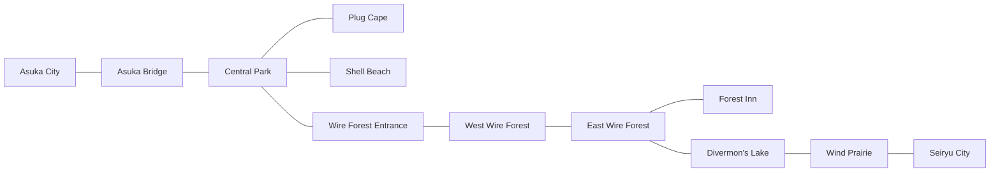
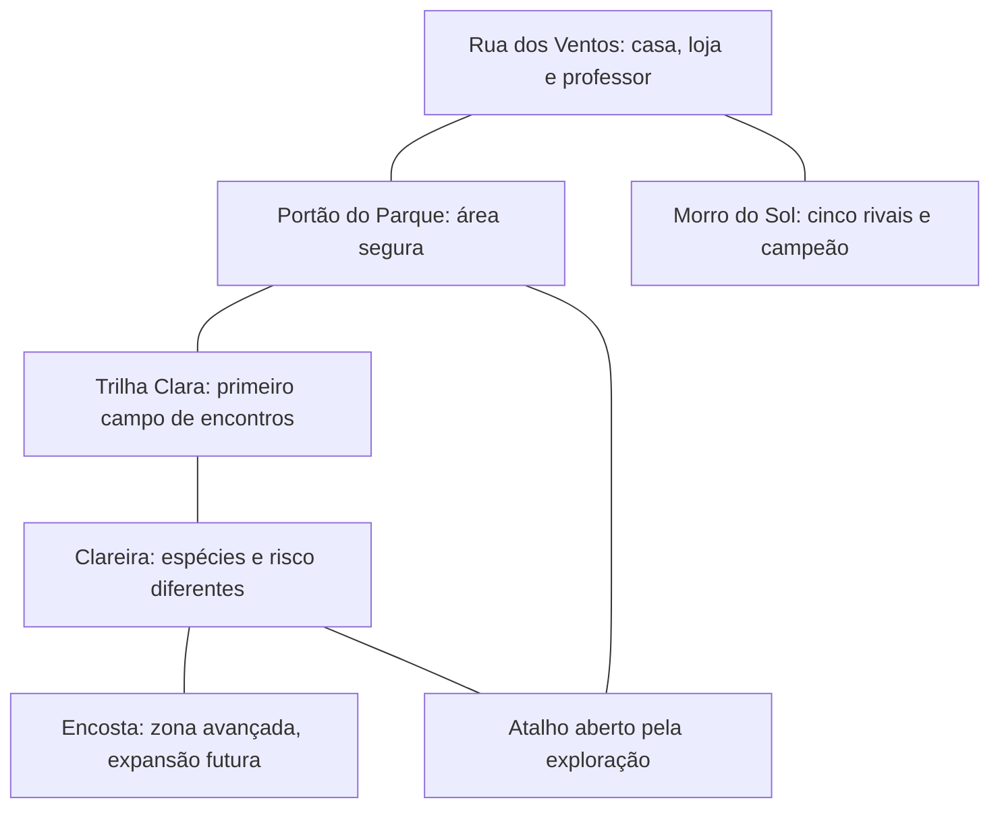

# Benchmark consolidado — Digimon World 2003

**Objetivo:** orientar a criação de exploração repetível, encontros aleatórios, evolução individual e obtenção de rabiolas em Soulmonsters/PipaKlub. Pesquisa realizada em 21/10/2026.

**Conclusão:** falta uma camada de aventura entre a cidade segura e os cinco rivais de cada bairro. Recomenda-se uma região opcional de exploração, acessível após o primeiro voo, onde o jogador escolhe procurar Pipamons, ganha XP e pode obter rabiolas. Os rivais continuam responsáveis pela progressão narrativa.

Este documento é pesquisa e proposta de design, não uma implementação. Números de protótipo abaixo não são taxas extraídas de Digimon World 2003.

## 1. Escopo, versões e confiabilidade

Digimon World 2003 é a edição PAL de Digimon World 3. Não confundir com Digimon World de criação/cuidado de um parceiro, nem com World 2, Dawn/Dusk ou os títulos Cyber Sleuth. Há sistemas compartilhados entre DW3 e 2003, mas diferenças regionais impedem tratar todo guia americano como documentação exata do PAL. A edição 2003 inclui conteúdo após o final que não deve ser confundido com a campanha comum. [Visão geral das versões](https://digimon.fandom.com/wiki/Digimon_World_3), [guia PAL de Funeralord](https://manuals.plus/m/31e65a3dbbb36ad8ecc74bb22f5beaf904d98d51bb9d65f07d53e35fbe341fab).

Método: manual da Bandai disponível em arquivo indexado, comparação de guias, referências de mapas e screenshots, relatos de jogadores e inspeção do código atual do nosso jogo. Não foi feita uma nova campanha de Digimon nem medição em emulador. Frequências de encontro, chances de drop e tempos originais não foram medidos; informações conflitantes entre guias foram omitidas da proposta quantitativa.

## 2. O que o jogo documenta

| Sistema | Referência documentada | Aprendizado para nós |
|---|---|---|
| Combate | Encontros levam a batalhas individuais por turnos, com ataque, técnica, troca, digivolução, item e fuga. | Conservar a separação entre exploração e batalha, adaptando ao nosso combate de pipas. |
| Preparação | O menu reúne mapa, itens, ordem dos parceiros e status; TP serve ao treinamento em ginásio. | A preparação precisa ter lugar e propósito no mundo, com retorno claro à exploração. |
| Crescimento | Existem experiência, atributos e progressão das formas. | Fazer cada sessão render progresso legível além do próximo chefe. |

Fonte destas funções: [manual da Bandai](https://www.gamesdatabase.org/Media/SYSTEM/Sony_Playstation/Manual/formated/Digimon_World_3_-_2002_-_Bandai.pdf).

### O primeiro circuito de treino

Central Park apresenta encontros iniciais e o ginásio de Leomon. Kunemon concede 6 EXP/10 BIT; Tapirmon, 5 EXP/20 BIT. Em West Wire Forest, Betamon concede 10 EXP/25 BIT. Esses exemplos mostram mudança de retorno conforme o lugar; não são valores a copiar para nossa curva de XP. [Guia de EmeraldPhoenix](https://gamefaqs.gamespot.com/ps/562323-digimon-world-3/faqs/18310).

O percurso inicial conecta cidade, ponte, parque, entrada da floresta, floresta oeste e leste, lago e pradaria antes de Seiryu. Forest Inn oferece apoio ao longo do trajeto. Há bifurcações e desvios com recompensas, em vez de cada tela existir apenas para um combate obrigatório. [Percurso de Matthew Wilson](https://walkthrough.freeola.com/game/4620/ps1/digimon-world-2003.html).

### Coleção não é captura de cada inimigo

Novos parceiros são obtidos por missões dos DRI Agents envolvendo DDNA e condições específicas. Formas de digivolução têm requisitos de nível/atributos e configuração no laboratório. Portanto, “derrotar um selvagem, receber sua rabiola e invocá-lo” é uma adaptação nossa, não uma reprodução de DW2003. [FAQ europeu de Mykas0](https://gamefaqs.gamespot.com/ps/562323-digimon-world-3/faqs/21889), [formas e requisitos — ChaosBeelzemon](https://gamefaqs.gamespot.com/ps/562323-digimon-world-3/faqs/51616).

Cardmon associa encontros encontrados por pesca ou árvores à obtenção de boosters de cartas. A lição é que explorar/interagir pode ter uma recompensa própria, sem transformar todo objeto em combate genérico. [Referência de Cardmon](https://digimon.fandom.com/wiki/Cardmon).

## 3. Benchmark de mapa e level design

### Geografia funcional

O parque funciona como articulação entre destinos; a sequência de áreas mistura deslocamento, combate e serviços. Este é um esquema parcial de conexões, não uma reprodução da escala ou orientação do mapa original:

Conexões conferidas nos guias de [EmeraldPhoenix](https://gamefaqs.gamespot.com/ps/562323-digimon-world-3/faqs/18310) e [Matthew Wilson](https://walkthrough.freeola.com/game/4620/ps1/digimon-world-2003.html). O esquema omite saídas e áreas posteriores.

### Como estudar o visual

Referências para consulta: [Central Park](https://wikimon.net/images/0/02/Dw3_central_park.jpg), [Wire Forest Entrance](https://wikimon.net/Wire_Forest_Entrance), [Wire Forest de Amaterasu](https://wikimon.net/Wire_Forest_%28Amaterasu_Server%29) e [percurso ilustrado](https://stratswiki.com/digimon-world-3/walkthrough/part-1/).

Minha leitura das imagens: o caminho caminhável tem contraste, as massas de vegetação enquadram o percurso e objetos marcantes ajudam a reconhecer trechos. A floresta mistura elementos naturais e artificiais; a referência de Amaterasu também identifica uma hospedaria na grande árvore. Isso sugere usar composição e identidade local antes de aumentar a quantidade de decoração. [Descrição do mapa](https://wikimon.net/Wire_Forest_%28Amaterasu_Server%29).

| Critério de mapa | Aplicação proposta para o nosso jogo |
|---|---|
| Identidade | Cada tela deve ter uma silhueta reconhecível: árvore, reservatório, coreto ou encosta. |
| Caminho principal | Chão legível e direção reconhecível sem depender de um seletor de destinos. |
| Desvio opcional | Um pequeno percurso com motivo concreto: espécie, item ou descoberta. |
| Risco espacial | O jogador identifica onde há encontros e onde pode descansar. |
| Circuito | A volta revela um atalho; não exige refazer sempre todo o caminho. |
| Profundidade | Mais risco adiante, com possibilidade de recuar antes de entrar. |
| Continuidade | A saída de uma tela e a chegada na outra devem combinar em direção, piso e elevação. |
| Colisão | Toda passagem aparente precisa ser caminhável ou claramente bloqueada. |

## 4. O ciclo que vale aproveitar

Interpretação de design, a partir dos sistemas documentados:

**Preparar → sair → encontrar inimigos → ganhar recursos → ficar mais forte → decidir avançar ou voltar → preparar novamente.**

Três objetivos convivem: vencer a próxima etapa, fortalecer o parceiro e descobrir algo opcional. É isso que transforma repetição em aventura. Para nós, a rabiola acrescenta um quarto objetivo: buscar um futuro parceiro.

O mapa deve responder perguntas simples: “onde encontro a espécie que quero?”, “até onde consigo ir?”, “quando é melhor voltar?” e “qual novo caminho minha vitória abriu?”.

### O que não copiar sem revisão

Há relatos de jogadores que elogiam o mundo e o treinamento, mas criticam retornos longos, frequência de encontros e caminhos confusos. São experiências individuais, não uma pesquisa representativa. [Relato de retrospectiva](https://www.reddit.com/r/digimon/comments/18pj7nk/i_played_digimon_world_3_or_rather_2003_after/).

A existência de um mod voltado a viagem rápida também sinaliza demanda por diminuir deslocamentos repetidos, sem provar sozinha o que todos os jogadores desejam. [Projeto DW2003 Fast Travel](https://github.com/Flaweyy/dw2003fasttravel/blob/main/README.md).

| Preservar | Melhorar na nossa adaptação |
|---|---|
| Região conhecida vira lugar de preparação. | Caminho seguro para quem quer apenas passar. |
| Inimigos e retornos variam por área. | Habitat e recompensas ficam consultáveis após descoberta. |
| Exploração pode surpreender. | Nada de encontro imediato na saída de um loading ou diálogo. |
| Formar um objetivo de longo prazo. | Não combinar várias chances minúsculas sem proteção contra azar. |
| Retorno à base fecha uma expedição. | Atalhos e saída rápida após descobrir a região. |
| Desenvolvimento motiva novas sessões. | Não tornar grind longo obrigatório para vencer o primeiro rival. |

## 5. Diagnóstico do nosso jogo

Inspeção da versão local atual, não afirmação sobre Digimon:

| Já existe | Falta para sustentar grind |
|---|---|
| Bairro com cinco encontros e portões por vitória. | Percurso opcional que não dependa de repetir rival. |
| XP por cópia de Pipamon, até nível 50. | Fonte de XP própria de exploração. |
| Rabiolas e ritual de invocação com até três tentativas. | Entrega verificada de rabiola por encontro aleatório. |
| Registro de espécies vistas e catálogo com habitats. | Mostrar localização descoberta, espécies e expectativa de busca. |
| Bancos de 30 no save e 20 globais. | Tratar o banco cheio antes de consumir uma rabiola. |
| Saves manual e automático. | Retomar encontro pendente sem sortear de novo sua recompensa. |
| Mapas Tiled, colisão e transições. | Zonas de encontro, áreas seguras, atalhos e pontos de apoio autorados. |

Referências internas: `src/engine.js`, `src/pipamon-level-client.js`, `assets/pipa-dex.json`, `assets/world/morro-road-v1/manifest.json`, migrações 007, 008, 016, 019 e 020.

### Dois conflitos que precisam ser resolvidos no design

**Limite diário:** a migração 016 limita a concessão a 2.000 XP por conta/dia, somando as fontes existentes. Isso pode interromper uma sessão longa de progressão. Recomendo revisar a restrição de PvE para a proposta Steam: combater concessões inválidas e taxas impossíveis no servidor, sem transformar o fim da cota diária em “seu parceiro não evolui mais hoje”. Isso exige decisão explícita antes de implementar; este benchmark não altera o limite.

**Derrotas como fonte:** Trilhas atualmente concedem 20 XP na derrota. Não transportar automaticamente essa regra para selvagens repetíveis, ou perder deliberadamente pode se tornar a rotina mais eficiente. No protótipo, fuga e derrota não concederiam XP nem rabiola; a punição seria tempo/retorno, sem perder o parceiro.

## 6. Proposta: Parque dos Ventos

Nome provisório. Entrada pela Rua dos Ventos, liberada após concluir o treino do professor, antes de exigir vitória contra Zeca. Ele deve ensinar a busca de rabiolas e permitir preparação para o Morro. Não exige compromisso com novos bairros nem substitui os cinco rivais.

### Primeira versão viável

**Duas telas novas:** uma reúne portão, apoio e Trilha Clara; outra contém a clareira e a volta pelo atalho. Encosta fica para expansão. Essa versão já permite sair, explorar, batalhar, obter uma rabiola e voltar ao professor.

| Lugar | Papel de jogo | Direção visual |
|---|---|---|
| Portão e apoio | Segurança, explicação curta e retorno à rua. | Placa, banco, sombras, chão amplo. |
| Trilha Clara | Primeiros encontros e primeira rabiola. | Capim baixo, pequenos papéis presos em galhos, chão que distingue a trilha segura. |
| Clareira | Escolher continuar a busca ou voltar. | Árvore reconhecível, espaço aberto e rajadas visíveis. |
| Atalho | Reduzir deslocamento depois da descoberta. | Portinhola destravada por dentro, conectada ao portão. |

O ambiente deve parecer parte da cidade brasileira já construída: vegetação, papel, bambu e vento. Não copiar os cabos, o cenário ou a planta do mapa de Digimon.

### Experiência de primeira visita

Assis explica que alguns Pipamons soltos deixam rabiolas durante os encontros. Kael sai com Rabbito, vê a trilha segura e uma faixa de vegetação agitada pelo vento. Ao explorar essa faixa, surge um redemoinho, uma silhueta aparece e começa um duelo curto. A primeira vitória elegível entrega uma rabiola comum garantida como apresentação do sistema. O jogador decide continuar procurando ou voltar à invocação.

Essa garantia é uma recompensa de introdução registrada uma vez por conta, não uma premiação repetível ao apagar saves. O nascimento narrativo de um novo Rabbito em outra campanha continua seguindo sua regra própria.

## 7. Encontros aleatórios: comportamento proposto

1. Só rolar encontros dentro de zonas demarcadas, com personagem realmente se deslocando. Esperar parado não gera encontros.
2. Acumular distância efetiva e respeitar uma distância mínima antes do próximo sorteio. Não usar chance por quadro de renderização.
3. Não acumular durante menus, diálogos, loading, corte de cena ou outro encontro.
4. Ao sair de batalha, conceder uma pequena faixa de segurança para recuperar o controle e escolher recuar.
5. Mostrar um sinal breve de vento/papel antes da transição. A composição da arena deve corresponder ao lugar.
6. Sortear espécie e nível pela região. Evitar escalonar todo o mundo ao nível do jogador: voltar mais forte a um lugar conhecido deve ser perceptível.
7. Permitir fuga de selvagens. Ações de campanha e de campeão mantêm suas próprias regras.
8. A passagem pavimentada principal e os pontos de apoio não geram encontros. Quem entra no terreno de busca aceita o risco de forma legível.

**Combate proposto:** um duelo curto com um Pipamon, sem melhor de três e sem cerimônia de rival para cada encontro. Manter a mecânica real de voo, cruzamento e ataque. Recompensa compacta com XP, avanço de nível e rabiola, deixando o jogador continuar rapidamente.

Faixas para testar: 15–30 segundos de exploração ativa antes de um novo encontro elegível; 30–60 segundos para um duelo comum. São metas iniciais de sensação, não valores fechados nem medições de Digimon. Devem virar distância em unidades de mapa depois que a velocidade do tamer for medida.

## 8. Espécies, XP e drops — hipótese de protótipo

Usar espécies já presentes e seus habitats para reduzir custo de arte. Não colocar Rabbito no sorteio inicial: seu nascimento especial é parte central da história. Pipamons de evento também não entram automaticamente em pools comuns.

Exemplo de um único pool inicial, com raridade relativa apenas dentro desse campo:

| Espécie | Peso de encontro | Nível inicial | XP total por vitória | Rabiola da própria espécie |
|---|---:|---:|---:|---:|
| Carcará | 50% | 1–2 | 20 | 25% |
| Mata Verde | 35% | 1–3 | 20 | 25% |
| Raio de sol | 15% | 2–3 | 30 | 25% |

Azulão pode pertencer a um trecho úmido na expansão, sem condicionar o jogador à chuva real ou a um horário real de login. “Raro neste lugar” não determina a raridade geral ou de troca da espécie.

Esses valores são **propostas para playtest**. XP é o total pretendido do encontro: não somar inadvertidamente mais 25 XP do evento genérico de corte. Moedas, se existirem nos selvagens, devem ter retorno pequeno e ser calibradas junto das lojas; não assumir uma nova fonte ilimitada de dinheiro antes de medir sua economia.

### Por que a chance efetiva importa

Com o pool acima e antes de qualquer proteção contra azar, a chance de receber uma rabiola de Raio em cada vitória seria 15% × 25% = 3,75%. A média matemática seria uma a cada 26,7 vitórias, **não uma garantia em 27**. Carcará teria média de 8 vitórias; Mata Verde, 11,4.

Já uma espécie com encontro de 1% e drop de 10% produziria chance final de 0,1%: média de mil vitórias. Essa combinação seria excessiva para o primeiro sistema de invocação.

Proposta inicial de proteção: primeira rabiola comum garantida na apresentação do sistema; depois, após sete vitórias elegíveis consecutivas sem rabiola, a oitava entrega uma. Isso protege a obtenção de alguma rabiola, não garante uma espécie específica. Para a busca rara, considerar posteriormente pistas ou uma missão direcionada; não esconder outra garantia não explicada dentro do mesmo sorteio.

Os contadores devem persistir e não ser reiniciados por troca de mapa, reconexão ou carregamento de save. Os cálculos de média acima deixam de descrever exatamente o sistema quando a proteção entra em vigor.

### Compatibilidade com a curva atual

Hoje, os limiares acumulados dos níveis 2, 3 e 4 são 50, 120 e 210 XP. Com 20 XP por vitória, um Pipamon começando em zero alcançaria esses marcos após 3, 6 e 11 vitórias, respectivamente. Isso é uma base para testar a sensação; Rabbito já treinado pode começar com XP adquirido na campanha.

Antes de balancear os selvagens, medir a recompensa efetiva das Trilhas repetidas. A exploração deve valer por busca, acesso e variedade, sem exigir que o jogador escolha sempre o conteúdo matematicamente dominante.

## 9. Invocação e bancos

O ciclo completo passa a ser:

**Explorar → encontrar espécie → vencer → ganhar XP e talvez rabiola → voltar ao NPC → escolher espécie e rabiola → executar feitiço → receber parceiro no banco do save.**

Preservar regras já definidas: espécie vista; rabiola específica por padrão; suporte futuro a receitas alternativas sem habilitá-las agora; rabiola comprometida ao usar; até três tentativas; abandono torna a rabiola danificada; banco do save com 30 espaços e global com 20.

O banco cheio não impede procurar uma rabiola, pois a rabiola é item, não um novo parceiro. A capacidade de parceiro deve ser conferida antes de iniciar/consumir o ritual. Nunca descartar automaticamente uma cópia existente para abrir espaço. A regra de capacidade do inventário de rabiolas, se necessária, é uma decisão separada.

## 10. Requisitos para implementação futura

### Conteúdo e Tiled

- Autorizar polígonos de encontro, áreas seguras, saídas, apoio e atalho.
- Separar máscara de colisão do desenho do cenário.
- Definir catálogo por zona: espécies, pesos, níveis, recompensas, requisito de acesso e versão.
- Reutilizar sprites existentes; criar chão, vegetação, portão, apoio, marco da clareira, fundo de duelo e transição curta de vento.
- Validar escala do tamer, pés no chão, oclusão atrás de árvores e continuidade entre telas.

### Economia online

- Registrar um encontro autenticado por vez, vinculando zona e cópia do parceiro ao início.
- O servidor autoriza a zona, sorteia o encontro e confirma resultado/recompensas; o cliente não envia “ganhei uma rabiola”.
- Distância informada pelo cliente não é evidência suficiente para conceder itens. Combinar validação de sessão, acesso, ritmo possível e batalha verificada.
- Vincular sorteio e recompensa ao identificador do encontro para que reconectar, repetir resposta ou carregar save não role novos drops.
- Fazer a concessão de XP, item e contador de azar de forma atômica e idempotente.
- Não dar ao papel de servidor de partida uma permissão genérica para fabricar rabiolas: a função atual de concessão é restrita e precisa ser usada por uma finalização verificada.
- Bloquear conflitos com partida, troca e ritual ativos. Encerrar ou recuperar encontro pendente antes de reiniciar campanha.
- Não usar o banco global nem reset de save para repetir prêmios de apresentação ou garantias de conta.

Referência: `grant_summon_tail` já possui identificação de origem/referência; `pipamon_xp_events` já possui registro por evento. Novos encontros precisam integrar essas garantias, não criar uma economia paralela.

## 11. Critérios para considerar o protótipo pronto

| Pergunta | Evidência desejada |
|---|---|
| O jogador entende onde há risco? | Consegue escolher a trilha segura e o terreno de busca sem abrir um tutorial longo. |
| A primeira recompensa é clara? | Vê a rabiola, identifica a espécie e sabe procurar o professor. |
| Vale repetir? | Uma sessão curta produz progresso visível, mesmo sem a espécie rara desejada. |
| O mapa é um lugar? | Reconhece um marco e usa o atalho após descobri-lo. |
| A dificuldade é justa? | Consegue recuar; selvagens iniciais não exigem vencer Zeca antes. |
| A economia é íntegra? | Fuga/derrota não concedem drop; reconexão e repetição de chamada não duplicam nada. |
| O retorno funciona? | Depois de batalha, chega à mesma zona em ponto seguro; não entra imediatamente em outro encontro. |
| A coleção é respeitada? | Rabiola não vira parceiro automaticamente; banco cheio não apaga nem consome indevidamente. |
| O controle funciona? | Exploração, fuga, resultados, inventário e retorno podem ser feitos sem mouse. |

Medir no playtest: tempo até primeiro encontro e primeira rabiola; duração de duelo e de transição; XP/minuto; rabiolas/hora por espécie; proporção de fugas/derrotas; intervalos sem drop; tempo em menus; retorno espontâneo à área. As metas numéricas devem ser revistas com esses dados, não tratadas como promessa de balanceamento.

## 12. Ordem recomendada

1. Fechar regras de recompensa, derrota, fuga e revisão da cota diária de XP.
2. Fazer mapa cinza de duas telas, incluindo circuito, zonas seguras e atalho.
3. Validar caminhada/controle, encontro e retorno sem recompensa real.
4. Integrar duelo curto e finalização online verificada.
5. Integrar rabiola, proteção contra azar e tutorial de retorno à invocação.
6. Produzir e aplicar arte definitiva depois de validar o percurso.
7. Testar o ciclo completo com banco cheio, derrota, fuga, reconexão e reset.

**Recomendação final:** construir primeiro esse pequeno circuito de exploração. Ele dá à cidade uma atividade recorrente e um motivo de retorno, sem exigir a criação de todos os 12 bairros antes de o jogo ter uma rotina de aventura convincente.
