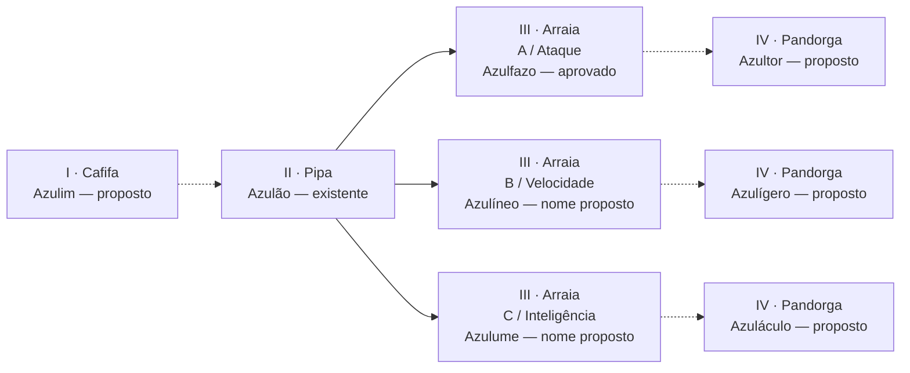
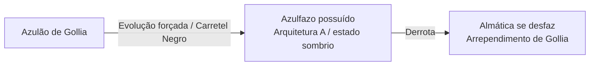

# Azulão — chart completo para teste, v1

## Estado desta proposta

O autor aprovou **Remonta / Reweaving** e os nomes de estágio **Cafifa → Pipa → Arraia → Pandorga**, preservados em inglês. Também já aprovou as três arquiteturas do Azulão: A ataque, B velocidade e C inteligência, com A/Azulfazo usada por Gollia.

**Este teste propõe** colocar Azulão no estágio II e as três arquiteturas no estágio III. Azulim, Azulíneo, Azulume, Azultor, Azulígero e Azuláculo são nomes de trabalho, não nomes aprovados. Azulim e as três Pandorgas têm folhas exploratórias A/B/C, ainda sem alternativa escolhida; as configurações especiais permanecem em brief. Não foi inserida nenhuma criatura nova no jogo.

**Correção do autor após a primeira folha:** Azultor deve mudar expressivamente de plano corporal e ser um **hipogrifo de quatro patas e duas asas**. A exploração aviana bípede anterior fica arquivada. [Abrir as folhas de silhuetas](../../../art/creatures/azulao-family-v1/index.html). A diretriz vale para Azultor; não transforma automaticamente as demais rotas em hipogrifos.

**Escolha posterior:** o autor escolheu **Azultor A da folha de hipogrifos** e pediu recuperar o traço 2D mangá. Foram produzidas oito pranchas individuais: Azulim, Arraias B/C, Azultor A refinado, Pandorgas B/C e Velas de Monção/Alísio. Todas estão nas fichas do chart e na [galeria atual](../../../art/creatures/azulao-family-v1/index.html); a escolha de A não aprova automaticamente o acabamento novo. Novas anatomias e nomes continuam em revisão. O histórico das silhuetas foi preservado.

[Abrir chart interativo](index.html) · [Dados estruturados](chart.json).

## Linha principal: uma base, três rotas

As setas contínuas representam as três rotas já escolhidas; não confirmam condições numéricas ou atribuição de estágio. As tracejadas são conexões novas propostas.

| Estágio | Forma | Ideia de corpo | O que aprende | O que não domina |
| --- | --- | --- | --- | --- |
| I · Cafifa | **Azulim** | Ave pequena redonda, crista dupla dobrada, asas em concha, nuvem curta de rabiola | Encontrar abrigo e sustentar um voo curto | Alcance e sustentação prolongada |
| II · Pipa | **Azulão** | Losango azul/creme, asas de nuvem e rabiola conhecida | Proteger outro e ler uma rajada | Especialização extrema |
| III · Arraia · A | **Azulfazo** | Águia de peito forte e garras, asas largas | Conter avanço e devolver impacto | Curvas fechadas e recuperação rápida |
| III · Arraia · B | **Azulíneo** | Ave de pernas/pescoço longos da opção B | Reposicionar e encontrar passagem | Choque frontal e encurralamento |
| III · Arraia · C | **Azulume** | Ave compacta e leque de espirais da opção C | Antecipar e organizar o espaço | Perseguição e resposta sem preparo |
| IV · Pandorga · A | **Azultor** | Hipogrifo: quatro patas, duas asas, frente aviana e garupa equina | Proteger sob pressão e preparar impacto decisivo | Retorno após compromisso de ataque |
| IV · Pandorga · B | **Azulígero** | Ave serpentina de voo horizontal, duas asas e duas patas traseiras; anatomia proposta na nova prancha | Sustentar curvas encadeadas e sair delas com precisão | Espaço apertado e interrupção de trajetória |
| IV · Pandorga · C | **Azuláculo** | Ave baixa, três grandes espirais orientáveis e asas como mantos | Interpretar vários eixos e preparar controle de área | Previsão precisa quando o adversário muda o plano |

As funções são hipóteses de jogo; ainda não são skills ou atributos implementados. “Inteligência” não significa leitura automática da entrada do jogador. “Velocidade” não significa esquiva infinita. “Ataque” não significa imunidade.

## Requisitos de remonta: proposta legível

O chart não fixa níveis: primeiro queremos validar a diferença entre os corpos, sem prometer balanceamento. Cada nova ligação tem três critérios visíveis no protótipo:

1. **Corpo anterior estável.** Há uma configuração de origem clara; não se salta de Cafifa para Pandorga marcando uma caixa.
2. **Domínio funcional.** O parceiro demonstra a capacidade que orienta a rota: avanço/frenagem, mudança de direção ou antecipação.
3. **Construção apropriada.** Materiais e pontos de tensão sustentam essa capacidade. Nomes de itens, quantidades e custos ainda precisam ser definidos.

O teste permite marcar critérios para experimentar a navegação. Isso não registra treinamento real nem altera um save. Ao selecionar uma forma sem ligação direta, a ação de remonta fica indisponível e o motivo aparece.

### Voltar e escolher outra rota

Proposta: retornar pela oficina a um corpo anterior e escolher outra rota, conservando a identidade na rabiola. O protótipo simula o caminho de volta sem reset de experiência, porque preservação de XP e custos ainda não foram decididos. Não inventar redução, bônus ou reembolso por consequência do clique.

Configurações especiais são retiradas ao remontar para outra forma no teste; não transferem vantagens gratuitamente. A composição de efeitos só deve existir se for projetada e balanceada depois.

## Remonta Especial: fora da escala vertical

Estas configurações conservam Azulão no **estágio II · Pipa**. Não são novas espécies, não substituem a Arraia B e não requerem uma alma diferente.

| Configuração proposta | Construção | Ganho funcional | Compromisso |
| --- | --- | --- | --- |
| **Vela de Monção** | Membranas que desviam água e grandes planos sobrepostos de asa | Estabilidade e cobertura sob pressão contínua | Mais peso de resposta e menor agilidade |
| **Vela de Alísio** | Membrana leve e bordas flexíveis, duas fitas de leme | Planar e corrigir deriva com suavidade | Menos sustentação contra choque frontal e vento contrário |

Os nomes se referem à configuração, não ao nome pessoal do parceiro. Não foram introduzidos itens de loja, imunidades elementais, receitas ou habilidade de campo desbloqueável. O desenho precisa continuar sendo Azulão de imediato.

## Gollia: evolução e possessão, não quarta rota

O estado possuído fica em painel narrativo separado e não pode ser escolhido no simulador de Remonta.

O chart também relaciona a forma livre Azulfazo à sua identidade possuída, mas **não obriga a cena de Gollia a passar por uma oficina ou mostrar a forma livre primeiro**. Não existe seta saudável de recompensa de Azulfazo possuído para Azultor; tampouco a possessão é Pandorga, estágio V ou configuração rara do jogador.

## Entrelaço e ápice temporário

**Entrelaço / Interweaving:** reservado. Nenhum par compatível foi aprovado para Azulão. Não inventar fusão com Rabbito ou com outra ave apenas para tornar a página maior. O tema das almas e o precedente da Pipa-Dragão exigem uma decisão específica.

**Ápice temporário:** fora deste primeiro teste. Se houver depois, será um estado breve com causa e recuperação, não mais um degrau acima de Pandorga.

## Arte e produção

Fontes existentes:

- [Azulão aprovado](../../../art/soulgen/keys/azulao/color-rig-v2/concept.png).
- [Prancha A/B/C aprovada como arquiteturas](../../../art/soulgen/campaign-redesigns-v1/azulfazo/concept-v1/opcoes.png).
- [Azulfazo livre, rig editado pelo autor](../../../art/soulgen/keys/azulfazo/README.md).
- [Azulfazo possuído, rig editado pelo autor](../../../art/soulgen/keys/azulfazo-possuido/README.md).

A página usa as referências existentes e as oito novas pranchas individuais em revisão. B/C de Arraia preservam as arquiteturas anteriores; as novas folhas aparecem nos detalhes. PNGs de image_gen foram copiados integralmente e têm fonte/hash registrados. Não há desenho procedimental fingindo ser concept. As silhuetas anteriores ficam no histórico da galeria.

Cada nó do JSON tem identidade, mudança anatômica, função, limite, gesto, paleta, critérios propostos e situação de aprovação. Arte nova deve seguir o 2D mangá limpo do projeto, preservando crista dupla, azul/creme e motivo de nuvem sem obrigar a todos os corpos losangos e remendos. Não copiar uma ave existente e só mudar o tamanho.

### Ordem para gerar os novos concepts

1. Aprovar ou ajustar esta distribuição de estágios e os nomes de trabalho.
2. Gerar Azulim junto à referência da base para validar que a pré-evolução pertence à família.
3. Produzir individualmente B e C preservando suas arquiteturas já aprovadas; o objetivo é acabamento, não reinventá-las.
4. Explorar as três Pandorgas uma a uma, contrastando corpo e gesto com a Arraia de origem.
5. Só então testar a leitura lateral das duas Velas Especiais.

Esta ordem não impede testar o chart agora. O protótipo é completo em relações e briefs, sem apresentar desenhos ainda inexistentes como aprovados.

## Como testar a prova

Abra [index.html](index.html), inclusive por arquivo local. Clique numa forma para ver o brief. Comece em Azulim ou Azulão, marque os critérios e avance pela ligação disponível. Volte pela oficina para experimentar outro ramo. Em Azulão, experimente cada Remonta Especial e veja que o estágio não muda. Selecione a possessão e confirme que não há remonta disponível.

Os controles usam botões e caixas nativos, acessíveis por teclado. Em telas estreitas, o chart rola horizontalmente dentro do próprio painel; detalhes e simulador empilham. Dados ficam inline para não depender de servidor ou fetch por file://. Nenhum acesso ao banco, Supabase ou código de jogo.
