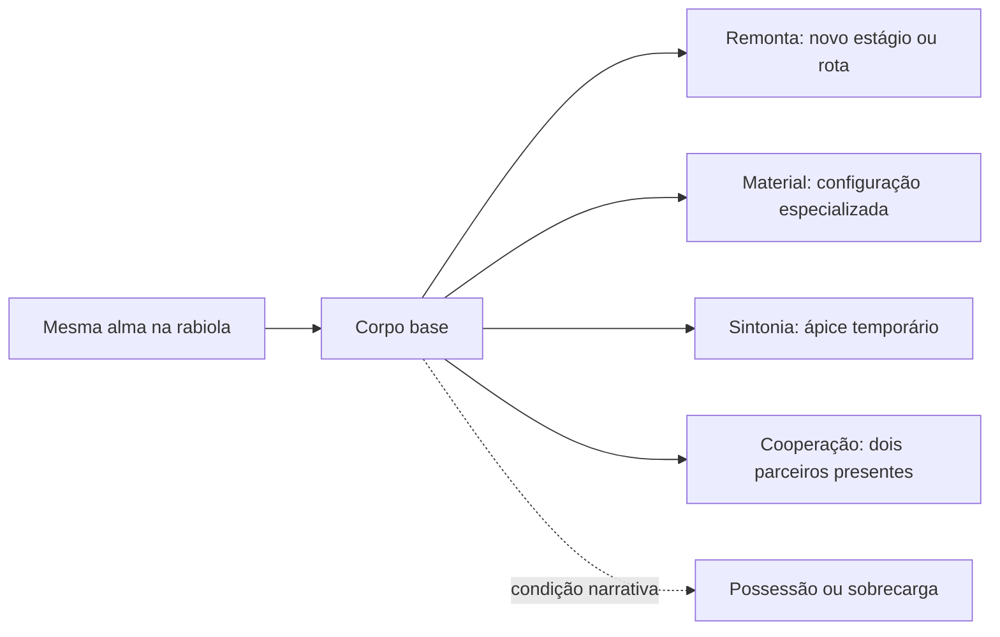

# Evolução em Digimon e o que ela ensina ao Soulmonsters

Pesquisa: 03/11/2026. Estudo de mecanismos e direção de criaturas. Não aprova novas regras, nomes ou fusões para Soulmonsters.

**Decisão posterior à pesquisa:** [Remonta / Reweaving e Cafifa → Pipa → Arraia → Pandorga foram aprovados](../DECISOES-NOMENCLATURA.md). As aplicações e condições discutidas neste estudo continuam propostas. [Chart do Azulão para teste](../azulao-chart-v1/index.html).

## 1. A descoberta central

Digimon permite mudar **estágio, caminho, configuração e relação com outros personagens**. Essas mudanças não são todas a mesma operação. A apresentação oficial de Adventure 02 distingue evolução comum, Armor por Digimental e Jogress pela combinação de duas criaturas. Já o produtor de Time Stranger descreve um sistema ramificado com retorno a formas anteriores. Não existe um único conjunto de condições que sirva para todos os animes, jogos e brinquedos. [Toei: Adventure 02](https://lineup.toei-anim.co.jp/ja/tv/digimon02/), [Bandai Namco: entrevista de Time Stranger](https://en.bandainamcoent.eu/digimon/news/digimon-story-time-stranger-producer-interview).

**Interpretação de design:** o potencial de uma criatura pode se revelar de vários modos. A pergunta produtiva é “o que ela passa a conseguir fazer e por quê?”, antes de “quantos chifres acrescentar?”.

Para Soulmonsters, isso sugere distinguir:

| Dimensão | Pergunta | Exemplo do nosso projeto |
| --- | --- | --- |
| Estágio de corpo | Quanto a construção consegue sustentar? | Remonta, ainda proposta na bíblia |
| Rota | Em que função o parceiro se especializa? | Azulão A/ataque, B/velocidade, C/inteligência |
| Configuração por artefato | Que capacidade específica um material habilita? | Possível equivalente autoral de Armor, ainda não definido |
| Cooperação | Duas vontades conseguem agir juntas? | Possível mecanismo do Elo, não aprovado |
| Estado | O que está acontecendo com a mesma criatura? | Possessão, sobrecarga, máscara, recuperação |

Essas são categorias de análise. Não é necessário implementar todas, nem dar todas a cada espécie.

## 2. Vocabulário: estágio não é nível numérico nem método

As traduções variam. Uma comparação útil dos nomes japoneses com nomes ingleses recorrentes é:

| Estágio japonês | Nomes ingleses encontrados na franquia | Como ler |
| --- | --- | --- |
| Yōnenki I | Fresh / In-Training I | Primeira fase infantil |
| Yōnenki II | In-Training / In-Training II | Segunda fase infantil |
| Seichōki | Rookie | Fase de crescimento |
| Seijukuki | Champion | Fase adulta |
| Kanzentai | Ultimate | Fase perfeita |
| Kyūkyokutai | Mega | Fase extrema |

A enciclopédia atual chama Botamon de In-Training I e Koromon de In-Training II. A expressão japonesa Kyūkyokutai não corresponde ao rótulo inglês Ultimate dessa tabela: sua localização recorrente é Mega. Sempre registrar o idioma para evitar deslocar um estágio inteiro. [Botamon](https://digimon.net/reference_en/detail.php?directory_name=botamon), [Koromon](https://digimon.net/reference_en/detail.php?directory_name=koromon), [Gallantmon: Mega](https://digimon.net/reference_en/detail.php?directory_name=dukemon).

Armor e Hybrid também aparecem como classificações próprias na enciclopédia. Isso não os transforma em degraus universais entre os seis acima. O estágio da espécie, o nível de experiência num jogo e o método que produziu a forma devem ficar em campos separados. [Flamedramon: Armor](https://digimon.net/reference_en/detail.php?directory_name=fladramon), [Agunimon: Hybrid](https://digimon.net/reference_en/detail.php?directory_name=agnimon).

Outra ambiguidade importante: **Digi-Egg de Armor é o Digimental**, o artefato usado para transformar; não confundir o nome localizado com um ovo de nascimento. O perfil de Flamedramon descreve explicitamente a transformação pelo Digi-Egg of Courage. [Perfil oficial](https://digimon.net/reference_en/detail.php?directory_name=fladramon).

## 3. Evolução comum e ramificações

Em Time Stranger, uma criatura pode ter vários destinos. As condições incluem parâmetros e, em determinados casos, item ou personalidade. É uma descrição desse jogo, não uma receita automática para Adventure ou qualquer outro título. [Entrevista do produtor](https://en.bandainamcoent.eu/digimon/news/digimon-story-time-stranger-producer-interview).

**O que aprender:** desenhar caminhos como escolhas de função. Uma rota de força pode concentrar massa no peito e nos apoios; uma de mobilidade pode redistribuir o mesmo tema para membros longos; uma de controle pode favorecer órgãos sensoriais e gestos precisos. Isso é nossa análise, não uma regra oficial de anatomia de Digimon.

O Azulão já oferece um ótimo ponto de partida autoral: A é uma águia de força, B uma ave alta e esguia, C uma ave compacta de inteligência. São três respostas diferentes ao tema, não a mesma águia com acessórios trocados. Não reduzir as diferenças a ATK/SPD/INT sem mudança de comportamento.

**Cuidado:** uma rede com alternativas não exige que todo indivíduo possa chegar a qualquer identidade. No nosso jogo, as origens de Rabbito, Retalho e Platyx impõem continuidade narrativa.

## 4. Armor Evolution: criatura × artefato × função

Flamedramon evolui pelo Digi-Egg of Courage, associado ao fogo e ao combate corpo a corpo. Lighdramon usa o Digi-Egg of Friendship, associado ao trovão e à velocidade. O produtor de Adventure 02 apresenta Armor como transformação em que o Digimental se torna armadura. [Flamedramon](https://digimon.net/reference_en/detail.php?directory_name=fladramon), [Lighdramon](https://digimon.net/reference_en/detail.php?directory_name=lighdramon), [Toei: Adventure 02](https://lineup.toei-anim.co.jp/ja/tv/digimon02/).

**Leitura criativa:** o artefato traz uma ideia que reorganiza o corpo e a maneira de lutar. Seu papel não precisa se resumir a vestir uma criatura com metal. O resultado precisa explicar, pelo desenho, a capacidade habilitada.

Magnamon é classificado como Armor, mas seu perfil descreve capacidade ofensiva comparável à de um Mega. Portanto, “Armor sempre equivale a Champion” seria uma generalização incorreta. Também não significa que toda forma Armor seja tão forte quanto Magnamon. [Magnamon](https://digimon.net/reference_en/detail.php?directory_name=magnamon).

### Aplicação proposta ao Soulmonsters

Um material raro de construção poderia revelar uma **configuração especializada da mesma alma**. O material não fornece outra alma nem rouba a identidade do parceiro. Propostas de teste, não nomes ou receitas aprovados:

| Base | Ideia de material | Transformação que teria de aparecer na anatomia | Função |
| --- | --- | --- | --- |
| Mata Verde | Membrana leve que recolhe e dispersa umidade | Folhas largas em concha, juntas flexíveis e cauda de equilíbrio | Apoio e travessia de copas molhadas |
| Carcará | Trama resistente que guarda calor | Peito compacto, asas com borda sustentada e pontas bem separadas | Planar em correntes térmicas, com pouso preciso |
| Rabbito | Fibra elástica de retorno | Pernas e base das orelhas capazes de acumular e devolver tensão | Salto e resgate |

Não são três recolorações elementais. Cada proposta precisa mudar postura, movimento e pelo menos uma ação. Tampouco são parentescos novos com outras espécies do catálogo.

**O que decidir antes de produzir:** configuração temporária ou corpo remontado estável? O artefato é reutilizável, consumido ou apenas estudado? Quem pode usá-lo? O que impede a mesma configuração de ser a melhor em tudo? As respostas pertencem ao nosso sistema, não podem ser herdadas do anime por conveniência.

## 5. DNA Evolution / Jogress: combinação de parceiros

Adventure 02 apresenta Jogress como união de duas criaturas. No episódio 27, a convergência das intenções de Daisuke e Ken provoca a combinação de ExVeemon e Stingmon em Paildramon. A cena transforma a relação entre os personagens em acontecimento de combate. [Toei: episódio 27](https://lineup.toei-anim.co.jp/ja/tv/digimon02/episode/27/).

Paildramon retém forte leitura de dragão com defesa de carapaça de inseto. Dinobeemon nasce da mesma dupla, mas o perfil destaca predominância de características de inseto, quatro asas e percepção por olhos compostos. É um caso muito útil de **duas sínteses diferentes a partir dos mesmos componentes**. Não prova que inverter a ordem dos parceiros sempre mude o resultado em todos os jogos. [Paildramon](https://digimon.net/reference_en/detail.php?directory_name=paildramon), [Dinobeemon](https://digimon.net/reference_en/detail.php?directory_name=dinobeemon).

Omnimon também reúne qualidades de WarGreymon e MetalGarurumon, expressas de forma muito direta nos braços. Ainda é classificado como Mega na enciclopédia. Combinação não exige que inventemos um degrau universal acima de Mega para toda fusão. [Omnimon](https://digimon.net/reference_en/detail.php?directory_name=omegamon).

### Lições para desenhar uma combinação

Estas são inferências de direção artística:

1. Definir qual parceiro organiza a silhueta principal.
2. Escolher uma contribuição anatômica e uma contribuição funcional inequívocas do outro.
3. Criar uma terceira função que nenhum dos dois realiza sozinho.
4. Resolver uma hierarquia de cor; somar as duas paletas integralmente costuma fragmentar a figura.
5. Mostrar como o movimento combina os temperamentos. O resultado não precisa ter duas cabeças nem metade de cada corpo.

### Compatibilidade com nossa história

**Este é o mecanismo com maior risco de contradição no Soulmonsters.** Pipa-Dragão já dramatiza almas roubadas costuradas num corpo e a libertação por desatar os nós. Uma fusão voluntária só funciona se a diferença puder ser vista e entendida.

Proposta a avaliar: duas rabiolas continuam identificáveis e separáveis, as duas vontades participam e a união pode ser desfeita sem apagar um parceiro. O ponto dramático seria consentimento e coordenação. Nenhum dos dois vira ingrediente descartável para melhorar o outro.

Antes de gerar uma combinação, definir quem controla, quem se lembra, como se separa e o que acontece se um quiser parar. “É como DNA de Digimon” não responde a essas perguntas. Recomendo adiar um sistema amplo de combinações e testar primeiro uma ação conjunta sem fundir almas ou corpos.

## 6. DigiXros: composição funcional de equipe

O episódio 6 de Xros Wars mostra uma combinação por DigiXros em Shoutmon X4. A enciclopédia o descreve como uma forma associada ao desejo de vitória de quatro Digimon e especializada em combate terrestre. [Toei: episódio 6](https://lineup.toei-anim.co.jp/ja/tv/digimon_xw/episode/6/), [Shoutmon X4](https://digimon.net/reference_en/detail.php?directory_name=shoutmonx4).

**Distinção útil:** estudar DigiXros como composição de funções da equipe, sem tratá-lo como sinônimo automático de todo Jogress. As condições concretas continuam dependentes da obra.

Aplicação proposta: dois parceiros podem sustentar uma técnica, cruzar linhas para erguer um apoio ou proteger uma travessia, mantendo corpos e rabiolas separados. A contribuição de cada um aparece na ação. Isso transmite cooperação com menor risco narrativo e menor custo de arte que dezenas de fusões completas.

Uma ação cooperativa não é, por si só, uma nova espécie ou evolução. Não multiplicar entradas do catálogo só porque dois parceiros aprenderam a agir juntos.

## 7. Spirit Evolution e Hybrid

Em Frontier, as crianças se transformam em Digimon usando os Spirits herdados dos guerreiros lendários; a Toei destaca essa diferença em relação às séries anteriores, nas quais há parceiros Digimon. Agunimon aparece como Hybrid na enciclopédia. [Toei: Frontier](https://lineup.toei-anim.co.jp/ja/tv/digimon_4th/), [Agunimon](https://digimon.net/reference_en/detail.php?directory_name=agnimon).

**Lição:** uma transformação pode transmitir legado e responsabilidade. O poder não vem apenas de acumular experiência, mas de conseguir carregar algo que existia antes do personagem.

Não recomendo transformar Kael em Soulmonster por analogia. Isso mudaria a relação entre pipeiro, parceiro e rabiola. Uma possibilidade menos invasiva é estudar como uma construção antiga influencia o corpo do parceiro, desde que não implique substituir sua alma. Tudo permanece proposta.

## 8. Biomerge / Matrix Evolution em Tamers

A sinopse oficial do episódio 36 descreve Gallantmon/Dukemon como a forma em que Guilmon e Takato se tornam um. Aqui, o vínculo reúne **humano e parceiro**, diferente da dupla de Digimon de Jogress e do humano que usa um Spirit em Frontier. [Toei: Tamers, episódio 36](https://www.toei-anim.co.jp/tv/digimon_t/episode/summary/36/).

Para nós, a lição aproveitável é a sincronização: gesto do pipeiro, tensão da linha e iniciativa do parceiro comunicando uma intenção comum. Recomendo mostrar isso no manejo e nas técnicas conjuntas, preservando os dois personagens. Fusão literal de Kael com Rabbito exigiria uma decisão muito maior sobre o Elo e não é necessária para transmitir intimidade.

## 9. Mode Change: nova organização da mesma criatura

O perfil de Imperialdramon Fighter Mode descreve a transformação de Dragon Mode para uma forma de guerreiro ao liberar seu poder. A classificação continua Mega. Mudar postura, estrutura e modo de combater não exige uma espécie-base completamente diferente. [Imperialdramon Fighter Mode](https://digimon.net/reference_en/detail.php?directory_name=imperialdramonfightermode).

**Aplicação proposta:** um corpo pode recolher ou abrir velas, trocar o eixo de apoio, assumir postura de travessia ou de combate. Dóber montado e sem cavaleiro não precisa virar duas espécies. Eremor recolhido e desperto pode ser estudado por esse eixo, sem inventar uma infância capturável.

Mudança de modo também tem custo: duas configurações precisam de animações, recortes e regras de transição. Reusar a alma e parte da arte não significa que o trabalho seja gratuito.

## 10. Burst Evolution: ápice temporário

ShineGreymon Burst Mode é descrito como forma especial que **temporariamente** atinge o limite da capacidade com Burst Digivolution. Continua classificado como Mega. O caráter temporário é essencial; não é só um nome mais grandioso para o próximo estágio. [Perfil oficial](https://digimon.net/reference_en/detail.php?directory_name=shinegreymonburstmode).

**Aplicação proposta:** um ápice breve de sintonia poderia concentrar uma capacidade já existente, com duração e recuperação claras. Em arte: abertura máxima de um órgão, tensão visível nas linhas, mudança de postura e um gesto culminante; aura sozinha não basta.

Não usar um ápice saudável para tornar a possessão uma versão melhor de combate sem consequência. O Carretel Negro tem função dramática própria, especialmente na perda do parceiro de Gollia. A vontade dos dois personagens deve diferenciar os processos.

## 11. Warp: saltar a apresentação de etapas

A sinopse oficial do episódio 45 de Adventure descreve Agumon fazendo Warp Evolution para WarGreymon. O interesse aqui é o acesso direto à forma, sem apresentar cada transformação intermediária naquela ocasião. [Toei: episódio 45](https://lineup.toei-anim.co.jp/ja/tv/dejimon/episode/45/).

**Lição de ritmo:** a primeira remonta pode ser um acontecimento demorado; repetir toda a sequência em cada duelo não agrega o mesmo valor. Depois de descoberta, uma transformação pode ter versão curta ou ser pulável. Isso é apresentação e usabilidade, não necessariamente uma nova regra de progressão.

## 12. Evolução sombria: causa e consequência

Adventure tem um episódio intitulado evolução sombria de SkullGreymon. A sinopse liga a situação a uma tentativa imprudente de Taichi de provocar nova evolução diante de um adversário. O perfil da espécie enfatiza instinto de combate sem razão. São perspectivas da cena e da espécie; não demonstram que toda aparência escura seja possessão. [Toei: episódio 16](https://lineup.toei-anim.co.jp/ja/tv/dejimon/episode/16/), [SkullGreymon](https://digimon.net/reference_en/detail.php?directory_name=skullgreymon).

**Aplicação ao nosso projeto:** a falha na relação deve aparecer em postura, gesto, falta de resposta e amarras, além da cor. O Azulfazo de Gollia não precisa ser apenas preto/roxo com olhos brilhantes; sua forma protetora pode passar a avançar sem verificar quem deveria proteger. Isso é proposta de atuação, sem mudar o design aprovado.

Preservar três diferenças já definidas: Mormaço pode ser libertado e retornar à forma livre; a almática do parceiro de Gollia se desfaz após a derrota; Retalho mascarada não foi automaticamente definido como vítima do Carretel Negro. Esses arcos não devem receber uma única regra de cura por comodidade.

## 13. X Antibody: variante não equivale a possessão

Agumon X continua classificado como Rookie. O perfil descreve alterações no DigiCore, listras e mudanças de capacidade relacionadas ao anticorpo. É um exemplo de variante que não é simplesmente o próximo estágio da escala principal. [Agumon X](https://digimon.net/reference_en/detail.php?directory_name=agumon_x).

**Lição:** registrar variante, estágio e estado em campos separados. Uma adaptação duradoura de construção em Soulmonsters pode pedir desenho próprio sem obrigar toda a família a ganhar um degrau adicional. Não copiar o anticorpo como conceito de mundo se não houver necessidade narrativa nossa.

Também não tratar atributo como alinhamento moral automático. Gallantmon é oficialmente Virus e, ao mesmo tempo, um Holy Knight. “Virus”, “escuro”, “corrompido” e “vilão” não são sinônimos universais. [Gallantmon](https://digimon.net/reference_en/detail.php?directory_name=dukemon).

## 14. De-digivolution e o valor de voltar

No sistema descrito pelo produtor de Time Stranger, evoluir e retornar pode conservar certos parâmetros e vínculo; o ciclo aumenta Talent e amplia o teto de nível. Esses detalhes são desse título, não números a copiar para World 3, World DS, Cyber Sleuth ou Soulmonsters. [Entrevista oficial](https://en.bandainamcoent.eu/digimon/news/digimon-story-time-stranger-producer-interview).

A divulgação de Next Order, por sua vez, apresenta alimentação, treino, disciplina e cuidado como parte da relação com os parceiros. É um enfoque distinto de apenas escolher um destino numa tela de RPG. Não importar condições, temporizadores ou efeitos de um título para outro sem conferência específica. [Next Order](https://en.bandainamcoent.eu/digimon/digimon-world-next-order).

**Aplicação proposta:** remontar por outra rota pode ser experimentar sem apagar o parceiro. Antes de aprovar isso, decidir o que fica: nome, lembranças, confiança, técnicas, experiência e descoberta de formas. São seis coisas diferentes. Retorno ao corpo menor não deveria ser tratado narrativamente como perda da alma ou da amizade.

O nosso usuário já definiu que não quer progressão fácil demais. Minha recomendação é que novas rotas exijam domínio e escolhas, mas não criar um ciclo obrigatório de perder níveis repetidamente apenas para alongar a duração. Dificuldade de duelo, aquisição de experiência e acesso a formas precisam ser balanceados separadamente.

## 15. O que não generalizar

| Afirmação tentadora | Formulação mais correta para trabalhar |
| --- | --- |
| Cada Digimon tem uma evolução verdadeira e única | Há obras e sistemas com múltiplas rotas; um parceiro de anime pode ter uma trajetória narrativa específica |
| Armor é só armadura vestida ou Champion alternativo | Tem método e classificação próprios; o perfil de Magnamon impede igualar todos a uma faixa fixa |
| DNA sempre absorve ou apaga o segundo parceiro | Identidade, permanência e separação precisam ser verificadas na obra; não deduzir a regra do nome |
| Mesmos componentes sempre geram o mesmo corpo | Paildramon e Dinobeemon demonstram alternativas; isso não valida toda combinação arbitrária |
| Fusion sempre significa um estágio acima de Mega | Omnimon permanece classificado como Mega na enciclopédia |
| Toda forma final deve ser um guerreiro humanoide | É uma convenção de vários designs, não uma obrigação útil para nosso elenco |
| Evoluir é ficar maior, metálico e cheio de detalhes | São escolhas visuais possíveis; não substituem função, silhueta e atuação |
| Preto/roxo ou Virus significa maldade | Estado, atributo e caráter são dimensões distintas |
| Todos os jogos usam os mesmos requisitos e reversões | Conferir a versão concreta; o estudo não prescreve tabelas de requisitos de cada jogo |

## 16. Proposta de sistema autoral para avaliar

Esta seção é recomendação nossa. Não é regra de Digimon nem decisão do dono.

### Primeiro: remonta como eixo principal

O corpo muda; a rabiola conserva a identidade. O sistema já proposto na bíblia pode sustentar progressão e ramificações sem obrigar a todas as criaturas uma infância biológica. Cafifa, Pipa, Arraia e Pandorga continuam nomes propostos, não rótulos automaticamente atribuídos aos briefs.

### Depois: configurações por materiais específicos

É o princípio mais interessante de Armor para nossa oficina. Poucas configurações muito reconhecíveis e úteis são melhores que uma tabela de elementos para todas as espécies. Materiais diferentes alteram anatomia e função, não apenas cores. Não reaproveitar concepts reservados para outras espécies sem decisão.

### Cooperação antes de fusão

Experimentar ações combinadas com duas rabiolas visíveis. Só estudar corpo compartilhado depois de definir vontade, continuidade e separação. O problema ético de Pipa-Dragão precisa continuar fazendo sentido.

### Estados em eixo separado

Possuído, mascarado, ferido, livre, sobrecarregado e desperto não ocupam por padrão a mesma coluna de uma cadeia de estágios. Pode haver interseções, mas devem ser narradas e aprovadas caso a caso.

O diagrama é uma classificação de possibilidades, não uma tela do jogo nem um chart aprovado.

## 17. Mudanças no próximo brief de criação

Acrescentar estes campos antes de gerar uma forma nova:

| Campo | O que deve responder |
| --- | --- |
| Identidade preservada | Qual alma, nome e relação permanecem? |
| Natureza da mudança | Estágio, rota, configuração, modo, combinação ou estado? |
| Causa | Aprendizado, remonta, material, cooperação ou intervenção externa? |
| Participantes | Uma alma, duas almas ou humano e parceiro? Não misturar por implicação |
| Ganho funcional | O que o corpo passa a fazer que a base não fazia? |
| Compromisso | O que fica mais difícil, mais lento ou mais restrito? |
| Anatomia | Quais dois ou três volumes realmente mudam? |
| Assinaturas | Quais traços específicos da base continuam reconhecíveis? |
| Permanência | Fica assim, volta quando acaba ou exige oficina? |
| Separação/retorno | O que acontece com identidade, memória e materiais? |
| Situação narrativa | É permitido para aquela criatura, parceiro único ou lenda? |
| Aprovação | Quais pontos vieram do autor e quais ainda são proposta? |

## 18. Dez princípios que vou usar nos próximos concepts

1. Desenhar transformação de capacidade, não só crescimento de escala.
2. Preservar duas ou três assinaturas da base sem repetir toda a anatomia.
3. Escolher uma ideia dominante por ramo; nenhuma forma precisa carregar todas as funções.
4. Fazer a especialização aparecer na silhueta, no gesto e no ritmo.
5. Tratar material como parte da anatomia e da história, sem exigir retalhos em toda criatura.
6. Usar cor para organizar massas, e não para disfarçar designs idênticos.
7. Dar a cada rota limites claros; alternativa não significa melhoria absoluta.
8. Exigir síntese funcional em qualquer combinação, além de colagem visual.
9. Separar coerção, estado emocional e evolução saudável em causa e atuação.
10. Manter os sistemas explicáveis pelo nosso mundo: oficina, linha, rabiola, vento e Elo.

## 19. Próximo teste recomendado

Escolher uma família, preferencialmente Carcará ou Mata Verde, e desenhar **três possibilidades de transformação com causas distintas**: uma remonta de estágio, uma configuração por material e uma especialização alternativa. Cada uma deve declarar qual problema resolve e qual assinatura preserva.

O objetivo é comparar mecanismos antes de produzir dezenas de corpos. Não é obrigar a família escolhida a receber todos eles. O Azulão permanece referência de ramificação já aprovada; não precisa ser reinventado para demonstrar o método.

## 20. Fontes, método e limites

Foram usadas páginas oficiais da enciclopédia Digimon Web, sinopses e apresentações da Toei e material de Bandai Namco. As referências estão junto às afirmações que sustentam. A parte de aplicação ao Soulmonsters é inferência autoral identificada como proposta. Não foram copiados designs, textos longos, sprites ou imagens para o projeto.

Os exemplos de anime foram conferidos por sinopses oficiais; não constituem revisão quadro a quadro dos episódios. Os exemplos de jogo explicam filosofias e mecanismos documentados, não auditam todas as tabelas de requisitos de todos os títulos. “Armor”, “DNA” e nomes de estágios podem mudar de localização; quando necessário, o nome original ou o perfil específico resolve a ambiguidade.

Continuidade do projeto: [bíblia da história](../../historia/BIBLIA-DA-HISTORIA.md), [briefs do elenco](README.md), [decisões de chart e classes existentes](CHART-E-PRIORIDADES.md). Nenhuma regra de jogo, asset aprovado ou relação canônica foi alterada por este estudo.
