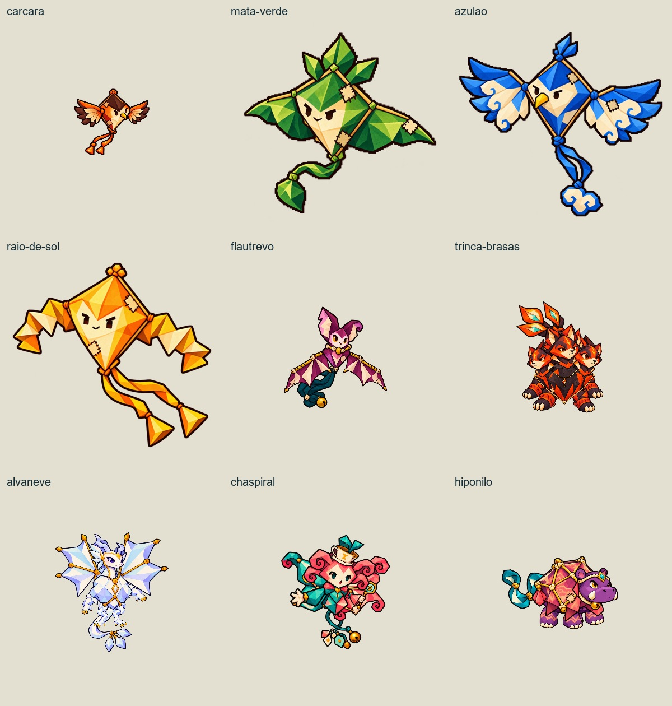
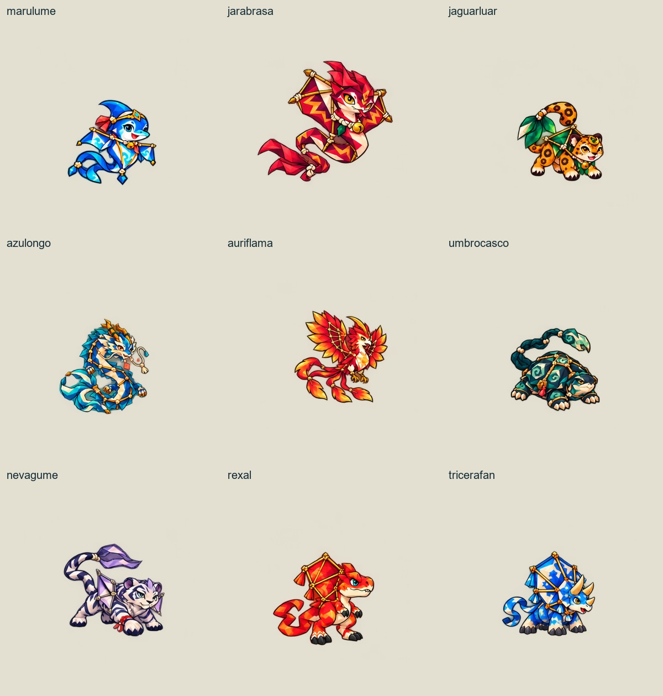
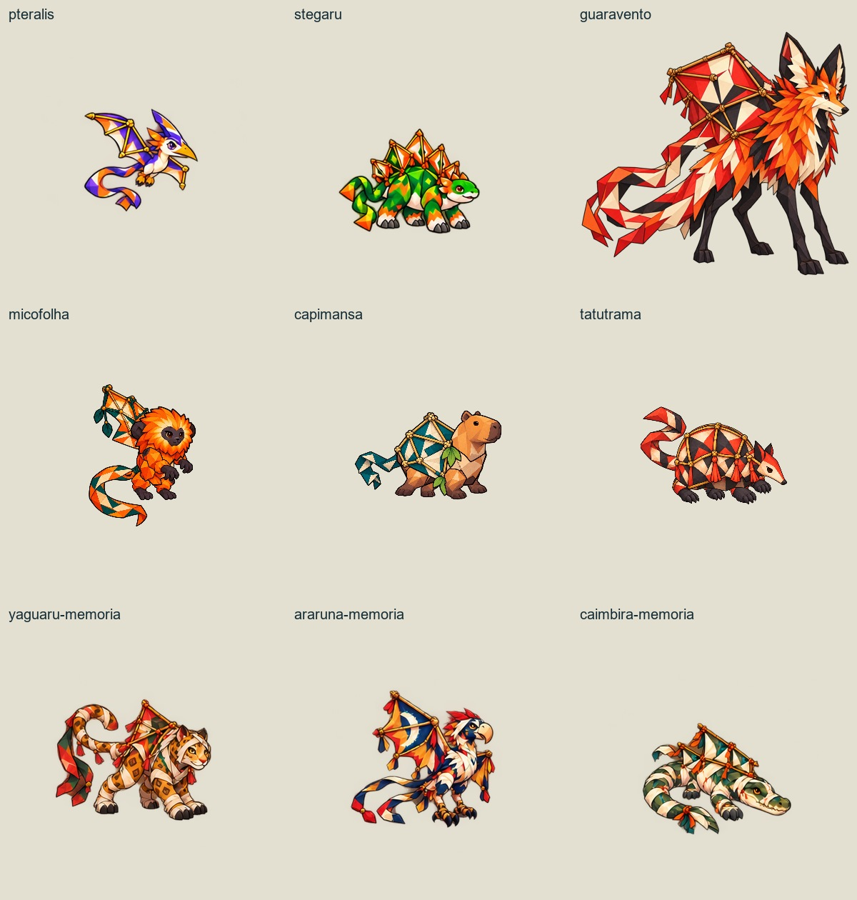
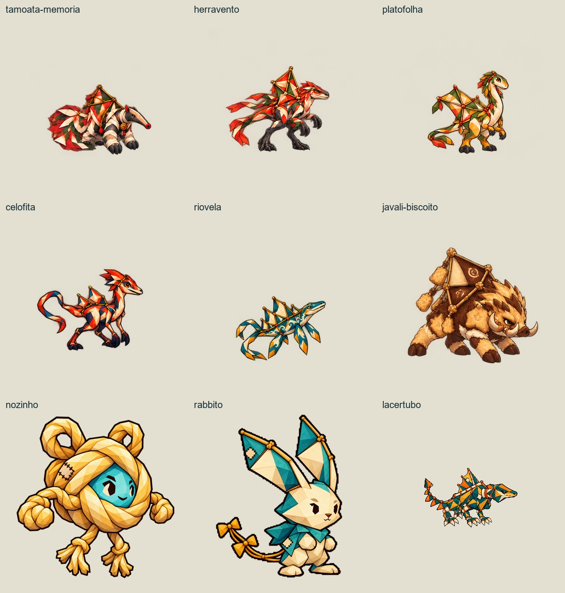
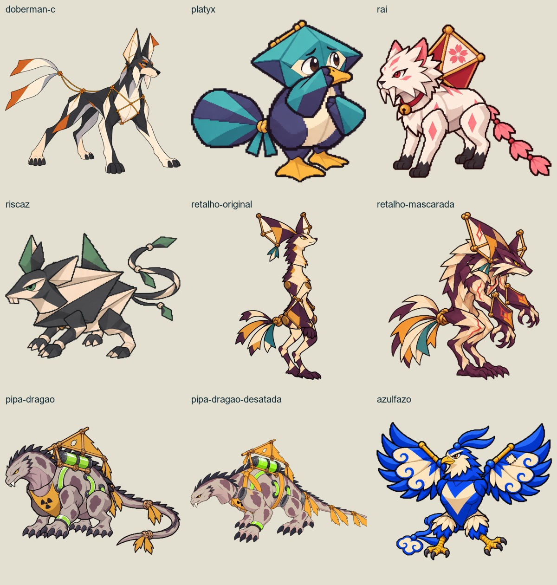
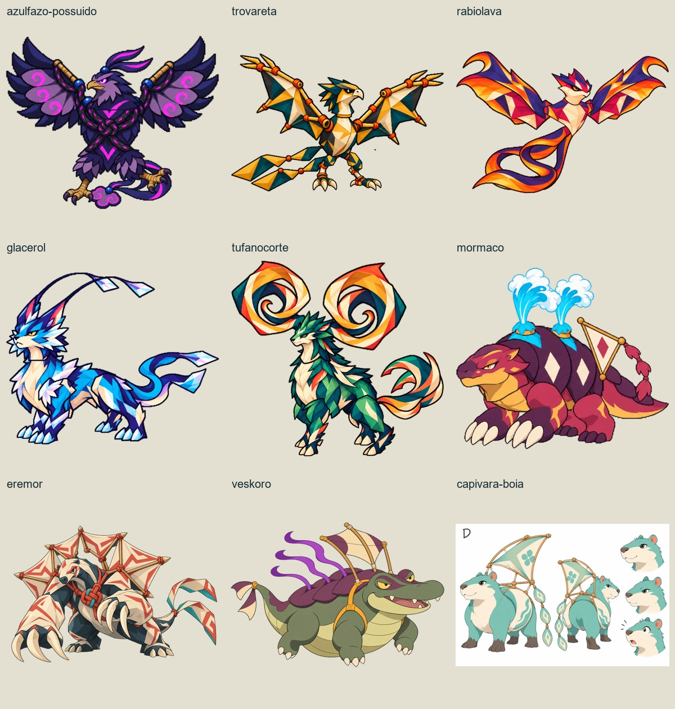

# Pré-evoluções e evoluções — estudo do elenco existente

2026-11-03 · Base local `ffda7042` · branch `codex/integracao-atualizada-local`.

**54 referências visuais estudadas, organizadas em 50 dossiês de identidade.** O número não equivale a 50 famílias evolutivas confirmadas: agrupa somente os vínculos já conhecidos e deixa os parentescos restantes em aberto. Os 36 registros do Dex entram no estudo, inclusive desenhos antigos ainda sem conversão completa.

[Abrir leitura visual do estudo](index.html) · [Estudo de evolução em Digimon: Armor, DNA e outros mecanismos](ESTUDO-DIGIMON.md) · [Fonte estruturada](briefs.json) · [Manifesto das imagens](fontes.json) · [Decisões de chart e prioridades](CHART-E-PRIORIDADES.md).

**Atualização após a escolha do autor:** [Remonta / Reweaving e os quatro nomes de estágio estão aprovados](../DECISOES-NOMENCLATURA.md). A distribuição por espécie permanece proposta. [Abrir o primeiro chart completo para teste: Azulão](../azulao-chart-v1/index.html).

## Como foi estudado

Conferência visual estática das 54 referências em seis folhas de contato, consulta dos textos do Dex e das notas disponíveis de arte/rig. A prancha A/B/C do Azulfazo foi conferida separadamente. Este trabalho não audita animações nem prova a jogabilidade de novos estágios. Não foram geradas novas criaturas.

Fontes principais: `assets/pipa-dex.json`, referências identificadas em cada brief, `art/soulgen/keys/*/README.md`, decisões da família Azulfazo e seções de regras/progressão/personagens da bíblia. O registro legado de classes do Rabbito foi conferido na migração 023 e no cliente web; não é prova de implementação equivalente no Godot. Onde a narrativa não está definida, comportamento e parentesco aparecem como proposta.

As referências são os desenhos existentes encontrados nesta base, incluindo arte legada; sua presença não torna todo tratamento visual antigo uma aprovação atual. Novos concepts devem seguir o traço 2D mangá limpo do projeto e as instruções mais recentes do autor: criaturas com cor e anatomia, sem obrigação de retalhos.

## Regras de continuidade

- **Evolução não exige reprodução ou infância biológica:** a remonta preserva a identidade na alma/rabiola. Cafifa → Pipa → Arraia → Pandorga é a nomenclatura aprovada, sem atribuição automática a estes desenhos. “Filhote” nos briefs descreve proporção visual de uma fase menor; não estabelece origem canônica. Requisitos de oficina ainda são propostas.
- O Rabbito já tem caminhos de classe registrados no web: Velocista → Rastro dos Ventos → Arauto da Tempestade; Condutor → Mestre dos Fios → Tecelão da Aurora; Rabbitknight especial sem sequência. O novo estudo visual não os apaga nem promete sua integração no Godot.
- Azulão tem três rotas já aprovadas: A ataque/Azulfazo de Gollia, B velocidade, C inteligência. B e C têm arquiteturas próprias preservadas; nomes específicos e requisitos continuam em aberto.
- Azulfazo possuído, Mormaço possuído, Retalho mascarada e Pipa-Dragão desatada/sobrecarregada são tratados como estados narrativos, não como provas de evolução natural.
- B/C dos guardiões, alternativas de Capivara-Boia e outras opções reservadas pelo autor não são automaticamente evoluções dos escolhidos.
- Não atribuir níveis, stats, afinidades, condições de evolução, locais de captura ou nomes definitivos neste estudo.
- A classificação de Eremor e as origens de Nozinho/Rabbito exigem cuidado narrativo; não inventar filhotes para preencher uma cadeia.

## Briefs individuais

| Nº | Identidade / conjunto conhecido | Estado do trabalho |
| --- | --- | --- |
| 01 | [Carcará](briefs/carcara.md) | Pré-evolução e evolução propostas; sem chart confirmado |
| 02 | [Mata verde](briefs/mata-verde.md) | Pré-evolução e evolução propostas; sem chart confirmado |
| 03 | [Azulão](briefs/azulao.md) | Rotas evolutivas aprovadas; pré-evolução proposta |
| 04 | [Raio de sol](briefs/raio-de-sol.md) | Pré-evolução e evolução propostas; sem chart confirmado |
| 05 | [Flautrevo](briefs/flautrevo.md) | Pré-evolução e evolução propostas; sem chart confirmado |
| 06 | [Trinca-brasas](briefs/trinca-brasas.md) | Pré-evolução e evolução propostas; sem chart confirmado |
| 07 | [Alvaneve](briefs/alvaneve.md) | Pré-evolução e evolução propostas; sem chart confirmado |
| 08 | [Chaspiral](briefs/chaspiral.md) | Pré-evolução e evolução propostas; sem chart confirmado |
| 09 | [Hiponilo](briefs/hiponilo.md) | Pré-evolução e evolução propostas; sem chart confirmado |
| 10 | [Marulume](briefs/marulume.md) | Pré-evolução e evolução propostas; sem chart confirmado |
| 11 | [Jarabrasa](briefs/jarabrasa.md) | Pré-evolução e evolução propostas; sem chart confirmado |
| 12 | [Jaguarluar](briefs/jaguarluar.md) | Pré-evolução e evolução propostas; sem chart confirmado |
| 13 | [Azulongo](briefs/azulongo.md) | Pré-evolução e evolução propostas; sem chart confirmado |
| 14 | [Auriflama](briefs/auriflama.md) | Pré-evolução e evolução propostas; sem chart confirmado |
| 15 | [Umbrocasco](briefs/umbrocasco.md) | Pré-evolução e evolução propostas; sem chart confirmado |
| 16 | [Nevagume](briefs/nevagume.md) | Pré-evolução e evolução propostas; sem chart confirmado |
| 17 | [Rexal](briefs/rexal.md) | Pré-evolução e evolução propostas; sem chart confirmado |
| 18 | [Tricerafan](briefs/tricerafan.md) | Pré-evolução e evolução propostas; sem chart confirmado |
| 19 | [Pteralis](briefs/pteralis.md) | Pré-evolução e evolução propostas; sem chart confirmado |
| 20 | [Stegaru](briefs/stegaru.md) | Pré-evolução e evolução propostas; sem chart confirmado |
| 21 | [Guaravento](briefs/guaravento.md) | Pré-evolução e evolução propostas; sem chart confirmado |
| 22 | [Micofolha](briefs/micofolha.md) | Pré-evolução e evolução propostas; sem chart confirmado |
| 23 | [Capimansa](briefs/capimansa.md) | Pré-evolução e evolução propostas; sem chart confirmado |
| 24 | [Tatutrama](briefs/tatutrama.md) | Pré-evolução e evolução propostas; sem chart confirmado |
| 25 | [Yaguarú](briefs/yaguaru-memoria.md) | Pré-evolução e evolução propostas; sem chart confirmado |
| 26 | [Araruna](briefs/araruna-memoria.md) | Pré-evolução e evolução propostas; sem chart confirmado |
| 27 | [Caimbira](briefs/caimbira-memoria.md) | Pré-evolução e evolução propostas; sem chart confirmado |
| 28 | [Tamoatá](briefs/tamoata-memoria.md) | Pré-evolução e evolução propostas; sem chart confirmado |
| 29 | [Herravento](briefs/herravento.md) | Pré-evolução e evolução propostas; sem chart confirmado |
| 30 | [Platofolha](briefs/platofolha.md) | Pré-evolução e evolução propostas; sem chart confirmado |
| 31 | [Celofita](briefs/celofita.md) | Pré-evolução e evolução propostas; sem chart confirmado |
| 32 | [Riovela](briefs/riovela.md) | Pré-evolução e evolução propostas; sem chart confirmado |
| 33 | [Javali de Biscoito](briefs/javali-biscoito.md) | Proposta condicionada a decisão de identidade |
| 34 | [Nozinho](briefs/nozinho.md) | Proposta condicionada à origem narrativa |
| 35 | [Rabbito](briefs/rabbito.md) | Proposta condicionada à origem narrativa |
| 36 | [Lacertubo](briefs/lacertubo.md) | Pré-evolução e evolução propostas; sem chart confirmado |
| 37 | [Dóber — design C](briefs/doberman-c.md) | Pré-evolução e evolução propostas; sem chart confirmado |
| 38 | [Platyx](briefs/platyx.md) | Pré-evolução e evolução propostas; sem chart confirmado |
| 39 | [Rai / Saber](briefs/rai.md) | Pré-evolução e evolução propostas; sem chart confirmado |
| 40 | [Riscaz](briefs/riscaz.md) | Pré-evolução e evolução propostas; sem chart confirmado |
| 41 | [Retalho — original e mascarada](briefs/retalho-original.md) | Distinguir evolução natural de mudança de estado |
| 42 | [Pipa-Dragão — sobrecarregada e desatada](briefs/pipa-dragao.md) | Distinguir evolução natural de mudança de estado |
| 43 | [Trovareta](briefs/trovareta.md) | Proposta condicionada ao papel de guardião |
| 44 | [Rabiolava](briefs/rabiolava.md) | Proposta condicionada ao papel de guardião |
| 45 | [Glacerol](briefs/glacerol.md) | Proposta condicionada ao papel de guardião |
| 46 | [Tufanocorte](briefs/tufanocorte.md) | Proposta condicionada ao papel de guardião |
| 47 | [Mormaço](briefs/mormaco.md) | Distinguir evolução natural de mudança de estado |
| 48 | [Eremor](briefs/eremor.md) | Preferir estudo de estados; evolução não estabelecida |
| 49 | [Veskoro](briefs/veskoro.md) | Pré-evolução e evolução propostas; sem chart confirmado |
| 50 | [Capivara-Boia — opção D](briefs/capivara-boia.md) | Proposta condicionada a decisão de identidade |

## Folhas de contato usadas na revisão

