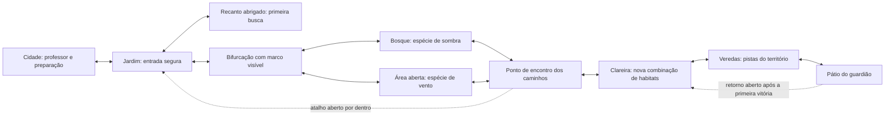

# Primeira região — aventura de um monster tamer

Estado: redesenho em etapas. A primeira mudança espacial do Jardim está integrada localmente; as etapas de fauna por habitat, Clareira, curva de progressão e atalhos persistentes continuam propostas.

## Jardim: primeira implementação — 25/10/2026

- Novo circuito de terra: o ramo do coreto e a volta pelo campo aberto se reencontram a leste. É possível retornar por outro caminho sem atravessar capim obrigatório.
- O terceiro canteiro de busca foi deslocado para dentro do circuito, com um pequeno agrupamento de árvores separando a leitura dos ramos. Bases de tronco e arte usam os mesmos apoios.
- Os três grupos de capim têm identificadores autorais estáveis: recanto, encosta e campo. Esses identificadores ainda não mudam o sorteio de espécies no servidor.
- Ao clicar de uma trilha segura para outra, a navegação do Jardim prefere o caminho de terra. Clicar no habitat ou caminhar manualmente continua permitindo explorar o capim. A preferência é ativada pelo mapa, preservando a navegação dos outros cenários.
- Foram preservadas as coordenadas da entrada, saída, coreto e serviços. O chão continua caminhável nas posições antigas do canteiro; não foi necessário migrar checkpoints.
- Verificações: 19 testes de parque/navegação passaram, incluindo ida e volta pelos dois ramos, circulação do seguidor, acesso aos habitats e coerência de arte/colisão. Builds concluídos; revisão no navegador em 1104×700 e 390×844, com caminhada por clique no ramo do coreto.
- Evidências locais: `../outputs` fica fora do repositório; as capturas desta revisão estão na pasta de trabalho `outputs/garden-circuit/`.

Próxima etapa funcional: tornar a escolha do habitat relevante para a busca, com seleção de encontros no servidor e descoberta no Pipadex. O novo traçado sozinho não entrega essa diferenciação.

## Experiência central

### Veredas e primeira missão — implementação local de 25/10/2026

O terceiro mapa foi reconstruído com três aproximações ao pátio, interligações e recantos de pistas. Nina, uma nova aprendiz de construção de pipas, perdeu o Carcará no confronto com Lacertubo e oferece a missão **A rabiola de Nina**. Após aceitar e vencer o guardião, o jogador encontra a rabiola brilhando no chão, recolhe o objeto de missão e o devolve para concluir a história. Nina então aparece perto da entrada com o Carcará.

Retrato e pose de mapa foram gerados para Nina e registrados nos consumidores existentes. O brilho respeita movimento reduzido. As pistas são opcionais; o combate exige confirmação. A vitória é confirmada no servidor; os passos narrativos desta primeira missão são salvos por conta no navegador, sem sincronização entre dispositivos nem concessão de itens à coleção do jogador. Contrato e origem da arte: `assets/characters/nina-v1/README.md`.

Passaram 17 testes específicos de missão, navegação, personagem, apresentação do guardião e integração do parque. A aceitação, coleta e entrega foram conferidas no navegador em prévias isoladas; isso não substitui um playtest completo da batalha com um jogador novo.

O jogador sai com um parceiro, percebe sinais de outros Pipamons, escolhe onde procurar, conquista uma rabiola, volta para invocar e retorna com um novo objetivo. Avançar até o guardião é uma das motivações, junto de conhecer espécies e desenvolver os parceiros.

O nível não deve ser uma sequência de arenas separadas por caminhada. A geografia precisa dar significado à coleção.

## Diagnóstico do recorte atual

- Jardim e Clareira repetem o esqueleto dos caminhos e a disposição dos três grupos de capim. A mudança de nome não cria uma nova experiência espacial.
- Os encontros são escolhidos por região inteira. Na migração 022, ambas compartilham a seleção de espécies; a Clareira acrescenta um nível. Escolher um capim específico não muda o objetivo da busca.
- Os encontros iniciais estão nos níveis 1–3 e 2–4, enquanto Lacertubo está no nível 15. Essa diferença exige revisar tempo de progressão e dificuldade real do combate; não basta recomendar treinamento.
- As Veredas são corredores em zigue-zague até o chefe, sem circuito de retorno ou descoberta opcional com função própria.
- O minimapa já oculta lugares não descobertos. O redesenho deve preservar isso.
- A aquisição existente é rabiola seguida de invocação no professor. Não substituir silenciosamente por captura convencional.

## Estrutura proposta

As ramificações são escolhas reais, não portas que exigem capturar uma espécie sorteada. O primeiro circuito sempre pode ser concluído e abandonado com o parceiro inicial.

## Função de cada área

| Área | Decisão do jogador | Composição e descoberta | Retorno |
|---|---|---|---|
| Jardim | Experimentar uma primeira busca ou seguir pela trilha segura | Entrada curta, visão do coreto, capim acessível ao lado do caminho; sinal local de movimento antes da primeira busca | Cidade próxima; voltar não exige atravessar capim |
| Bifurcação | Procurar uma espécie ou explorar o outro ramo | Uma grande árvore identifica o bosque; uma pipa presa e a vegetação indicam a área exposta ao vento | Os ramos se reencontram; sem obrigar a refazer os dois |
| Bosque | Buscar o Pipamon associado à sombra | Vegetação mais fechada e vestígios coerentes com uma espécie já existente; indicação visual, sem nome ou marcador antes da descoberta | Breve desvio, saída visível para o circuito |
| Área aberta | Buscar outra espécie ou apenas observar | Espaço amplo, movimento do vento e pistas de presença; linguagem diferente do bosque | Acesso ao mesmo ponto de reencontro |
| Clareira | Testar o parceiro novo ou continuar com o inicial | Traçado próprio, novo marco, encontro mais exigente e uma pequena descoberta opcional; não repetir o Jardim | Atalho de volta após percorrer a área |
| Veredas | Investigar os sinais e decidir se enfrenta o guardião | Canos quebrados, marcas e assobios aumentam perto do território; pátio visível antes da interação | Recuo livre e retorno curto após a vitória |

Os temas de habitat são direção de arte, não novos tipos de combate. A associação exata de espécies deve usar a fauna existente e ser validada com o elenco.

## Encontros com significado espacial

1. Cada habitat recebe uma identidade estável e um conjunto próprio de espécies. A região informa a dificuldade; o habitat informa o que procurar.
2. Sinais próximos ajudam a reconhecer o habitat. Não revelar todos os habitantes por uma lista na HUD.
3. Depois da primeira descoberta, registrar a relação espécie/local no Pipadex. O jogador pode voltar por vontade própria.
4. Preservar a primeira rabiola garantida e a proteção contra azar existentes. A primeira aquisição deve demonstrar o ciclo até a invocação, em vez de depender de uma longa sequência aleatória.
5. Usar as animações existentes para uma aparição ambiental inicial. Essa aparição é um sinal; a seleção do encontro e sua recompensa continuam no servidor.
6. Caminhos seguros permitem atravessar a região. Desvios de busca concentram o risco e o interesse.

## Progressão e guardião

Não definir a curva apenas pelo número exibido. Medir uma expedição de jogador novo: batalhas até a primeira rabiola, duração de ida/volta, nível ao reencontrar o professor e desempenho ao chegar às Veredas.

O primeiro guardião deve testar leitura do vento, esquiva e abertura, além do desenvolvimento do parceiro. Caso o nível 15 exija repetir encontros iniciais por muito tempo, ajustar a preparação disponível ou o próprio guardião. Não criar grind obrigatório para preencher o caminho.

Depois de vencido, o território precisa mudar de função: abrir um retorno físico e manter a revanche opcional. Uma mensagem de vitória sozinha não encerra a exploração.

## Ordem de implementação

1. **Jardim jogável:** substituir o traçado repetido por um circuito com dois desvios e reencontro. Validar circulação com Kael e o seguidor antes da arte final.
2. **Habitat como dado compartilhado:** identificadores estáveis no mapa, catálogo de encontros no servidor, pistas ambientais e descoberta no Pipadex. Validar o habitat informado pelo cliente; não confiar nele para conceder espécies ou recompensas.
3. **Primeira expedição completa:** cidade → busca → rabiola → professor → novo parceiro → retorno. Verificar saves e reentrada em cada trecho.
4. **Clareira própria:** nova silhueta, outro percurso e preparação adequada para as Veredas; calibrar XP e dificuldade com tempo medido.
5. **Território do guardião:** antecipação ambiental, escolha explícita, vitória e atalho persistente. Persistência deve integrar o progresso já confirmado pelo servidor.

## Critérios para o playtest

- Sem abrir uma lista de destinos, o jogador percebe uma trilha principal e pelo menos um desvio interessante.
- Consegue explicar por que procuraria um Pipamon em um lugar específico.
- Entende a utilidade da rabiola e completa uma invocação durante a primeira expedição.
- Consegue voltar à cidade e ao habitat descoberto sem encontros obrigatórios.
- Não precisa capturar uma espécie específica para sair da área.
- Não encontra portas aparentes sem passagem, atalhos sem conexão ou bloqueios que prendam o seguidor.
- Reconhece Jardim e Clareira pela composição, sem depender do nome na tela.
- A preparação para Lacertubo decorre da aventura; repetição obrigatória e duração precisam ser medidas antes de aprovar a curva.

## Limites deste documento

O diagnóstico foi feito em fontes locais, incluindo `src/park-isometric-layout.js`, os dois mapas de `assets/world/park-v1`, `src/park-boss-layout.js` e as migrações 022/028. Não é um playtest com jogadores externos. Os novos circuitos, habitats específicos, aparições e atalhos acima são trabalho proposto, não funcionalidades já entregues.

## Implementado localmente — Veredas ampliadas (25/10/2026)

As Veredas agora são uma região contínua de 3200 × 2048, com bosque, canal com duas pontes, mirante opcional, encosta acessível por duas escadas e pátio do guardião. Os desníveis participam do movimento, da projeção dos personagens e da seleção pelo mouse. Cinco baús incentivam desvios; suas recompensas são únicas por conta e verificadas no servidor.

Encontros selvagens ocorrem somente nas cinco manchas de mato. Trilhas, descansos e a conversa com Nina permanecem seguros. Após a primeira vitória confirmada, Lacertubo desaparece e concede sua própria rabiola; a rabiola do Carcará de Nina continua sendo uma coleta de missão separada. A proposta anterior de revanche opcional não se aplica a esta versão.

A migração 029 foi aplicada apenas no ambiente local. A publicação precisa incluir essa migração. A missão narrativa de Nina ainda usa a persistência local já existente; baús e recompensa do guardião usam o banco. A composição do terreno foi validada como versão jogável; ainda cabe uma passagem de acabamento artístico e playtest externo de duração e dificuldade.

Verificações: circulação e retorno por todas as interações, pontes, escadas, projeção nos desníveis, recompensas sem duplicação, isolamento entre contas e prévias visuais em desktop e celular.
