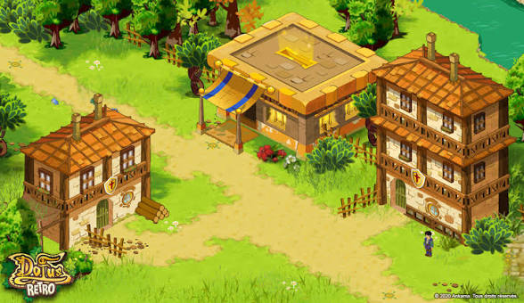
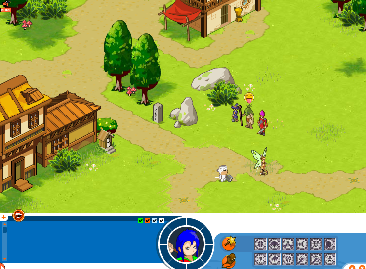
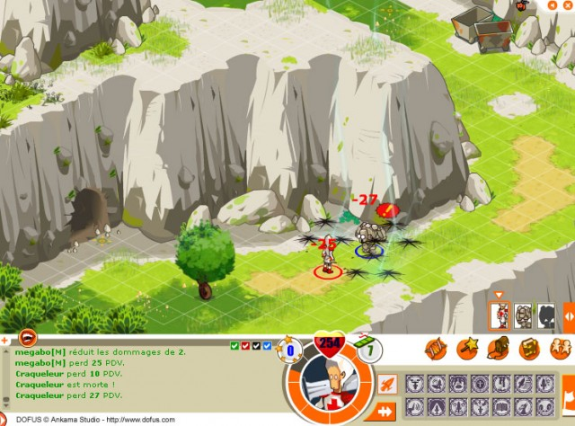
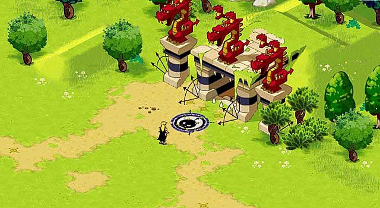
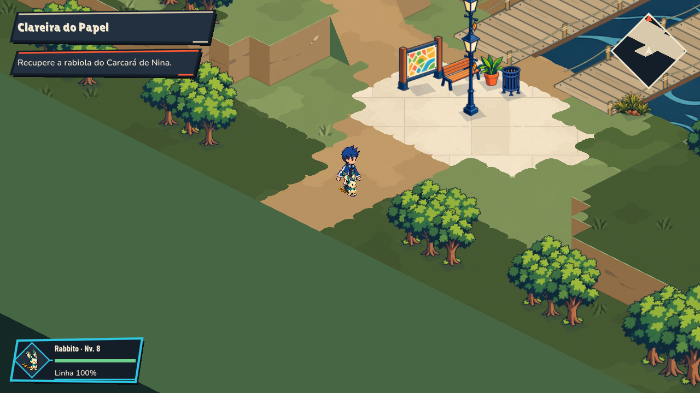
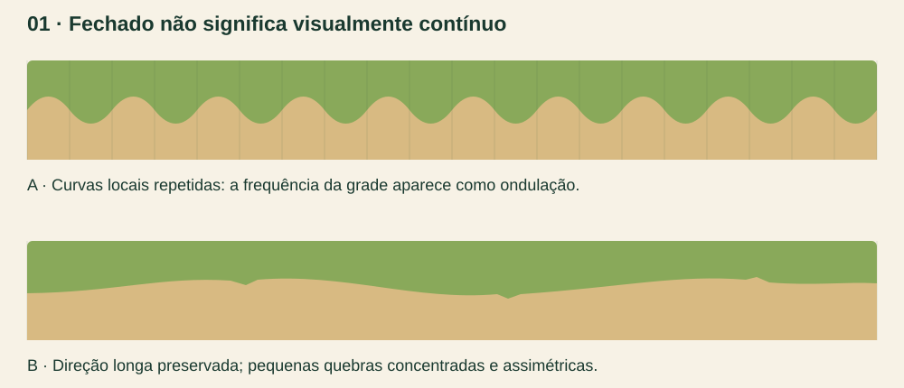
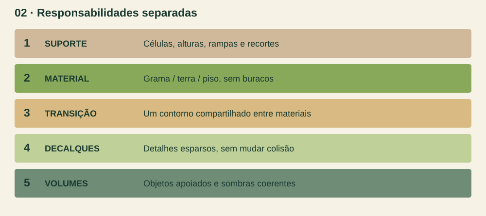
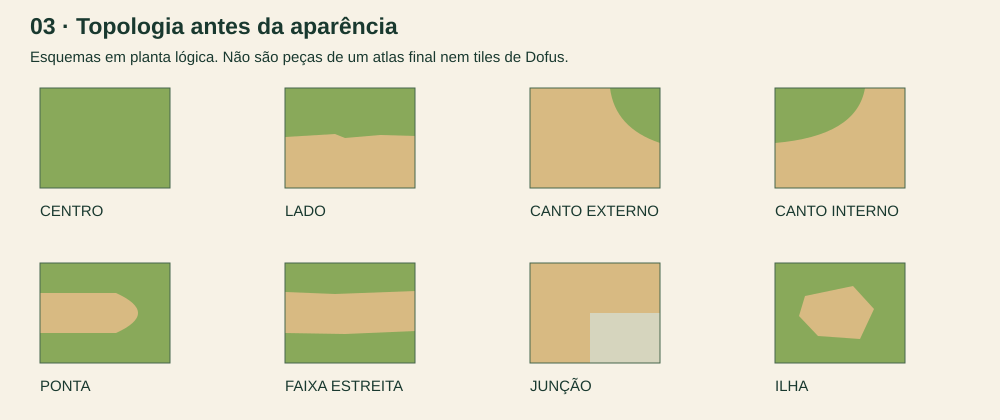

# Pisos contínuos: estudo de Dofus para Soulmonsters

**Caderno de referência e produção · 29 de outubro de 2026 · revisão 1**

Objetivo: entender por que os pisos das referências de Dofus parecem pertencer a um mesmo cenário e transformar essa leitura em regras reproduzíveis para nossos mapas isométricos 2D mangá. O problema prioritário é a borda ondulada e repetitiva entre materiais, não a quantidade de objetos do mapa.

Este documento contém pesquisa em fontes primárias, leitura das quatro imagens fornecidas, diagnóstico do renderer atual, diagramas próprios, especificação de um kit e um protocolo de validação. É um estudo para a próxima intervenção; não significa que os pisos do jogo já foram corrigidos.

**Conclusão principal:** o tile deve ser uma unidade de montagem invisível. O caminho tem uma direção contínua; os recortes e detalhes variam em torno dessa direção. Criar uma curva arredondada em cada canto elimina frestas, mas pode revelar a grade como uma sequência de ondas.

## 1. Como ler este estudo

As afirmações são identificadas por origem:

| Marca | Significado | Limite |
| --- | --- | --- |
| Documentado | Informação publicada pelo autor ou pela documentação da ferramenta | Não extrapolar para todas as versões de Dofus |
| Observação | Leitura visual das imagens do usuário ou das nossas capturas | Não prova como o jogo original foi implementado |
| Diagnóstico local | Evidência no código e em uma captura do nosso projeto | Hipóteses de material exigem comparação controlada |
| Proposta | Regra de produção para Soulmonsters | Precisa de validação visual na câmera real |

As referências misturam apresentações de épocas diferentes. A primeira contém a marca Dofus Retro; não atribuímos uma versão ou data exata às outras três sem confirmação. A grade clara visível na terceira imagem é uma sobreposição de leitura de células; não deve ser copiada como costura da textura.

As imagens de Dofus foram fornecidas pelo usuário e estão preservadas sem edição em `references/`. Servem para análise, não são materiais de runtime nem sprites extraídos. Os diagramas deste caderno são nossos esquemas técnicos, não reproduções de assets da Ankama.

## 2. O que a pesquisa realmente confirmou

**Documentado — produção de Dofus.** Em um relato em primeira pessoa, Catell-Ruz descreve a criação de sprites sobre grade isométrica no Flash, o reaproveitamento de símbolos e peças de uma biblioteca e conceitos feitos antes dos sprites finais. O exemplo de telhados mostra reutilização com ajustes de cor e perspectiva. Isso sustenta um fluxo modular e dirigido por conceito; não comprova a topologia de cada chão de Dofus Retro. [Relato da artista no Polycount](https://polycount.com/discussion/142282/catell-ruz-dofus-descent-hearthstone-stuff)

O portfólio da própria artista identifica trabalhos de Dofus, como Merkator e Almanax. É uma referência autoral de construção e acabamento; separar os trabalhos de Dofus de projetos pessoais e de outras franquias é essencial. [Portfólio de Catell-Ruz](https://catell-ruz.artstation.com/)

**Documentado — ferramentas de transição.** O Tiled distingue conjuntos por cantos, lados e combinação dos dois. Para dois terrenos, conjuntos completos por cantos ou por lados têm 16 combinações; o misto completo tem 256, com opções reduzidas como o blob de 47. Esses sistemas também podem trabalhar em mapas isométricos. Isso explica alternativas de montagem, não o pipeline proprietário de Dofus. [Manual de terrenos do Tiled](https://doc.mapeditor.org/en/stable/manual/terrain/)

**Documentado — Godot.** Terrain Sets selecionam variantes por relações de vizinhança. Os modos consideram cantos, lados ou ambos; o atlas recebe metadados de terreno. TileMapLayer também permite organizar camadas de um mapa. Nada disso produz automaticamente uma boa borda pintada: a arte das variantes e a escolha do contorno continuam sendo decisões nossas. [TileSets](https://docs.godotengine.org/en/stable/tutorials/2d/using_tilesets.html), [TileMaps](https://docs.godotengine.org/en/stable/tutorials/2d/using_tilemaps.html)

**Não confirmado:** dimensões exatas dos tiles das quatro imagens, número de variantes usadas pela Ankama, shader de mistura, algoritmo de autotile e proporções internas do mapa original. O contrato 64×32 citado adiante é nosso, não uma medida descoberta em Dofus.

## 3. Referência A: vila com três construções



**Observação.** O caminho é uma grande massa bege que conecta as portas, contorna os lotes e cria espaço diante das fachadas. Ele não é uma fita de largura constante: alarga nas áreas de uso e afina entre obstáculos. A grama ocupa os intervalos como um material contínuo. A borda tem pequenas quebras angulares e manchas, mas não parece uma série de círculos justapostos.

O detalhamento está distribuído por função. As construções recebem linhas, madeira, telhas e placas; a área de circulação fica relativamente calma. A vegetação se concentra junto de árvores, cercas e bases. Existem sombras de apoio sob volumes, sem uma sombra escura contornando todo o caminho.

**Aplicação nossa:** desenhar primeiro a massa que liga os destinos. A casa deve terminar num lote e num acesso coerentes; a transição de material não pode competir com a fachada. Reservar detalhe mais contrastado para entrada, letreiro ou objeto interativo.

**Erro a evitar:** copiar só o verde vivo e o bege. A coesão depende também da escala das manchas, da distribuição de contraste e do espaço vazio entre os grupos de objetos.

## 4. Referência B: caminho, árvores e área aberta



**Observação.** O caminho atravessa o quadro e mantém uma direção reconhecível apesar das irregularidades. Há trechos quase retos, aberturas maiores e pequenos dentes isolados. As bordas dos dois lados não repetem o mesmo desenho em espelho. O centro do caminho permanece claro e contínuo.

Na grama, marcas finas, flores e tufos funcionam como acentos. Eles não cobrem toda a superfície com a mesma frequência. A árvore tem copa, tronco e sombra reconhecíveis, enquanto o piso não tenta simular o mesmo volume. As pedras têm faces grandes e contorno seletivo, contrastando com o gramado.

**Aplicação nossa:** usar três escalas de decisão: direção geral do caminho, recuos de tamanho médio e raros detalhes pequenos. O detalhe pequeno não deve redesenhar a silhueta a cada tile.

**Erro a evitar:** trocar a borda de gominhos por ruído de alta frequência. Uma serrilha microscópica contínua também denuncia uma regra repetida e perde clareza à distância.

## 5. Referência C: falésia, patamar e passagem



**Observação.** O volume é explicado por topo claro, faces verticais com massas maiores, sombras de encaixe e objetos apoiados em cotas distintas. As fissuras seguem a direção das faces, não uma textura de piso dobrada para baixo. A entrada escura se encaixa numa face de rocha; a passagem ao lado da parede conserva uma faixa caminhável legível.

A sobreposição da grade não deve ser confundida com rachaduras ou juntas do cenário. As paredes são mais contrastadas que o piso e concentram arestas estruturais. A leitura de altura vem do conjunto de faces e oclusão, não apenas de uma linha na borda superior.

**Aplicação nossa:** preservar a solução geométrica de altura já existente. Refazer a transição grama–terra não autoriza achatar a margem da água, esconder uma face de rampa ou empurrar o personagem para uma cota diferente da arte.

**Erro a evitar:** tornar o topo tão irregular quanto uma copa. Um recorte decorativo na textura não precisa virar um novo desnível ou uma colisão.

## 6. Referência D: portal e clareira de uso



**Observação.** O piso aberto sustenta um destino forte: o portal. O caminho se expande perto da estrutura, enquanto árvores e vegetação enquadram os lados. O centro não é preenchido com todos os detalhes disponíveis. As bases dos pilares e suas sombras ancoram o volume.

O limite entre grama e terra possui ritmo irregular: longos trechos discretos alternam com recortes locais. Existem pequenas ilhas e manchas separadas, mas elas não desmontam o contorno principal.

**Aplicação nossa:** Nina, uma entrada de área e o boss precisam de uma área de apresentação. O piso deve conduzir até o ponto focal e deixar espaço para câmera, personagem e cutscene. Vegetação não deve esconder a interação para compensar uma transição ruim.

## 7. O vocabulário visual que queremos adaptar

Esta é uma síntese nossa das imagens, não uma especificação oficial da Ankama.

| Elemento | Leitura desejada | Aplicação Soulmonsters |
| --- | --- | --- |
| Piso de grama | Uma superfície, com pequenas mudanças locais | Base calma; tufos como decalques esparsos |
| Terra | Massa contínua de circulação | Centro limpo, poucas pedras, bordas assimétricas |
| Encontro de materiais | Limite legível, fino e orgânico | Recorte curto; não desenhar uma moldura escura |
| Construção | Silhueta clara e apoio no lote | Fachadas mangá com profundidade e entrada conectada |
| Rocha | Faces grandes e arestas selecionadas | Planos de luz/sombra, sem grão fotográfico |
| Vegetação | Grupos que enquadram o percurso | Concentração nas bordas; clareiras com espaço |
| Relevo | Topo, face, base e oclusão coerentes | Mesma geometria para render, apoio e navegação |
| Personalidade | Silhuetas e acentos reconhecíveis | Motivos de papel, nós, vento e pipas em pontos focais |

Adaptar o princípio não exige copiar arquitetura medieval, árvores, paleta exata, interface, ícones ou construções de Dofus. Nosso jogo continua usando seus personagens, materiais e linguagem 2D mangá.

## 8. Diagnóstico do nosso mapa



**Proveniência:** captura nativa 1280×720 da execução de integração já existente neste checkout. Foi inspecionada neste estudo; não é uma nova captura nem uma correção aplicada agora.

### 8.1 O que está confirmado no código

Em `godot/scripts/overworld/view.gd`, `_draw_art_floor()` escolhe `_draw_manga_floor()` para o tratamento `native-editable-manga-v3`. Esse tratamento está ativo no kit do Parque.

Dentro de `_draw_manga_floor()`, a base é um losango opaco. Para cada canto cujo material difere do centro, é acrescentado um patch. Seu início e fim ficam nos pontos médios das arestas. A curva quadrática passa por um controle calculado a partir da ponta do losango. O parâmetro `bend` varia aproximadamente de 0,08 a 0,48, conforme um hash do vértice compartilhado.

Isso é útil para manter pontos de encontro coincidentes. Porém, não desenha uma única trajetória ao longo da borda inteira: cada região de canto continua sendo uma curva local. A continuidade dos pontos não garante continuidade da direção das tangentes nem evita uma sequência de barrigas. A variação do hash tampouco elimina a frequência visual associada à grade.

Na captura, o problema aparece tanto no encontro da terra com a grama quanto ao redor da praça clara. **A praça recebe um limite orgânico semelhante ao gramado, embora seja uma superfície construída.** Aqui, uma regra genérica está apagando a diferença entre dois tipos de borda.

### 8.2 O que ainda é hipótese de material

`godot/shaders/parque_paint.gdshader` amostra as pinturas em coordenadas de mundo de tela, com repetição espelhada a cada 448 unidades. O espelhamento pode criar massas simétricas se o fonte contiver manchas grandes. Isso é uma hipótese verificável com a pintura isolada, não a causa comprovada de todas as ondulações.

A projeção em mundo também merece um teste separado nas rampas: deslocamento vertical por altura e orientação podem alterar a percepção de fase. Não substituir esse sistema sem comparar solo plano, rampa e patamar com a mesma escala de material.

### 8.3 Prioridades

| Prioridade | Problema | Ação proposta |
| --- | --- | --- |
| P0 | Borda revela a grade como gominhos | Construir o contorno por região conectada ou usar máscaras de transição com continuidade dirigida |
| P0 | Praça construída recebe recorte de gramado | Separar regra de material natural da regra de pavimento |
| P1 | Manchas grandes competem com o caminho | Reduzir contraste do fonte e conferir repetição espelhada |
| P1 | Transição é uma só para situações diferentes | Definir caminho, praça, barranco e margem como famílias distintas |
| P2 | Detalhes repetem em cadência regular | Distribuir decalques por grupos e pesos, com trechos quase lisos |

Não começar acrescentando árvores, flores ou uma textura mais detalhada. Isso aumenta o ruído antes de resolver a forma.

## 9. Diagrama: encaixe não é continuidade visual



O desenho superior representa um perfil que oscila em cada unidade. Ele pode estar matematicamente fechado, sem um pixel transparente, e ainda parecer artificial. O inferior preserva a direção longa e concentra as irregularidades em poucos pontos. Ambos são esquemas; não são texturas prontas nem reconstruções do algoritmo da Ankama.

Há três verificações diferentes:

- **Cobertura:** existe buraco ou sobreposição indevida?
- **Conexão:** as peças concordam no ponto de encontro?
- **Ritmo visual:** é possível adivinhar o tamanho do tile só olhando a borda?

A terceira pode falhar mesmo quando as duas primeiras passam. A palavra “seamless” no prompt ou um teste de alpha não substituem essa análise.

## 10. Separar material, transição, relevo e decoração



O chão deve ter responsabilidades explícitas:

1. **Geometria de suporte:** células, cota, rampa, topo e corte da margem. É a fonte de apoio e navegação.
2. **Material principal:** grama, terra, piso ou rocha. Cobre a superfície sem borda transparente.
3. **Transição:** define qual material ocupa o limite. Não altera sozinha a cota física.
4. **Decalques:** capim, pequenas pedras, manchas e pétalas. Não fecham buracos de geometria.
5. **Volumes e sombras:** árvores, edifícios, barrancos e sombras de contato coerentes com a luz.

Sombras do quintal, oclusão de copas e efeitos de ambiente não devem ser pintados na textura neutra da grama. Uma variante de grama sombreada usada ao lado da mesma grama clara cria outro limite artificial.

## 11. Duas arquiteturas possíveis para a nossa implementação

### A. Contorno contínuo sobre o renderer atual — primeira escolha

Preservar TMJ, mapas compilados, células, alturas e navegação. Para cada encontro natural entre materiais na mesma superfície, extrair segmentos compartilhados e encadeá-los em trajetórias. Juntas entre três materiais são nós explícitos, não curvas independentes que se atropelam.

Antes de estilizar, proteger patamares, acessos, bordas de água e cruzamentos. Simplificar apenas trechos redundantes e usar uma perturbação estática limitada ao longo da trajetória, com frequência mais longa que uma célula. Manter a mesma curva e os mesmos vértices para os dois materiais. Não deslocar o caminho inteiro nem fechar uma passagem estreita.

Cada fronteira pode receber uma faixa curta de mistura ou um recorte pintado. O caminho fica geometricamente contínuo, a textura usa fase compartilhada e os detalhes são outra camada. Essa proposta ataca o defeito atual sem migrar o mundo inteiro para TileMapLayer.

### B. Atlas de transições com Terrain Sets — opção para o editor

Produzir máscaras e variantes com contratos de conexão por lados/cantos. Cada variante tem o mesmo ponto de conexão que as vizinhas; a irregularidade acontece dentro da área permitida. Alternativas visuais só substituem peças da mesma classe topológica.

É uma opção adequada para um pintor de mapas baseado em TileSet. Não misturar seus peering bits com a geometria procedural atual sem uma camada de conversão. “Usar 47 tiles” não resolve sozinho a direção de arte nem obriga a reescrever nosso editor.

**Decisão recomendada:** validar A num trecho pequeno do Parque. Manter B como especificação de biblioteca e ferramenta futura, se houver necessidade real de edição por atlas.

## 12. Centros, lados e cantos: o contrato antes da pintura



O atlas precisa distinguir forma e aparência. Um centro quase liso e um centro com duas pedrinhas são a mesma forma topológica. Um canto externo e um canto interno são formas diferentes, mesmo se tiverem a mesma paleta.

| Família | Função | O que deve permanecer fixo |
| --- | --- | --- |
| Centro | Interior de uma massa | Cobertura total e média de cor |
| Lado | Limite que atravessa a peça | Entradas e saídas do contorno |
| Canto externo | Material contorna a ponta de uma área | Convexidade e conexão com os lados |
| Canto interno | Recuo entre duas bordas | Concavidade, sem criar ilha ou buraco |
| Ponta | Final de um caminho/ramo | Largura e fechamento do percurso |
| Faixa estreita | Material com vizinhos dos dois lados | Continuidade do centro útil |
| Junção | Encontro de três ou mais regiões | Prioridade e ausência de sobreposição |
| Ilha | Mancha separada intencional | Tamanho e cobertura definidos, não um acidente |

Para uma biblioteca completa, escolher e registrar um único modelo: 16 casos por cantos, 16 por lados ou um conjunto misto adequado. Não somar automaticamente 16+16+47 como se fossem peças obrigatórias diferentes. O blob de 47 é uma alternativa reduzida de representação, não uma receita artística de Dofus.

## 13. Contrato de encaixe 64×32

**Proposta local.** A unidade lógica continua 64×32, com projeção `x = 32(u − v)` e `y = 16(u + v) − 64h`. Uma textura fonte pode ser maior para pintar; seu tamanho não redefine a célula de navegação.

Para cada junção, registrar: orientação, materiais A/B, posição de conexão na aresta e direção esperada da borda. Peças vizinhas usam a mesma assinatura de aresta. Um canto interno não é obtido apenas espelhando um externo que tenha sombra direcional.

A base natural deve cobrir todo o losango. Alpha fora da pegada é esperado em um tile raster isométrico; alpha no interior da superfície ou uma aresta recuada pode abrir frestas. No caso de polígonos com pintura contínua, a cobertura é da geometria, não do recorte do PNG. Não exigir que o raster copie uma máscara que o consumidor não usa.

Margem de atlas e extrusão de texels devem ser testadas com o filtro real, sem invadir outra variante. Não usar sobreposição grande para esconder erros de coordenadas. Verificar quatro direções, câmera fracionária, zoom e material sem textura.

## 14. Forma do caminho: três escalas

**Macroforma:** desenhar o caminho como uma área completa, com início, destino, estreitamentos e pequenas praças. Sua largura responde ao uso do lugar. Portas e bancos precisam de área acessível.

**Forma intermediária:** criar recuos e avanços espaçados, preferindo alguns trechos longos e poucos desvios maiores. As duas margens não devem oscilar juntas como uma mangueira. A largura mínima de passagem é um contrato de gameplay, não uma sobra da pintura.

**Microforma:** acrescentar alguns dentes de grama, pedrinhas e manchas pequenas perto das bordas. Interromper o detalhe em vez de distribuí-lo de modo uniforme. Manter um miolo caminhável de leitura calma.

Parâmetros iniciais para um protótipo, não medidas de Dofus: variação média distribuída em trechos de 3–6 células; recorte pequeno usual de 1–3 pixels na resolução nativa; raras reentrâncias maiores desenhadas manualmente; nenhuma oscilação obrigatória por célula. Conferir em 1280×720 antes de transformar esses valores em regra definitiva.

Uma borda natural não precisa ser lisa como vetor perfeito. Precisa ter uma intenção em escala maior que sua irregularidade.

## 15. Cor, contraste e traço

O piso deve sustentar o personagem, não disputar com ele. A referência mostra diferenças de material claras, mas a maior concentração de linhas e acentos está nos volumes e pontos de interesse.

Para Soulmonsters, organizar amostras por papel: grama clara neutra, terra quente, sombra ambiental mais fria, pedra dessaturada e pequenos acentos de flores ou papel. Os valores exatos serão escolhidos na amostra do nosso mapa; não tratar uma cor obtida de screenshot comprimida como paleta oficial.

Regra inicial de composição proposta: a maior parte do piso quase lisa, manchas médias discretas em segunda prioridade e poucos acentos contrastados. “Quase lisa” ainda pode conter uma textura suave de pincel, sem rachaduras grandes, brilhos ou vinheta repetidos no centro de cada peça.

Contorno fino ou interrompido pode ajudar a borda em pontos selecionados. Uma linha preta contínua ao redor de cada material transforma o caminho em adesivo. Grama e terra no mesmo nível normalmente não precisam de sombra de barranco. Pavimento pode ter junta e meio-fio; o gramado não deve herdar essa regra.

## 16. Relevo, escadas, barrancos e água

Aplicar as regras já consolidadas em [continuidade do terreno](../../continuidade-terreno-isometrico.md). O estudo de Dofus acrescenta referência de leitura; não revoga o contrato de suporte.

- No barranco: topo termina na face certa; a base fecha no terreno de baixo. A textura da face segue a orientação da rocha/terra, sem escorrer a pintura do piso.
- Na rampa: topo da rampa e patamar têm a mesma posição e altura na junta. Uma parede antiga não pode atravessar a passagem.
- Na escada: a abertura é real; degraus começam no piso inferior e acabam no patamar superior. A sombra não pode sugerir que passam por baixo da parede.
- Na água: o piso superior é recortado e a margem fecha até a cota inferior. Água, espuma e parede usam o mesmo contorno.
- Na praça: borda construída recebe desenho de construção; se houver desgaste, ele é localizado, não uma curva de gramado em todos os cantos.

Não suavizar todos os vértices do mapa. Canto construído, junta de rampa e ponta de ponte têm restrições diferentes de uma mancha de terra.

## 17. Catálogo proposto para a primeira família

Produzir uma família pequena e validada antes de expandir para dezenas de pisos. Os números abaixo são orçamento proposto, não uma contagem de assets de Dofus.

| Material/função | Primeira entrega | Variação útil |
| --- | --- | --- |
| Grama base | 6 centros | 2 quase lisos; 4 com manchas/tufos muito discretos |
| Terra compactada | 6 centros | 2 limpos; 2 com pedrinhas; 2 com desgaste leve |
| Pavimento | 4 centros | Juntas coerentes; sem rachaduras que reiniciam por peça |
| Grama–terra | Uma topologia completa escolhida | Depois, variantes de lados longos e cantos frequentes |
| Terra–pavimento | Lados, cantos, pontas e junções necessárias | Bordas construídas com desgaste pontual |
| Face de barranco | 4 segmentos + cantos interno/externo | Escala constante entre segmentos |
| Transição em rampa | Por orientação e conexão real | Não aplicar atlas plano com distorção |
| Decalques sem colisão | 3 tufos, 2 manchas de terra, 2 flores/trevos | Bases e densidade controladas |

As variantes de centro não precisam criar 6 cópias de cada máscara se a arquitetura usar material contínuo mais máscara independente. Separar os dois permite melhorar a pintura sem redesenhar toda a topologia.

## 18. Pipeline de arte: do conceito ao asset utilizável

1. Escolher um trecho curto representativo da Clareira, com terra, gramado, praça e uma ligação de rampa ou ponte. Preservar posição e colisões.
2. Fazer uma planta em duas cores chapadas. Corrigir direção e largura do caminho antes de pintar.
3. Testar o contorno contínuo sem textura, sem árvores e sem sombras. O tile não pode aparecer como ondulação.
4. Criar uma amostra de grama e uma de terra no nosso traço. Aprovar escala das manchas na câmera real.
5. Produzir as transições usando o contrato topológico escolhido. Uma folha de arte bonita não é automaticamente um atlas válido.
6. Normalizar fontes, pivôs, transparência e margens. Registrar origem e versão. Manter os originais.
7. Integrar no consumidor existente e comparar o antes/depois na mesma câmera, hora e resolução.
8. Só então adicionar decalques e volumes. Se a borda fica ruim sem um arbusto, ela continua ruim.
9. Revisar o movimento da câmera e os pés do personagem nas juntas. Aprovar a família antes de replicar para Jardim e Veredas.

Para geração de imagem, gerar separadamente a superfície e a direção do cenário. Não pedir “mapa final pronto em tiles” e presumir que a grade, a perspectiva e as conexões saíram corretas. A normalização e a integração continuam necessárias.

## 19. Briefs de produção reutilizáveis

### Superfície de grama — fonte original

```text
Uso: fonte de material de piso para Soulmonsters, não screenshot de outro jogo.
Traço: 2D mangá limpo, pintura gráfica simples, cores de papel vivo.
Forma: gramado claro e neutro, massas suaves, pouca variação de valor.
Detalhes: raros tufos pequenos agrupados; grandes áreas quase lisas.
Excluir: vinheta por tile, sombras de árvores, borda escura, pedras grandes,
fototextura, ruído denso, rachaduras, gradiente de iluminação no losango.
Contrato: fonte quadrada para amostragem contínua; escala final conferida no Godot.
```

### Superfície de terra — fonte original

```text
Uso: terra compactada de caminho; mesma câmera e escala da grama aprovada.
Traço: formas gráficas econômicas, bege quente, pedras miúdas esparsas.
Leitura: centro do caminho calmo, sem textura mais contrastada que o personagem.
Excluir: grandes placas de pedra, gomos, ondas, moldura, sulcos paralelos,
rachaduras pretas, volume em cada célula, sombras de objeto incorporadas.
```

### Transição — máscara dirigida

```text
Uso: fronteira entre grama e terra no mesmo nível.
Preservar: entradas e saídas da máscara, direção longa, largura mínima da passagem.
Desenho: pequenos recortes assimétricos e esparsos; trechos relativamente retos.
Excluir: semicírculo repetido, borda espelhada nos dois lados, halo, contorno preto,
blur largo, sombra de barranco, floresta encobrindo a junta.
Validar: reta longa, curva ampla, canto interno, canto externo e junção de três materiais.
```

Esses briefs precisam receber a amostra aprovada do nosso jogo. O nome “Dofus” sozinho não define o asset e não deve substituir uma descrição de forma, escala e acabamento.

## 20. Matriz de validação visual

| Prova | O que observar | Reprovar quando |
| --- | --- | --- |
| 8×8 de um material | Repetição e cobertura | Grade, vinheta, flor/pedra em cadência óbvia |
| Faixa longa grama–terra | Ritmo da borda | Ondulação com período igual ao tile |
| Curva ampla | Direção do percurso | Muitas barrigas locais anulam a curva principal |
| Caminho estreito | Largura útil | Recorte visual fecha a passagem |
| Cantos interno/externo | Topologia | Buraco, ilha involuntária ou sobreposição |
| Junção com praça | Linguagem de borda | Piso construído vira gramado arredondado |
| Rampa e patamar | Apoio e fase | Linha de corte, escala diferente ou parede atravessando |
| Água rebaixada | Profundidade e oclusão | Lâmina parece decalque ou vaza pela margem |
| Cena sem props | Defeito real do terreno | A composição depende de esconder a junta |
| Zoom/câmera em movimento | Estabilidade | Textura desliza, borda treme ou aparece fresta |

Conferir a resolução nativa 1280×720 e detalhes ampliados, mantendo o mesmo enquadramento no antes/depois. Um teste de colisão não aprova o acabamento; uma imagem bonita não aprova navegação. As duas verificações são separadas.

## 21. Plano de intervenção no checkout

| Ordem | Arquivo/consumidor | Intervenção proposta |
| --- | --- | --- |
| 1 | `godot/scripts/overworld/view.gd` | Isolar a política de contorno de `_draw_manga_floor()`; distinguir material natural e construído |
| 2 | `godot/assets/overworld/kits/parque/kit.json` | Declarar famílias e parâmetros de transição, sem misturar cor com suporte |
| 3 | `godot/shaders/parque_paint.gdshader` | Comparar fase/espelhamento em teste controlado; mudar só se a hipótese se confirmar |
| 4 | Fontes em `art/overworld/kits/parque/` | Refinar grama/terra aprovadas mantendo escala, histórico e cópias runtime |
| 5 | Clareira do Papel | Provar um trecho curto com praça, caminho e grama sem alterar layout lógico |
| 6 | Jardim e Veredas | Replicar a família validada; revisar relevo e junções específicas de cada área |

Não alterar saves, IDs de eventos, recompensas, encounters ou colisões durante uma revisão puramente visual. Se uma mudança de percurso for necessária, tratá-la como uma intervenção de gameplay separada.

**Critério de decisão:** só expandir a solução quando o trecho estiver convincente em cores chapadas e na escala de jogo. O teste final não é “parece mais detalhado”; é “o piso parece uma superfície única e o percurso continua claro”.

## 22. Fontes e proveniência

Consultadas em 29/10/2026:

- [Catell-Ruz no Polycount](https://polycount.com/discussion/142282/catell-ruz-dofus-descent-hearthstone-stuff): relato primário sobre grade, biblioteca de símbolos e conceito antes do sprite. Não é um manual do chão de Dofus Retro.
- [Portfólio autoral de Catell-Ruz](https://catell-ruz.artstation.com/): confirmação visual e autoral dos projetos de Dofus apresentados. Outros projetos da página não foram classificados como Dofus.
- [Tiled — Using Terrains](https://doc.mapeditor.org/en/stable/manual/terrain/): conexões de terrenos, conjuntos por cantos/lados/mistos e uso isométrico.
- [Godot — Using TileSets](https://docs.godotengine.org/en/stable/tutorials/2d/using_tilesets.html): Terrain Sets, metadados e variantes.
- [Godot — Using TileMaps](https://docs.godotengine.org/en/stable/tutorials/2d/using_tilemaps.html): organização de camadas e edição. Referência técnica, não razão para migrar nosso renderer.
- Quatro screenshots anexados pelo usuário: cópias sem edição em `references/`, nomeados pela função visual. Autoria visual de Dofus/Ankama; origem pública específica e data de captura não fornecidas.
- [Captura local da Clareira](references/05-nosso-mapa.png): cópia da evidência de integração do checkout; mapa Soulmonsters, não fonte externa.
- [Continuidade do terreno do projeto](../../continuidade-terreno-isometrico.md): contrato local de suporte, rampas e margens.

As recomendações de frequência de detalhe, paleta, protótipo e arquitetura são propostas próprias derivadas da análise. Não foram apresentadas como parâmetros oficiais da Ankama. Nenhum pacote proprietário de tiles foi baixado ou incorporado ao jogo neste estudo.

## Verificação desta entrega

Documento com aproximadamente 4.800 palavras, 22 seções numeradas e oito figuras. Os três diagramas foram rasterizados e inspecionados; seus SVGs editáveis estão preservados. Os hashes das quatro referências foram comparados com os anexos originais e coincidem. Os destinos locais de imagens e links foram verificados, assim como a estrutura HTML e XML dos diagramas.

A versão HTML foi gerada com índice e estilo de impressão, mas não recebeu revisão em navegador nesta sessão porque o controle do navegador local está desabilitado nas configurações de Work. Não houve alteração de renderer, mapas, assets de runtime ou gameplay durante o estudo.
