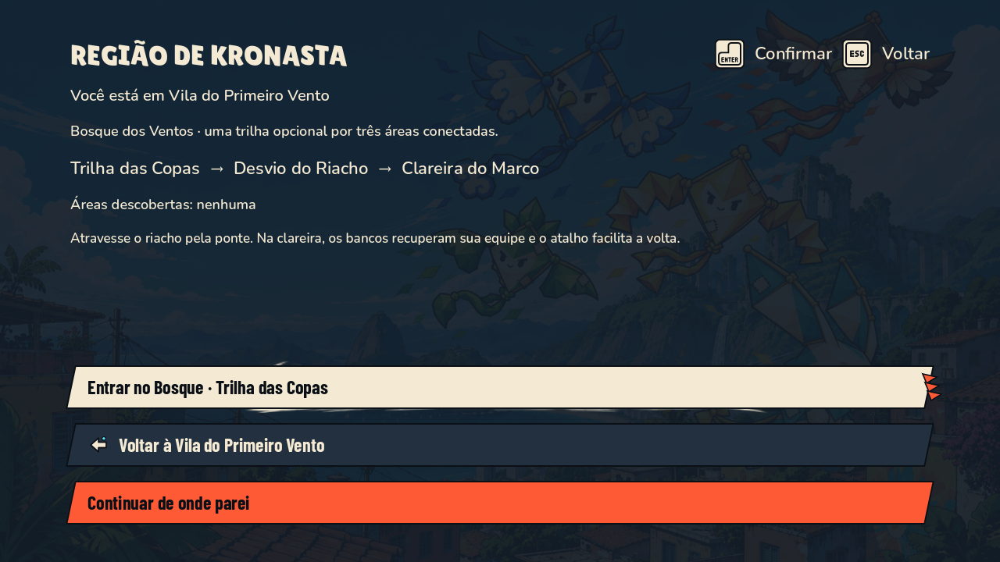
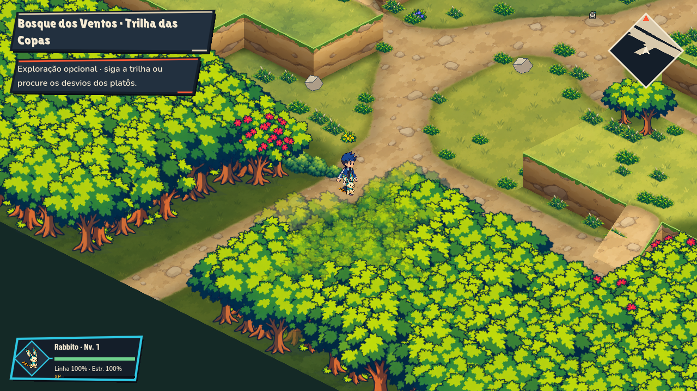
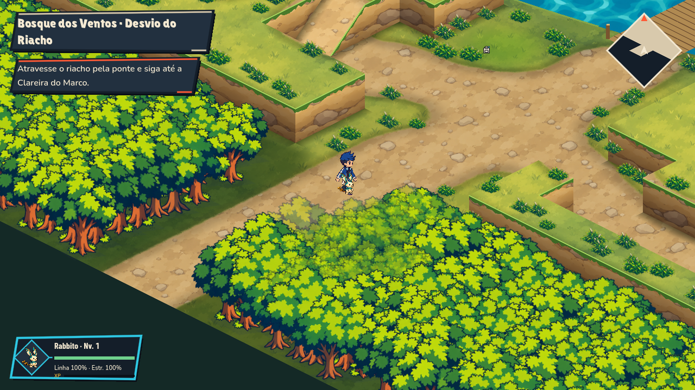
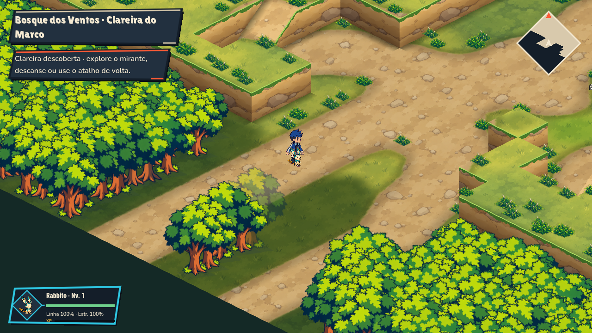
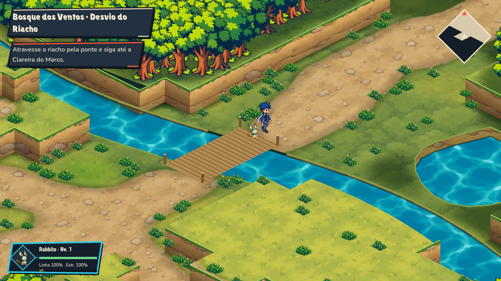

# Bosque dos Ventos integrado à campanha

Origem: `origin/codex/mapa-kronasta-bosque`, commit `20c7641137f695eabe5c8cc73024a2b7ba9f5775`.
Integração: branch `codex/integracao-bosque-kronasta`, baseada em `codex/pip84-bairro` (`7148ceca`).

Foram trazidos seletivamente mapas A/B/C, renderização, estruturas, shader, importador, planos, briefs e verificadores. Isso conserva as melhorias de campanha e personagens da branch local. Os mapas e a geometria foram preservados; não foi usada uma ilustração inteira como piso. A entrega original continua em `../relatorios/entrega-bosque-abc.md` e descreve o escopo anterior à integração.

## Como entrar

Depois de concluir a apresentação/oficina inicial e ter um parceiro, abra **M → Região de Kronasta → Entrar no Bosque** na Vila ou no parque. O destino inicial é a Trilha das Copas (A). A saída norte leva ao Desvio do Riacho (B), depois à Clareira do Marco (C). As saídas de retorno preservam o lado correto da chegada.

A saída sul de A abre a viagem regional. “Continuar de onde parei” mantém sua posição; “Voltar à Vila do Primeiro Vento” recupera sua última posição na cidade. A região é opcional e não substitui a sequência Parque–Veredas/Lacertubo.

## Comportamento integrado

- Saves reconhecem os três mapas, suas coordenadas e nomes. Entradas mantêm o fade/loading existente.
- Cada área registra sua primeira descoberta. Chegar a C libera persistentemente o atalho C→A.
- Os 12 itens autorais usam recibos atômicos: recompensa e coleta são salvas juntas, sem duplicação após recarregar. As 30 moedas vão para a carteira; materiais e página vão para a mochila. Marcadores/brilhos desaparecem após coleta.
- A página mantém o ID existente e aparece como pista; seu texto e sua função narrativa não foram inventados.
- Os bancos de C recuperam linha/estrutura de todos os parceiros, sem custo ou XP. Bancos, pontes e rampas são protegidos de encontros.
- Encontros seguem a regra atual do jogo: podem acontecer andando em terreno comum, com maior peso no mato. Faixas de nível A: 1–3, B: 2–4, C: 3–5; a curva de XP existente permanece.
- Fuga retorna ao ponto de origem no mesmo espaço de coordenadas. Câmera e seguidor usam o controlador real sobre rampas e pontes. Água recortada bloqueia movimento fora do tabuleiro da ponte.
- O exportador inclui os JSONs lidos dinamicamente dos mapas e materiais.

## Evidências

`bosque_campaign_integration.gd` cria armazenamento temporário isolado. Percorre os mapas com o controlador real, coleta os 12 itens, rejeita coleta remota/duplicada, usa banco, faz batalha com fuga pela entrada real do HUD, recarrega o save, testa o atalho e a saída sul. `report.json` guarda a contagem final. Nenhum save do jogador é usado.

Verificações complementares executadas no Godot 4.7.2:

| Verificação | Resultado |
| --- | --- |
| Campanha do Bosque com captura nativa | 119 verificações, zero falhas, 12 recompensas |
| Auditoria regional Node | A/B/C: zero erros e avisos |
| Regras da auditoria Node | 7 testes passaram |
| Chegadas do Bosque | 11 verificações, zero falhas |
| Água/ponte | 79 pontos de margem protegidos e 108 pontos de ponte transitáveis |
| Travessia física do Bosque | 105 alvos, 210 viagens, 53.500 frames, zero falhas |
| Geometria/controle do overworld | 101.250 verificações, zero falhas |
| Regressão da campanha Parque/Lacertubo | 104 verificações, zero falhas |
| Morro / transações | 377 / 51 verificações, zero falhas |
| Ritmo de encontros | 653 verificações, zero falhas |
| Curva de progressão | 423 verificações, zero falhas |

Capturas nativas em 1280×720:

## Pendências e limites

**Dito:** a entrega traz diálogo, mas não um sprite aprovado desse personagem. Sua interação fica desativada na campanha, evitando uma pessoa invisível ou o reaproveitamento de outro NPC. O evento original permanece no mapa-fonte para futura identidade visual.

As capturas foram inspecionadas e a travessia foi automatizada; isso não equivale a playtest humano com teclado/controle, nem comprova desempenho em outras GPUs ou Steam. A suíte headless ampla ainda emite um diagnóstico de shader em outro bioma, já observado na entrega original. Nesta máquina, a execução gráfica também informa que não pode criar cache de shaders em `user://`; as capturas e os testes funcionaram. Não foi feita uma nova build distribuível.

Os testes de preview passaram a carregar o renderer depois da inicialização dos autoloads, permitindo exercitar `PixelgenSprites` em execuções por `--script`. A expectativa antiga de mato ativo em todo mapa foi restringida aos mapas originais: em B o mato autoral fica em zonas de interação protegidas, mas há encontros em terreno comum.
