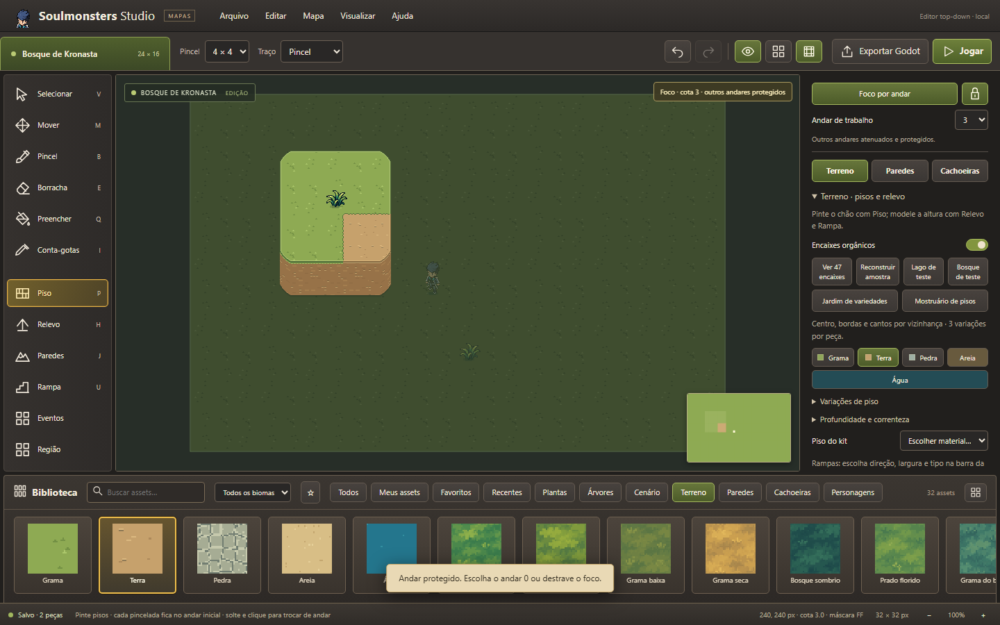

# Foco e trava por andar — ST-02

## Uso

No alto do painel direito, escolha **Andar de trabalho**. Isso ativa o foco, mantendo esse andar em destaque e atenuando os demais. O cadeado protege os outros andares; clique nele para manter somente a atenuação, com edição livre. **Foco por andar** desliga o recurso.

O aviso no canto superior direito do mapa informa a cota e se a proteção está ativa. A cota de trabalho é diferente da cota de destino da ferramenta Nivelar: a primeira protege o estado atual; a segunda define a altura que será aplicada. Depois de elevar uma região para outra cota, selecione a nova cota para continuar trabalhando nela com a trava.

## Regras

- Pisos, paredes, altura, floresta e colocação de objetos respeitam o andar escolhido. Pincéis grandes são recortados antes de aplicar as alterações.
- Objetos de outros andares ficam atenuados e protegidos contra seleção, exclusão e alterações de propriedades; cópias, colagens e destinos de movimentação também respeitam a trava.
- Rampas participam das duas cotas que conectam. Suas prévias continuam mostrando a ligação real; criar uma rampa não repinta automaticamente um patamar protegido.
- Qualquer alteração indireta em uma célula protegida é rejeitada pelo validador da operação geométrica.
- Cachoeiras pertencem à cota de origem; suas posições e impactos continuam sendo determinados pela geometria.
- Preferências de foco são salvas separadamente do documento, junto às preferências de camadas. Não entram no JSON ou na exportação Godot.
- Jogar desativa a atenuação e a trava durante o teste; voltar à edição restaura a preferência.
- Importar um mapa ou abrir explicitamente uma amostra é uma troca de documento, não uma pincelada protegida pelo foco.

## Validação

69 testes automatizados passaram. `level-focus.test.mjs` cobre cotas, extremos de rampas, pincéis grandes, mudanças protegidas e prévias. `level-focus-ui-check.mjs` verifica pintura bloqueada, aplicação no andar correto, proteção de objetos, destravar, persistência após recarregar, modo Jogar e ausência de preferências no JSON do mapa.

