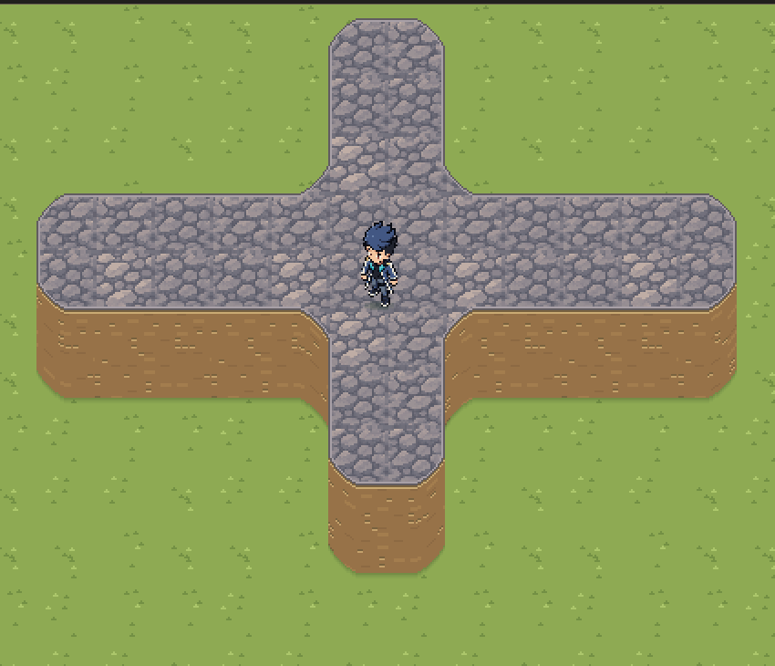

# Pintura nos contornos arredondados

O campo de sustentação pode ampliar um canto interno para a célula vizinha ou recortar um canto externo. Usar o índice da grade diretamente para escolher o piso deixava grama no topo e reproduzia o piso elevado no chão inferior.

`surfaceSupport` agora identifica a célula que sustenta a altura real de cada pixel. O raster e o picking usam essa origem, incluindo o modo de revelar apoio. A geometria e as colisões permanecem no campo de sustentação existente. A prévia do pincel usa a célula selecionada pelo raster.

## Verificação

- Caso em cruz com cantos internos e externos: pintar todo o topo não altera nenhum pixel visível do piso inferior.
- Todos os pixels do topo recebem o material elevado ou seu acabamento de borda.
- Clique na parte arredondada fora da célula original edita a célula elevada que a sustenta.
- Pinceladas continuam presas ao andar inicial, com pincéis 1×1, 2×2 e 4×4; novo clique e desfazer/refazer verificados no navegador.
- Suíte: 54 testes passaram.

Fixture: `cases/surface-corners.json`. Exportação de regressão: `node tools/plant-lab/prepare-godot.mjs --surface-corners`.
